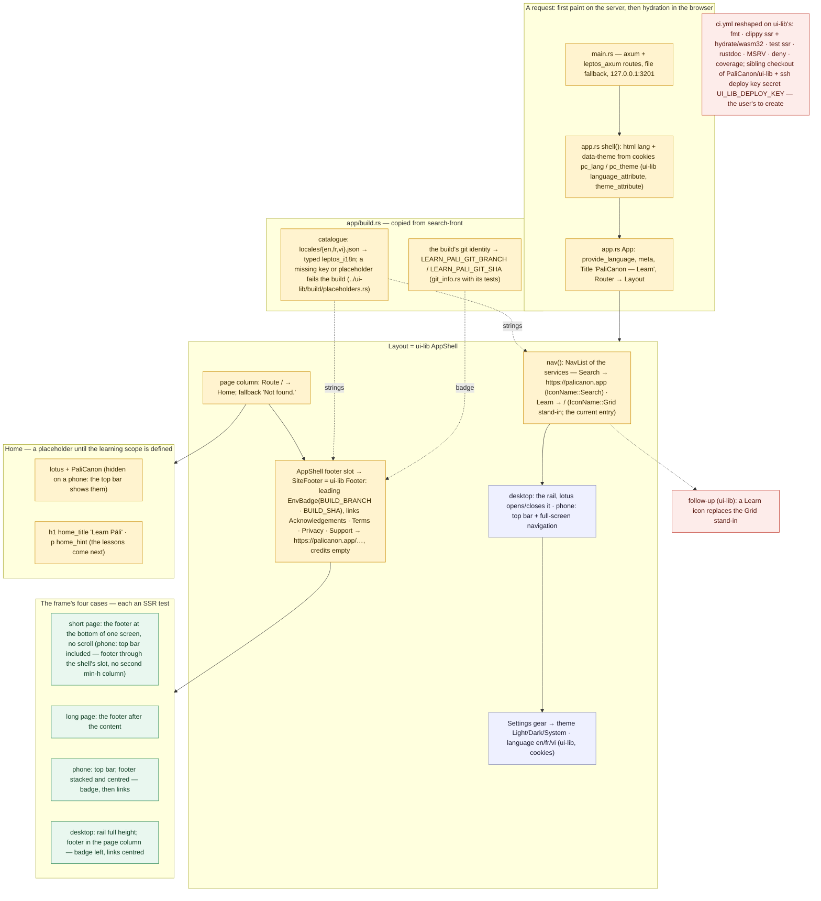

# 001 The site's structure — shell, nav, footer

status: merged · rank: 5 · level: standard · type: feature · request: learn-pali site structure · session: learn-pali-001-site-structure · process: ../../docs/workflows/development-process.mmd (frozen v20), fast path · after: []

## Workflow

```mermaid
flowchart LR
  Define:::done --> Plan["Plan ✓ 5 slices, no overlap"]:::done --> Build["Build — slices 1-4 ✓ 43 tests, cargo leptos build green (5 in the CI lane)"]:::done --> Verify["Verify ✓ 43 tests, matrix green, deny red then fixed (2 licenses, 2 advisories, 1 wildcard)"]:::done --> Review["Review ✓ round 1: 3 Δ, 5 T; 4 fixed, 4 ruled · round 2 clean"]:::done --> Fix["Fix ✓ deny policy: CC0, BSL, two advisories ignored, ui-lib versioned; round 1: deny dates, 3 tests, 52 tests green"]:::done --> Rebase["Rebase ✓ main not moved"]:::done --> Check["Check ✓ user: aller (2026-10-05)"]:::done --> Merge["Merge ✓ 6b0455b"]:::done --> Retro["Retro ✓ 7 lessons, docs 423a809 + 9421ecf + 9e67ebd"]:::done
  classDef done fill:#2e7d32,color:#fff
  classDef doing fill:#f9a825,color:#000
  classDef todo fill:#9e9e9e,color:#fff
  classDef fail fill:#c62828,color:#fff
```



## Log

| Step | Result | Output |
| --- | --- | --- |
| Define | done | user (2026-10-05): "prend example sur le search ../ et mets la structure du site. nav, footer." — fast path, the orchestrator's decisions below flagged for the user's check; session opened (design dd6dc926c0c0c40, review dc76051e2bda647, discussion d729594e3135648, process db2ea5c019ff140) |
| Plan | done | 5 slices (chain 1→2→3, 4 and 5 disjoint and parallel), no overlap with an open branch, `a2m impact` has nothing to say (one-file placeholder crate), 6 ASSUMPTIONs posted in `process` |
| Build, slice 1 | done | workspace + `app/` crate `learn_pali`, `build.rs` (catalogue, git identity), `catalogue.rs`, `git_info.rs`, locales en/fr/vi; 17 tests (13 git_info, 4 catalogue) green; red seen first (build without locales: `LocaleFileNotFound`); parity probe: `footer_terms` removed from fr.json → build red "Missing key footer_terms in locale fr", restored; fmt, clippy ssr + hydrate/wasm32, rustdoc clean; `rust-version` 1.88 (orchestrator ruling: MSRV 1.85 made resolver 3 pick leptos 0.8.3, ui-lib does not compile against it) |
| Build, slice 2 | done | `app.rs` (shell, App, nav, Layout, BUILD_*, BADGE), `components/home.rs`, `components/mod.rs`, `main.rs`, `lib.rs` (+ `pub mod app`, `mod components`, hydrate entry); 12 tests added (9 app, 3 home), 30 in all, green; red seen first (build: shell, Layout, Home not found); the document test (title, stylesheet, `lang`/`data-theme` from cookies) drives `shell()` through `ServerMetaContext` + `inject_meta_context`, which needed two dev-dependencies (`futures`, `any_spawner` with `tokio`, both already in the lock); fmt, clippy ssr + hydrate, rustdoc clean; also fixed slice 1's catalogue test, 56 lines, over clippy's 50 (split in two, folded into the slice 1 commit) |
| Build, slice 3 | done | `components/site_footer.rs` (`SiteFooter` = ui-lib `Footer`, badge leading, no credits, four absolute links), `app.rs` (`footer=` on `AppShell`, `BADGE` now read), `components/mod.rs`; 9 tests added (6 footer incl. the long page, 3 frame cases on the real `Layout`, in `app.rs` because `Layout` is private), 39 in all, green; red seen first (SiteFooter missing); fmt, clippy ssr + hydrate, rustdoc clean |
| Build, slice 4 | done | `app/style/main.css`, `app/public/{favicon.ico,lotus.png}`, `.gitignore` (+ `.a2m/`), `README.md` (port 3201, check matrix); `app/tests/assets.rs` 4 tests, red first (files missing), then green, 43 tests in all; `cargo leptos build` green (A3 confirmed: wasm32 target, standalone Tailwind; `target/site/pkg/learn-pali.{css,js,wasm}` produced, 1m29s cold); fmt, clippy ssr + hydrate, rustdoc clean |
| Verify | **red** | lane branch `feat/site-structure-ci` rebased onto `feat/site-structure` (no conflict) and fast-forwarded to 3b29514 (4ad65d8 ci.yml, 2f02a83 deny.toml, 3b29514 msrv 1.88); lane worktree and branch deleted. Matrix (log in the lead's scratchpad): `cargo fmt --all --check` ✓; `cargo clippy -p learn_pali --features ssr --all-targets -- -D warnings` ✓; `cargo clippy -p learn_pali --lib --features hydrate --target wasm32-unknown-unknown -- -D warnings` ✓; `cargo test -p learn_pali --features ssr` ✓ 43 (39 unit, 4 assets); `RUSTDOCFLAGS="-D warnings" cargo doc --no-deps -p learn_pali --features ssr` ✓; `cargo check --locked -p learn_pali --features ssr` ✓ (the lock does not change); `cargo leptos build` ✓; **`cargo deny check advisories bans sources licenses` ✗ exit 7 — advisories FAILED, bans FAILED, licenses FAILED, sources ok**: licenses: `CC0-1.0` (base16 0.2.1 via wasm_split_macros ← leptos) and `BSL-1.0` (xxhash-rust 0.8.19 via server_fn ← leptos) not in `allow`; advisories: `paste` 1.0.15 RUSTSEC-2024-0436 and `proc-macro-error2` 2.0.1 RUSTSEC-2026-0173, both unmaintained, both via leptos; bans: `wildcard` on `app/Cargo.toml:16` (`palicanon-ui-lib` git dependency with `branch`, no version); warnings: duplicates (convert_case, syn, thiserror, thiserror-impl), and `unmatched-source`: the `allow-git` entry matches nothing (the workspace `[patch]` resolves ui-lib to the path `../ui-lib`). No Rust file changed in this step, so none is untested; `ci.yml` and `deny.toml` have no test of their own (reading only, as planned). Docs: the README lists the check matrix and no deny command (checked: no `deny` in README.md), not stale since CI is the one running deny |
| Fix | done | ruling of the orchestrator on the Verify red (process 2316). Red first: `cargo deny check advisories bans sources licenses` exit 7 on c741509 (2 licenses, 2 unmaintained advisories, 1 wildcard), and `app/tests/assets.rs` extended to require the deny command in the README (red: "README lacks: cargo deny check…"). Then 2c23391 `deny.toml` (CC0-1.0, BSL-1.0 allowed, RUSTSEC-2024-0436 and RUSTSEC-2026-0173 ignored with reasons, allow-git comment) and `app/Cargo.toml` (`version = "0.1"` on palicanon-ui-lib); 13a603c README + assets test. Matrix green: deny exit 0 (warnings: 4 duplicates, unmatched-source, as ruled), `check --locked` (Cargo.lock unchanged), fmt, clippy ssr and hydrate/wasm32, test 43 (39 + 4), rustdoc -D warnings, `cargo leptos build`. Docs made stale by the change: README Checks and the task's Check matrix, updated; no PaliCanon `architecture/` or `projects/` diagram involved |
| Merge | done | squash `6b0455b` on main; tests 52 green, coverage 95.24% lines (cargo llvm-cov, ssr); gate `task-check pre-merge` green (the tool now lists learn-pali, docs 2e255fa) |
| Review round 2 + Check | done | user (2026-10-05): "aller" after the orchestrator's captures; round 2 (review 2405–2411, rulings 2426): Deep — 3 Δ recorded (stale review graph after the cfg(test) include, hydrate-side reactivity, dated ignores), 4 T ruled (two verified green: `serde_json` dev-dep, clippy `--all-targets` with the include; two accepted gaps: a signal-swap render, the parity path from `build.rs`); Gemini's late round-1 answer (2429) ruled 2443; Sage 400 ×2 (reasoning effort setting). Branch already on main. Served on :3201 (`cargo leptos watch`), curl: title, `lang`, two rail hrefs, the four footer hrefs, badge `feat/site-structure · f57ec5d`, css and wasm 200. CDP captures (`Emulation.setDeviceMetricsOverride`; a bare `--window-size=390` is clamped to ~500px by Chrome and rogues the frame — search-front's 001 used CDP for the same reason): phone 390×844 scrollWidth 390, scrollHeight 844 — one screen, footer bottom at 844 (the 56px scroll of search-front's open point is absent); desktop 1280×800 one screen; `pc_lang=fr; pc_theme=dark` → French, dark; `/nope` → Not found., same frame. Looked at: corners clean, badge then links stacked on the phone, badge left and links centred on desktop |
| Fix (review round 1) | done | rulings in process 2383 on Deep 2381. T1 `the_rail_and_the_footer_follow_the_same_language_signal` (one render of `Layout` per language, fr and vi, rail and footer labels together and no English left; a server render is a one-shot string, so a reactive flip inside it is not observable; seen red by mutation: footer pinned to `Locale::en`, then restored), T4 `a_placeholder_missing_in_one_locale_is_a_mismatch` (`ui-lib/build/placeholders.rs` included under `#[cfg(test)]` in `lib.rs`, compiles as is; the file's own 6 tests run here too; green on first run, the function already existed), T5 `unknown_cookie_values_fall_back_to_english_and_the_system_theme` (green on first run, pins ui-lib's behaviour), Δ1 dates in `deny.toml` (no test, TOML). Commits ef3b284, 4ba07a4. Matrix green: fmt, clippy ssr and hydrate/wasm32, test 52 (48 lib + 4 assets), rustdoc -D warnings, `check --locked`, deny exit 0. No doc made stale |

## Summary

**Asked** (user, 2026-10-05): take search-front as the model and put the
site's structure in place: nav, footer. The frame of the service, before
its learning scope is defined (`../docs/projects/pali-learn/requirements.md`,
round 1 unanswered): the frame is the same in every PaliCanon service and
does not depend on that scope.

**Rank** (rank.md): difficulty 4 (a new Leptos workspace, about twenty
files, every one with its model in search-front's worktree
`../wt/search-front-001-v1-front`; the CI against a private git
dependency has no model yet), impact 3 (nothing live, no data, GitHub
only) → **4**, re-ranked **5** at Verify: a red deny from a slice built
against a stub, two dependency facts the design did not know. Level **standard**: several files, one area, no new
architecture (the shell is ui-lib's). Fast path: no architecture of its
own; the one value captured at build time and shown later (the build
badge) follows search-front's settled mechanism (`build.rs` sets both the
server's and the browser's copy from the same build).

**Decided** (orchestrator, from the evidence — the user overrules any of
these at the check):

- **Workspace as search-front**: a Cargo workspace, member `app/` (crate
  `learn_pali`, lib `cdylib` + `rlib`, a bin), Leptos 0.8 SSR + hydrate,
  `[[workspace.metadata.leptos]]` `name = "learn-pali"`, site
  `127.0.0.1:3201`, reload `4201` (this task's own port);
  `palicanon-ui-lib` by git (`branch = "main"`) with the workspace
  `[patch]` to `../ui-lib`; the same workspace lints
  (`unsafe_code = "forbid"`, `missing_docs`, pedantic, the three allows);
  `clippy.toml` kept (`too-many-lines-threshold = 50`); `.gitignore`
  gains `.a2m/`.
- **`app/build.rs`** copied: the typed `leptos_i18n` catalogue from
  `app/locales/{en,fr,vi}.json` (a missing key or a placeholder not in
  every locale fails the build, `../ui-lib/build/placeholders.rs`
  included by `#[path]`), and the build's git identity as
  `LEARN_PALI_GIT_BRANCH` / `LEARN_PALI_GIT_SHA`; `app/src/git_info.rs`
  copied with its tests; `app/src/catalogue.rs` copied (`Strings`,
  `strings()`, exhaustive `From<Language>`).
- **Shell**: `app/src/app.rs` as search-front's — `shell()` renders
  `<html lang data-theme>` from the cookies (`language_attribute`,
  `theme_attribute`), `App` provides the language and the meta context,
  `<Title text="PaliCanon — Learn" />`, `<Stylesheet href="/pkg/learn-pali.css" />`,
  a `Router` around `Layout`; `main.rs` the axum server; `lib.rs` with
  `#![recursion_limit = "512"]` and the `hydrate` entry.
- **Nav**: the rail lists the services (`decisions.md`: "services on
  top"): **Search** → `https://palicanon.app` (`IconName::Search`) and
  **Learn** → `/` (the current entry). ui-lib has no Learn icon:
  `IconName::Grid` stands in, as search-front did for Search until
  ui-lab 034; the icon is a follow-up in ui-lib (`followup-learn-icon`
  in this session), not this task.
- **Footer**: ui-lib's `Footer` handed to `AppShell` through its
  `footer` slot — not as a child of the page: search-front's open point
  (a short phone page scrolls by the top bar's 56px) comes from its own
  `min-h-dvh` column under the shell's screen-tall one. `leading` = the
  build badge (`EnvBadge env=BUILD_BRANCH sha=BUILD_SHA`, ui-lab 044:
  the one copy, at the footer's left, nothing on the shell's panel);
  `credits` empty; links **Acknowledgements · Terms · Privacy · Support**
  → `https://palicanon.app/acknowledgements`, `/terms`, `/privacy`,
  `/support` (the texts live on the main site; no copy here — a Privacy
  of learn-pali's own becomes a task the day it stores a learner's data).
  Labels from search-front's locales (`footer_*`: en, fr "Crédits ·
  Conditions · Confidentialité · Soutenir", vi).
- **Home `/`**: a placeholder in the page column — the brand (lotus +
  "PaliCanon", hidden on a phone where the top bar shows them), an
  `<h1>` `home_title` ("Learn Pāli") and one line `home_hint` saying the
  lessons come next; `Routes` fallback "Not found.". Strings:
  `nav_search`, `nav_learn`, `home_title`, `home_hint`,
  `footer_acknowledgements`, `footer_terms`, `footer_privacy`,
  `footer_support`, in en/fr/vi.
- **Theme and language**: `AppShell`'s own (Settings gear → `ThemePicker`
  Light/Dark/System in `pc_theme`; the globe → en/fr/vi in `pc_lang`);
  nothing of the service's.
- **Mobile**: the shell's top bar (lotus, full-screen navigation with a
  Settings row), the footer stacked and centred (badge, then links);
  desktop: the rail at the page's full height, the footer in the page
  column (badge left, links centred). **The frame's four cases** (steps/build.md)
  each get an SSR test: short page (one screen, footer at the bottom, top
  bar included), long page (footer after the content), phone, desktop.
- **Styles**: `app/style/main.css` = Tailwind, `@import` of
  `../../../ui-lib/style/theme.css`, `@source` of ui-lib's and this
  crate's `src`. Assets `app/public/favicon.ico`, `app/public/lotus.png`
  copied from search-front.
- **CI**: `.github/workflows/ci.yml` reshaped on ui-lib's (fmt; clippy
  `ssr` and `hydrate` on `wasm32-unknown-unknown`; test `ssr`; rustdoc
  `ssr`; MSRV `--locked`; cargo-deny; coverage), plus a sibling checkout
  of `PaliCanon/ui-lib` at `../ui-lib` (the `[patch]`, `theme.css`,
  `placeholders.rs`) and ssh access for the private git dependency
  (`webfactory/ssh-agent` with `secrets.UI_LIB_DEPLOY_KEY`). The secret
  is the user's to create: a read-only deploy key on ui-lib, its private
  half in this repository's secrets. **CI stays red until then — QUESTION
  to the user**, recorded in `process`.
- **README** rewritten on search-front's: what it holds and never holds,
  run it (the port), the check matrix below.
- **`deny.toml`**: the policy kept; the git source `ssh://git@github.com/PaliCanon/ui-lib.git`
  allowed under `[sources]`.

**Check matrix** (the README's, this task's):

```sh
export RUSTUP_HOME=$HOME/.rustup-pc/rustup CARGO_HOME=$HOME/.rustup-pc/cargo PATH=$HOME/.rustup-pc/cargo/bin:$PATH RUSTC_WRAPPER=sccache
cargo fmt --all --check
cargo clippy -p learn_pali --features ssr --all-targets -- -D warnings
cargo clippy -p learn_pali --lib --features hydrate --target wasm32-unknown-unknown -- -D warnings
cargo test -p learn_pali --features ssr
RUSTDOCFLAGS="-D warnings" cargo doc --no-deps -p learn_pali --features ssr
cargo leptos build
cargo deny check advisories bans sources licenses
```

**Ruled out**: copying the four footer pages (content, on the main
site); any learning content, lessons, search, AI (the next task, after
the requirements); infrastructure and deploy (later, like search-front);
a `Book` icon in ui-lib (a follow-up, another repository — this session
touches learn-pali only).

**Open**: the deploy key for CI (the user); the Learn icon (follow-up);
whether the Search entry belongs in Learn's rail before
learn.palicanon.app is live and search-front gets its own Learn entry
(the user, at the check).

## Design

Viewer: learn-pali-001-site-structure/design (dd6dc926c0c0c40), v1,
drawn from the talk (fast path), 2026-10-05; the user's go-ahead is the
request quoted above.



## Lanes

| File | Tests (first, red) | Code | Done |
| --- | --- | --- | --- |
| **Slice 1 — workspace, catalogue, git identity** | | | |
| `Cargo.toml` (root, replaced: package → workspace), `app/Cargo.toml`, `src/lib.rs` + old `src/` deleted | none of their own: the build is the test (below) | workspace, `[patch]` to `../ui-lib`, leptos metadata, lints; crate `learn_pali` |  ✓ |
| `app/build.rs`, `app/locales/{en,fr,vi}.json` | the build fails on a missing key or placeholder (a probe: remove one key, see red, restore) | typed catalogue, `LEARN_PALI_GIT_BRANCH` / `LEARN_PALI_GIT_SHA` |  ✓ |
| `app/src/catalogue.rs` | `every_language_reads_its_own_strings`, `strings_follow_the_language_signal`, `every_key_is_translated_in_every_language` (parity), one per string of this task | `Strings`, `strings()`, exhaustive `From<Language>` |  ✓ |
| `app/src/git_info.rs` | its tests, copied | the pure decisions, included by `build.rs` through `#[path]` and declared in `lib.rs` |  ✓ |
| `app/src/lib.rs` (minimal: `recursion_limit`, `mod catalogue`, `mod git_info`) | via the two files above | |  ✓ |
| **Slice 2 — shell, nav, home** | | | |
| `app/src/app.rs` | SSR through the real `Router` + `RequestUrl("/")`, per language: `<title>`, the two rail entries in order (Search `https://palicanon.app`, Learn `/`), exactly one `aria-current="page"` and it is Learn (a second test: no entry current on `/nope`), labels en/fr/vi, `/nope` renders "Not found." and no home, `shell()` carries `lang` and `data-theme`, `<Stylesheet href="/pkg/learn-pali.css">` | `shell`, `App`, `nav`, `Layout` (no footer yet), `BUILD_BRANCH`, `BUILD_SHA`, `BADGE` |  ✓ |
| `app/src/components/home.rs`, `app/src/components/mod.rs` | the home: `<h1>` `home_title` in each language, `home_hint` present, the brand link `hidden … sm:flex` (hidden on a phone), lotus ``; the home sits before no footer yet | `Home` |  ✓ |
| `app/src/main.rs`, `app/src/lib.rs` (adds `pub mod app`, `mod components`, the `hydrate` entry) | none (axum glue, copied; `cargo leptos build` is its check, slice 4) | |  ✓ |
| **Slice 3 — footer** | | | |
| `app/src/components/site_footer.rs` | the four links, absolute `https://palicanon.app/…` hrefs, in order (Acknowledgements, Terms, Privacy, Support); exactly four `<a`; no Legal; labels en/fr ("Crédits · Conditions · Confidentialité · Soutenir")/vi; badge first and `sm:col-start-1`, before `<nav`; the badge is on no other surface (one copy, after the page, in `<footer>`); **no `mt-auto` and no `min-h-dvh` of its own** (the shell's slot owns the wrapper), and the long page (all in `site_footer.rs`); the frame's cases on the real `Layout` are the three tests in `app.rs`, since `Layout` is private (see below) | `SiteFooter` = `Footer` (leading badge, credits empty); `app.rs` gets `footer=SiteFooter` on `AppShell` (one line); `components/mod.rs` one line |  ✓ |
| **Slice 4 — styles, assets, docs** (disjoint from 1–3, parallel) | | | |
| `app/style/main.css`, `app/public/{favicon.ico,lotus.png}`, `.gitignore`, `README.md` | `app/tests/assets.rs`: the two assets exist and are non-empty, `main.css` imports ui-lib's `theme.css` and has the two `@source`s, `.gitignore` lists `/target` and `.a2m/`, README names port 3201 and every command of the check matrix | the files; `cargo leptos build` green is the slice's end-to-end check |  ✓ |
| **Slice 5 — CI, deny** (disjoint, parallel; no test: `act` is not available, the YAML is reviewed by reading, `cargo-deny` is not installed here) | | | |
| `.github/workflows/ci.yml`, `deny.toml` | reading, against the check matrix and ui-lib's ci.yml | the jobs below | ✓ merged (3b29514..4ad65d8, rebased on the build); its `cargo deny` probe is red, see Log |

**Order**: 1 → 2 → 3 is a chain (each builds on the last; run one after
the other, never in parallel), so `lib.rs`, `components/mod.rs` and
`app.rs` take one additive line from a later slice — a deliberate
exception to "no file in two lanes", stated here and impossible to
conflict since the slices are sequential. 4 and 5 touch none of the
Rust files and can run beside the chain. One commit per slice (tests
and code together, test seen red first in the lane's log), then Verify.

**The reference, file by file** (search-front worktree
`../wt/search-front-001-v1-front`), and what differs:

| Ours | Model | Differs |
| --- | --- | --- |
| `Cargo.toml` | its `Cargo.toml` | license kept `MIT OR Apache-2.0` and `rust-version = "1.88"` (search-front: `LicenseRef-Proprietary`, no MSRV; 1.88 and not the placeholder crate's 1.85, since leptos 0.8.21 and its siblings declare 1.88 and resolver 3 resolves to older, ui-lib-incompatible versions below it; ruling, orchestrator, 2026-10-05); `repository` → learn-pali; leptos `name = "learn-pali"`, `bin-package`/`lib-package` `learn_pali`, `3201`/`4201` |
| `app/Cargo.toml` | its `app/Cargo.toml` | no `serde`, no `unicode-normalization` (search-only); same features, same build-deps |
| `app/build.rs` | its `build.rs` | env names `LEARN_PALI_GIT_*`; `#[path]` of `../../ui-lib/build/placeholders.rs` unchanged (resolves in a worktree through `wt/ui-lib`, in the main checkout and in CI through the sibling) |
| `app/src/{catalogue,git_info}.rs` | same | tests keep their names; catalogue tests refer to our keys |
| `app/src/app.rs` | its `app.rs` | one Learn-side nav with **two** entries (Search external, Learn current) instead of one; title "PaliCanon — Learn"; stylesheet `learn-pali.css`; routes: `/` only; **the footer through `AppShell`'s `footer` slot, not a child `<div class="flex min-h-dvh flex-col"><div class="flex-1">…</div><SiteFooter/></div>`** (ui-lib's shell already wraps the slot in `mt-auto` inside its screen-tall column) |
| `app/src/components/home.rs` | its `home.rs` `BrandLink` only | brand + `h1` + one hint line; no search card, examples, verses |
| `app/src/components/site_footer.rs` | its `site_footer.rs` | links are absolute `https://palicanon.app/…` constants, no `pages` module; **no own `<div class="mt-auto">`**; four-cases tests added |
| `app/src/{lib,main}.rs` | same | no `highlight`, `page`, `pages`, `search`, `ui`; port text 3201 |
| `app/locales/*.json` | its `locales` | only `nav_search`, `nav_learn`, `home_title`, `home_hint`, `footer_{acknowledgements,terms,privacy,support}`; footer/nav_search values copied (fr "Crédits · Conditions · Confidentialité · Soutenir", vi from its json) |
| `app/style/main.css` | its `main.css` | without the `mark` rule |
| `app/public/*` | favicon, lotus.png | copied; no `brand/`, `support/` folders |
| `README.md`, `.gitignore`, `clippy.toml` | its | README rewritten with the check matrix of this task; `.gitignore` gains `.a2m/`; `clippy.toml` kept as is (identical) |
| `.github/workflows/ci.yml` | ui-lib's CI (clippy/test/docs per feature) + this repo's own (fmt, MSRV, deny, coverage) | `--all-features` dropped everywhere (`ssr` and `hydrate` do not build together); sibling checkout of `PaliCanon/ui-lib` and ssh agent; search-front has no CI to copy |
| `deny.toml` | this repo's | git source allowed; a `[[licenses.exceptions]]` for `palicanon-ui-lib` (its license is `LicenseRef-Proprietary`, not in the allow list) |

**The frame's four cases** (slice 3, on the real `Layout`, SSR; the
classes are asserted, the pixels are the orchestrator's capture at Check):

| Case | Test |
| --- | --- |
| short page | `/`: markup order home `<h1>` → `<footer>`; the footer's wrapper is `mt-auto`, the last child of the page column (`min-w-0 flex-1 flex-col`) which sits in the shell's `min-h-screen flex-col`; **one** `min-h-screen`, **no** `min-h-dvh` anywhere (no second column under the shell's) |
| long page | `AppShell` + `SiteFooter` around 200 paragraphs: the footer after the last one, same wrapper |
| phone | the mobile navigation (`sm:hidden`) precedes the page; footer inner `flex-col items-center` (no `sm:` prefix on those), badge before `<nav` |
| desktop | the rail (`DesktopRail`, `hidden … sm:`) precedes the page column in the same row (`sm:flex-row`); footer `sm:grid sm:grid-cols-[1fr_auto_1fr]`, badge `sm:col-start-1`, links `<nav>` in the middle column |

**CI jobs** (slice 5): `fmt`; `clippy` matrix `ssr` / `hydrate` +
`wasm32-unknown-unknown` (`-p learn_pali --lib` for hydrate); `test`
(`--features ssr`); `docs` (`--features ssr`, `-D warnings`); `msrv`
(1.88, `cargo check --locked --features ssr`); `deny`; `coverage` (ssr).
Every job first: `webfactory/ssh-agent` (`secrets.UI_LIB_DEPLOY_KEY`) and
`git clone` of `PaliCanon/ui-lib` into the sibling directory
(`actions/checkout` cannot write outside the workspace), so `../ui-lib`
exists for the `[patch]`, `theme.css` and `placeholders.rs`.

**Overlaps**: `git branch --list` — only `feat/site-structure` (and
`main`); `git diff --name-only main...feat/site-structure` is the task
file alone. No other open task of this repository, so no lane waits.
`a2m impact` has nothing to say: today's crate is one `src/lib.rs` with
`name()`, which this task deletes; every file here is new.

**ASSUMPTIONs** (each probed before it is built on; posted in `process`):
A1 `palicanon-ui-lib` on `../ui-lib` exports every symbol used — probe:
read done in Plan (`lib.rs:73-89`, `AppShell.footer`, `IconName::Grid`),
compile in slice 1. A2 an absolute `href` in a `NavEntry` renders a
plain `<a href>` and is never "current" — probe: `nav.rs:136`
(`current == href`), asserted by the slice-2 test. A3 `cargo leptos
build` works here (0.3.11 installed; the wasm32 target and the
standalone Tailwind) — probe at slice 4. A4 (refuted, ruled) an MSRV `1.85` does not
work: resolver 3 picked leptos 0.8.3, which ui-lib does not compile
against; `rust-version = "1.88"` (what leptos 0.8.21 declares) resolves
to ui-lib's own versions. A5 `cargo-deny` accepts the git source and the
license exception — not installed here, unprobed until CI. A6 `cargo
--locked` in CI resolves `[patch]` with the sibling checkout and the
ssh key — unprobed until the user creates the secret.

**Questions the design leaves** (none blocks Build): (a) MSRV: settled at 1.88, see A4; (b) the Search entry in Learn's rail (already
the user's at the check); (c) the deploy key (already open).

## Reviews

### Round 1 — 2026-10-05

One substantive voice (Deep, 2381; Gemini 503 twice, Sage silent), rulings in process 2383.

- **Δ1** `deny.toml` ignores carry no date — FIX: each reason ends `(ignored 2026-10-05)`. No test (TOML); deny exit 0.
- **Δ2** frame tests assert ui-lib's class spelling — NO CHANGE: the plan said so (classes asserted, pixels are the orchestrator's capture at Check); a ui-lib change that reddens them is the signal wanted (`branch = "main"` + `[patch]`).
- **Δ3** `recursion_limit` missing from the graph — NO CHANGE: `app/src/lib.rs` has `#![recursion_limit = "512"]`; the graph dropped it, not the file.
- **T1** rail and footer on one language signal — FIX: `app::tests::the_rail_and_the_footer_follow_the_same_language_signal`.
- **T2** meta context in `render_document` — NO CHANGE: it provides `ServerMetaContext` and `RequestUrl`, not `provide_meta_context()`; `App`'s own call puts `<title>` and the stylesheet in the head (existing test).
- **T3** CI sibling checkout — NO CHANGE: ui-lib is cloned to `path: ui-lib` inside `$GITHUB_WORKSPACE`; a job without the key cannot clone a private repository, the key is the user's open point (2262).
- **T4** placeholder parity never exercised — FIX: `catalogue::tests::a_placeholder_missing_in_one_locale_is_a_mismatch`.
- **T5** unknown cookie values — FIX: `app::tests::unknown_cookie_values_fall_back_to_english_and_the_system_theme`.


### Round 2 — 2026-10-05

The fix diff of round 1 (review thread 2405–2408) to Deep (2409 → 2411);
Gemini 503 ×2 then a late answer on flash-lite (2429), Sage 400 (settings).
Rulings (2426, 2443), no code change — the round is clean:

| Finding | Ruling |
| --- | --- |
| Δ the review graph is stale (`lib.rs` now includes `placeholders.rs` under `cfg(test)`) | recorded; the round-2 diff is in the thread |
| Δ the one-signal invariant is untested under hydrate | no change: rail and footer both read `strings()` = `language_signal()`; `strings_follow_the_language_signal` pins the identity reactively; a wasm-side test is the gallery's |
| Δ dated ignores | recorded |
| T a signal-swap render of `Layout` | no change: a server render is one string; same reason |
| T the parity path reached from `build.rs` with a fixture | accepted gap (as search-front): the function is tested, the three-line wiring is read |
| T `serde_json` must be a dev-dependency | verified: it is, the test target is green |
| T lint exposure of the included file | verified: clippy `--all-targets -D warnings` green |
| Gemini: sibling path coupling, deploy key on forks, runtime locale recovery, cookie/hydration divergence | none a design invariant here: chosen (ui-lib.md), no forks, the catalogue is compiled in, hydration reads `<html lang>` back by design |

## Errors

Swept into the Retro below (retro-discussion 2501: the list with message ids).

## Merge

`6b0455b` on main (squash of feat/site-structure, 2026-10-05); branch and worktree deleted.

## Retro

Retro message 2501 (retro agent), Deep's review 2505 (gemini 429, sage 400,
deep silent twice before answering). Closed by the main orchestrator of the
palisearch session on 2026-10-05 (the hook blocked every stop until then).
Lessons (docs 423a809): a probe outside its toolchain said the tool was
absent (cargo-deny, deny.toml against a stub); a check piped into tail hid
a red (pipefail, exit codes printed; no side-effecting loop into head); a
CI lane merged before its run was seen (a CI slice hands back its run, the
worktree stays until Verify); a phone capture without mobile emulation
(CDP `setDeviceMetricsOverride`, scrollWidth quoted). Changed: process.md
§6, steps/plan.md, steps/build.md, agents/lane.md, agents/lead.md.
Not taken as lessons (already covered or out of scope): voice outages
(lesson 2026-10-03 a silent voice was not retried), the MSRV probe (folded
into the probe lesson), the hand-copied check matrix and the 1.5 MB lotus
(followup-lotus-asset exists). Deep's ask for the real paths of the brief
template and matrix source: the paths are `docs/prompts/task-brief.md` and
each README's Checks block.

**This session's part** (the two orchestrators closed the retro in parallel; the lessons were written twice and kept once, docs 9e67ebd):

Retro agent: retro-discussion 2501 (summary and errors), Deep 2505 (ten
gates; weighed below). Validated 2026-10-05.

**Lessons written** (docs 9421ecf, `lessons/2026-10-05-*`): a new
dependency's facts probed at Plan (MSRV resolution and the deny policy on
the real tree — never against a stub); a tool declared absent outside its
env (`cargo-deny`, `timeout`); a lane merged before its artefact was
checked; a check script hiding a red clippy (`| tail`); a bare headless
window under 500 px faking an overflow (CDP device metrics only);
`@`-names in a plain post summoning three voices; the merge gate not
knowing the repository (`task-check` REPOS, docs 2e255fa).

**Actions**: ask-yourself/common/dependency.md; prompts/task-brief.md
(toolchain for probes, pipefail check scripts, no `timeout`);
prompts/steps/verify.md (a lane checked before the fast-forward);
conventions/process.md §6 (CDP phone capture); prompts/repo-init.md step
14; tools/viewer.md; claude-memory `phone-capture-cdp` (6870c9d).

**Weighed and not taken** (Deep 2505): a workflow run URL as a lane's exit
(CI cannot run before the user's deploy key); a one-token pre-flight ping
per voice (the viewer's `GET /settings` and the fallback order already
serve); the T1 per-language render (allowed by the brief and ruled, not
absorbed); one machine-readable check matrix generated into README, test
and CI (a fork for later, `followup-check-matrix` not opened: three copies
today, each tested against the README); an asset size budget
(`followup-lotus-asset` holds it).

**Operational, not lessons**: Gemini on quota and 503 most of the day,
Sage refusing `reasoning_effort: none` and hitting its output ceiling —
the user's viewer settings; Deep answered every round after a retry.

**Open for the user**: the `UI_LIB_DEPLOY_KEY` deploy key (CI red until
then); the Search entry in Learn's rail (kept); the Sage settings.
