# 002 learn-core — the learning loop as a library, tried at the terminal

status: merged · rank: 5 · level: hard · type: feature · request: learn-pali learning loop · session: learn-pali-002-learn-core · process: ../../docs/workflows/development-process.mmd (frozen v20), full path · after: []

## Workflow

```mermaid
flowchart LR
  Define["Define ✓ consensus v3, 2 rounds"]:::done --> Plan["Plan ✓ skeleton + 9 lanes, probes green, 4 questions"]:::done --> Build["Build ✓ all slices: S0, L1–L5 (L4b, L5 in)"]:::done --> Verify["Verify ✓ matrix green on 63a24be: core 92+5, cli 60+14, build_deck 60, app 48+5; coverage 98.25%; deny, +1.88, --locked, leptos build"]:::done --> Review["Review ✓ round 1: 5 Δ, 5 T; 1 code fix, 7 tests, 4 ruled; round 2: 3 tests, 5 ruled"]:::done --> Fix["Fix ✓ round 1: changed_at_start + 3 commits, matrix green"]:::done --> Rebase:::todo --> Check:::todo --> Merge["Merge ✓ e461276"]:::done --> Retro["Retro ✓ 4 lessons"]:::done
  classDef done fill:#2e7d32,color:#fff
  classDef doing fill:#f9a825,color:#000
  classDef todo fill:#9e9e9e,color:#fff
  classDef fail fill:#c62828,color:#fff
```

## Log

| Step | Result | Output |
| --- | --- | --- |
| Define | done | user (2026-10-05, chat): the loop decided (facets, stages Day · Week · Month · Quarter · Half-year · Year, strict fail, new on demand, localStorage later), "go !"; requirements in docs/projects/learn-pali/requirements.md (6532c4c); session opened (design daa3ded96265948, review d1defe3c9db7542, discussion daa42cb96932e49, process db93746fb3b8248); consensus agent: v1 → v3 in two rounds (Deep 2720, 2724; Gemini lite 2725; summary 2731), no objection open; orchestrator review: v3 accepted |
| Plan | done | `a2m impact`: nothing to say (every file is new; `app/` untouched). Probes on the task branch (process 2743-2751): `learn_core` checks native and wasm32 (serde 1.0.229, serde_json 1.0.151 only); `cargo +1.88 check --locked` of the three crates exit 0; `cargo deny check advisories bans sources licenses` exit 0 once the path dependencies carry `version = "0.0.0"` (first run: bans, wildcard); `cargo leptos build` exit 0 with the four members. Probe manifests removed from the worktree (copies in scratch; lane S0 re-adds them). 4 questions for the orchestrator, 10 assumptions below |
| S0 | done | the skeleton as the probe manifests (path dependencies carry `version = "0.0.0"`): `cargo check` native (workspace) and `-p learn_pali --features ssr`, `-p learn_core --target wasm32-unknown-unknown`, `+1.88 --locked` of the three crates, `cargo deny check advisories bans sources licenses`, clippy `--all-targets -D warnings` of the three crates, `fmt --check`, `cargo leptos build`: all exit 0. `cli/src/lib.rs` and `tools/build-deck/src/lib.rs` already declare their `pub mod` lines, so the parallel lanes edit one file each |
| L1 | done | `core/src/{date,deck,facet,stage,progress}.rs`, tests first and seen red per file (date 11, deck 9, stage+facet 12, progress 13 failing on `todo!()` bodies), then green: 47 tests. `cargo test -p learn_core`, clippy `--all-targets` native and `--lib` wasm32 `-D warnings`, `fmt --check`, `RUSTDOCFLAGS=-D warnings cargo doc`, `+1.88 check --locked`: all exit 0. `Date` is `u32` days (brief; the plan's assumption 10 said `i64`). Test builders of terms and decks live in `deck::samples` (`#[cfg(test)]`, `pub(crate)`) for the later lanes. `Deck::from_json` and `State::from_json` read the version before the shape; they use let chains (edition 2024, 1.88) |
| L2a | done | `core/src/session.rs`, tests first: 24 written, 23 red on `todo!()` bodies (process, red post), then green; `cargo test -p learn_core` 71 pass; clippy `--all-targets` native and `--lib` wasm32 `-D warnings`, `fmt --check`, `RUSTDOCFLAGS=-D warnings cargo doc`: all exit 0. Beyond the spec: `today()`, `snapshot()` (state with `last_today`, for the CLI's write after each answer), `pub(crate) unpassed_questions` for L2c; a due term with no facet left to ask (the deck lost its pending facet) is promoted at `start`; `next` carries `allow(clippy::should_implement_trait)` |
| L2b | done | `core/src/forms.rs`, tests first: 6 written, 5 red on the `todo!()` body (the sixth, a term gaining forms is asked at its next due and not today, is session behaviour and already passed), then green; `cargo test -p learn_core` 77 pass; clippy native and wasm32, `fmt --check`, `cargo doc`: all exit 0. `forms_question(&Term, &Progress) -> Option<&Form>` |
| L2c | done | `core/src/{grow,stats}.rs`, tests first: grow 10 and stats 3 written, all 13 red on `todo!()` bodies, then green; `cargo test -p learn_core` 90 pass; clippy native and wasm32, `fmt --check`, `cargo doc`: all exit 0. `request_new(n)`, `advance(k)` (refused unless the queue is empty, no deck-known term is due and every deck term is started; orphans never block), `stats()` counts deck-known terms (an orphan is counted apart, with its lapses left out) |
| L4a | done | `cli/src/{args,store}.rs`, tests first and seen red (29 failing on `todo!()` stubs), then green: 29 tests (args 21, store 8). `cargo test -p learn_cli`, clippy `--all-targets -D warnings`, `fmt --check`, `RUSTDOCFLAGS=-D warnings cargo doc`: all exit 0. `ArgsError::Help` added to the brief's variants; a missing count is `BadCount("")`, a missing option value is `Missing("--deck")`; `-1` is a count, not an option; `utc_today()` = UTC day of `SystemTime` (Q3 plan, std only). The store writes `<name>.tmp` beside the state file, then renames, and removes the temp file on failure; tests use `std::env::temp_dir()/learn-cli-store-<pid>/<test>` |
| L3a | done | `tools/build-deck/src/{inflections,blank}.rs`, tests first and seen red (inflections 14, blank 13, failing on `todo!()` bodies), then green: 27 tests. `cargo test -p build_deck`, clippy `--all-targets -D warnings`, `fmt --check`, `RUSTDOCFLAGS=-D warnings cargo doc --no-deps -p build_deck`, `cargo deny check advisories bans sources licenses` all exit 0. One dependency added: `unicode-normalization` 0.1 (NFC of the example and of the match; MIT/Apache, plus `tinyvec` Zlib/Apache/MIT, both pass deny). Rulings applied: Q1 (first `<b>` span is the blank, search fallback), Q4 (grey per value, rare = no plain value); `in comps` and padding cells skipped silently; an unknown title keeps its form and warns. Commit `feat(build-deck): the inflection parser and the example blank, pure functions`. |
| L3b (code) | done | `tools/build-deck/src/{reader,build,lib,main}.rs`, tests first and seen red (reader 10 + build 13 failing on `todo!()` bodies; lib `run` 4), then green: 57 `build_deck` tests in all (27 from L3a). Reader on an in-memory sqlite (`dpd_headwords`, `dpd_roots`, key/value `db_info`: `dpd_release_version`, `license`); `read_root` returns `Result<Option<Root>, ReadError>` (not a bare `Option`) so a missing table is not swallowed. Assembly: rank = line order, sorted by (rank, id), duplicate key / missing key / no key refused, `--strict` fails on warnings (parser, empty `meaning_1`, unknown root) and never on blank notes; `run` writes nothing on failure; exit codes 0 / 1 / 2. clippy `--all-targets -D warnings`, `fmt --check`, rustdoc `-D warnings`, `cargo deny` all exit 0. The fixture follows in its own commit. |
| L3b (fixture) | done | `core/fixtures/terms.txt` (the 50 keys of the Plan notes, 2 comment lines), `core/fixtures/deck.json` generated from `dpd.db` (v0.4.20260926) with `cargo run -p build_deck -- <dpd.db> --terms core/fixtures/terms.txt -o core/fixtures/deck.json`; run twice, `cmp` identical (206150 bytes). Report: **50 terms, 41 with forms (the 9 indeclinables have none), 50 with a blank, 3 warnings, 0 notes**; 80 rare labels. The 3 warnings are real DPD empty cells (`karoti 1`: `reflx opt 3rd pl`, `reflx opt 2nd sg`, `reflx opt 2nd pl`). `core/tests/fixture.rs`: 5 tests, red first (no `deck.json`), then green: ids = `terms.txt` in order, ranks 1..=50, every `meaning.en` non-empty, a regular form and a blank exist, the source names `CC BY-NC-SA 4.0`, the file is what `Deck::to_json` writes. `QUESTION @orchestrator` posted: the DPD pads many tables with empty titled cells (e.g. 1084 `reflx aor 3rd pl`), so `--strict` on a wider deck would fail on data, not on a parser slip. |
| Verify (final, orchestrator) | done | the matrix run by the lead at L5 (process 2888) stands as the final Verify: every command exit 0 on 63a24be, coverage 98.25% lines; nothing untested left (Date::ymd covered, cli end-to-end 14) |
| Verify (lanes) | done | each lane green on its own tree before any merge: session `learn_core` 90 pass, clippy native + wasm32, fmt, rustdoc; cli `learn_cli` 29 pass, clippy, fmt, rustdoc; builder `build_deck` 57 pass, clippy, fmt, rustdoc (process, lane post). Merged into `feat/learn-core` by rebase + ff in the order session (7891299), cli (1d17eb4), builder (f17aeb6); task-file conflicts only (Log and Lanes rows), every row kept; lane worktrees and branches removed. Ruling 2810 (b711487): `Parsed.empty_cells`, `Report.empty_cells`, `empty cells: N` in the report, test red first (3 compile errors), fixture regenerated, 0 warnings, 3 empty cells, `deck.json` bytes unchanged. Matrix on the merged tree, all exit 0: `fmt --check`; clippy `learn_pali --features ssr --all-targets`; clippy `learn_pali --lib --features hydrate` wasm32; clippy `learn_core learn_cli build_deck --all-targets`; clippy `learn_core --lib` wasm32 (all `-D warnings`); `cargo test -p learn_pali --features ssr` (4 + 48 pass, 1 doctest ignored); `cargo test -p learn_core -p learn_cli -p build_deck` (core 90 + fixture 5, cli 29, build_deck 60); `RUSTDOCFLAGS=-D warnings cargo doc` for the three crates and `learn_pali --features ssr`; `cargo +1.88 check --locked` of the three crates; `cargo check --locked` (Cargo.lock unchanged); `cargo deny check advisories bans sources licenses` (ok x4); `cargo leptos build`. Untested: `Date::ymd` has no direct test (read through `Display` and `parse`); no `cli/tests/cli.rs` yet (L4b). Stale doc: `README.md` still describes one crate (L5) |
| L4b | done | `cli/src/{review,stats,lib,main}.rs` (06e4177), `cli/tests/cli.rs` (83883a2), `Date::ymd` test (6767769). Tests first and seen red: review 13 + stats 6 against `todo!()` stubs (19 fail), the 12 `run` tests by neutralising `run`; `cli/tests/cli.rs` (14) and the `ymd` tests (2) came after the code, checked by mutation (no `save_state` in the loop fails 5 of 14; a wrong month in `ymd` fails 3). `learn_cli` 60 lib tests + 14 integration; `learn_core` 92 + 5. Shape: `review(deck, state, today, input, out, state_path) -> Result<Outcome, CliError>`, `Outcome{answered, passed, failed, practice, finished}` (practice counted apart); `run(args, input, out, err) -> i32` (0 / 1 / 2); `CliError{Store, Session, Io, Deck}`. The orphan warning goes to `out` (the stats command shows `orphans` too). `new` and `advance` save only when they moved something; `advance` 0 gives the reason from the stats before it ran. A Forms practice question is derived from the state after the Fail, so its label can differ from the one failed (the pure function of stage and lapses, as designed) |
| Review r1 | done | Deep 2985, Gemini 2994 (retry); rulings 3000 + addendum: 5 Δ (1 FIX, 2 recorded, 2 NO CHANGE wording), T list: 7 tests, 2 already covered |
| Fix r1 | done | `Session::changed_at_start()`; every command saves when true; 91ce6fb fix, 868f6c6 core tests, 056c048 cli test; matrix exit 0 |
| Review r2 | done | Gemini 3040 clean, Deep 3042 (4 Δ, 4 T); rulings 3043: no code change; 3 tests (`session::tests::a_practice_question_answered_fail_leaves_the_failed_term_as_the_first_fail_made_it`, `cli::a_wrong_deck_makes_stats_write_nothing`, `last_today` assertion in `every_command_saves_a_promotion_made_at_the_session_s_start`) and one rustdoc sentence on `Session::snapshot`. First runs: the core test green (behaviour already right; the older `a_practice_answer_changes_nothing_and_the_session_ends` already looped Pass and Fail on the snapshot); the wrong-deck test red once on its own assertion (it expected the review's warning text, `stats` prints an `orphans` line), fixed in the test; the `last_today` assertion green. Mutations: `save_if` always saving fails the wrong-deck test; `snapshot` without `last_today` fails the assertion. `cargo test -p learn_core -p learn_cli` (core 97 + 5, cli 60 + 17), clippy `--all-targets`, `fmt --check`, rustdoc `-D warnings` all exit 0. Round 1 counted core as 98; HEAD had 96 `#[test]`, so that was a miscount |
| Fix r3 | done | two tests for the round-3 T rows: `session::tests::a_forms_practice_after_a_fail_may_show_another_form_label` (3 non-rare forms, only Forms left, Fail → practice `Forms` of the same term, `forms_question` after the Fail names another label than before) and `cli::a_deck_with_fewer_facets_promotes_and_stats_writes` (kho at Week with Meaning, Recall passed, a second deck without example or forms; `stats` exits 0, the file is rewritten, Month, due D+30, `last_today` D). Both green on their first run (behaviour already right). Mutations: `changed_at_start` forced false fails the new cli test and `every_command_saves_…`; `forms_question` ignoring `lapses` fails the core test; both reverted. `cargo test -p learn_core -p learn_cli` (core 98 + 5, cli 60 + 18), clippy `--all-targets -- -D warnings`, `fmt --check` all exit 0 |
| L5 | done | `README.md` rewritten (what is here, "Try the loop at the terminal", "Rebuild the fixture deck" with the report line, "Data": deck CC BY-NC-SA 4.0 from DPD v0.4.20260926, code MIT OR Apache-2.0, the check matrix for the three crates); `app/tests/assets.rs` README tests extended first (2 red), then green; the first green run failed once on a link splitting the DPD version string, fixed. `.github/workflows/ci.yml`: clippy entries `ssr`, `hydrate`, `native`, `core-wasm`; test, docs (one command with the mixed selection, probed exit 0), msrv, coverage over the four crates; YAML parsed with python. `cargo llvm-cov -p learn_pali -p learn_core -p learn_cli -p build_deck --features learn_pali/ssr --summary-only` exit 0: TOTAL lines 98.25% (4559, 80 missed), regions 97.33%, functions 96.86% (cli: lib 96.3%, review 95.8%, stats 96.1%; `main.rs` of both binaries are run by the integration test / not at all) |

| Check (orchestrator) | done | learn-cli walked on the fixture (new 3, a review with one Fail and its practice question, stats, the state JSON) |

| Merge | done | squash `e461276` on main; gate green; the user's check at the terminal |

## Summary

**Asked** (user, 2026-10-05): define the card structure and the learning
loop, and a `main` to try it at the command line before any screen.
Flash cards from the DPD; a card is a **term with facets**; spacing is
**Leitner stages**; new cards on demand; progress on the device.

**Rank** (rank.md): difficulty 5 (a new crate with a scheduler over time,
a persisted state format, a parser of the DPD inflection tables, a CLI),
impact 3 (nothing live, no shared data) → **5**. Level **hard** (several
modules, a persisted format): the main orchestrator orchestrates; lanes
Sonnet, review Opus.

**Decided** (user, in chat; the design diagram below is the spec):

- **Three crates in the workspace**: `core/` = `learn_core` (serde only,
  builds for wasm32 and native: the model, the rules, the session, JSON);
  `cli/` = `learn_cli` (bin `learn-cli`: review, stats, new N, advance K;
  `--today YYYY-MM-DD`; a hand-written argument parser, no clap);
  `tools/build-deck` = `build_deck` (bin; rusqlite bundled; reads a
  `dpd.db` path given as argument; never in the site's build).
- **Term** (one DPD headword): id = the DPD lemma key (`sati 1.1`),
  lemma, part of speech, meaning (en, fr, vi when present, literal),
  construction, root (key + meaning), example (text, source, sutta),
  forms (a list of labelled forms from `inflections_html`: `fem acc pl`
  → `satiyo`, rare forms flagged), rank (the order of entry).
- **Facets**: Meaning (pāli → sense), Recall (sense → pāli), Forms (a
  labelled form asked), Context (the example with the word blanked).
  A term has Meaning and Recall always, Forms when it has forms, Context
  when it has an example.
- **Stages**: Day 1, Week 7, Month 30, Quarter 90, HalfYear 180, Year
  365; Year stays Year.
- **Rules**: a term is due when `due ≤ today`; the session asks its
  facets not yet passed at this stage; **all passed → next stage**,
  passed cleared, `due = today + interval`; **one Fail → Day**, passed
  cleared, `lapses + 1`, `due = today + 1`, the facet re-queued at the
  end of the session. New terms on demand (`request_new(n)`), by rank,
  no limit, stage Day due today. `advance(k)` only when nothing is due
  and nothing new is left: the k Month+ terms with the earliest due
  become due today.
- **State** = `{version: 1, progress: [{term, stage, passed, due,
  lapses}]}` JSON; `Date` = days since 1970-01-01, `today` always an
  input (never a clock inside core); the CLI keeps it in a file, the
  site later in `localStorage` (task 003) with export/import.
- **Deck** = `{version, source, terms}` JSON generated by `build-deck`
  from `core/fixtures/terms.txt` (50 lemma keys: glue words, khandha,
  verbs, sati, dukkha…) into `core/fixtures/deck.json`, committed: the
  CLI's and the tests' deck. Source line: "Digital Pāḷi Dictionary
  v0.4.20260926, CC BY-NC-SA 4.0".
- **CLI review**: per (term, facet) the prompt, Enter, the answer, `y`/`n`;
  the state written after every answer; `stats` prints terms per stage,
  due today, new left, lapses.
- **Tests**: the eight groups of the design (T1–T8), in `core` as unit
  tests and one CLI integration test with piped answers.
- Everything in English; rustdoc on every public item explains the rules
  (the explanations above live there too).

**Refined at consensus (v3, taken in; the diagram is authoritative)**:
- `passed` is read as `passed ∩ facets_of(term)`: a deck that gains a
  facet asks it at the next due, one that loses a facet does not block
  the stage; a state term absent from the deck is kept, never asked,
  counted as an orphan (a wrong `--deck` warns).
- **Fail** drops the term's other queued facets (the term is no longer
  due); the failed facet is asked once more at the end of the session as
  **practice**: its answer changes nothing, no second lapse, never
  re-queued — so a session always ends. A late review counts from today.
- `advance(k)` only when nothing is due and every deck term is in the
  state; up to k terms of stage ≥ Month with the earliest due, stage
  kept, returns how many.
- The **Forms question** is a pure function of the state: one non-rare
  label chosen by `(stage index + lapses) mod count`; rare (grey) forms
  are never asked; the answer shows every value of that label.
- **Example blank** computed by the builder (`Blank{before, answer,
  after}`): the DPD's own `<b>` marker in `example_1` (the first marked
  span; other marks shown plain), else the lemma or a form found
  whole-word (NFC + case-folded, diacritics kept); nothing → no Context
  facet (an info line, not a `--strict` failure). The CLI's default date
  is the UTC calendar date of `SystemTime`; `--today` overrides. Grey is
  per value: a label is rare when it has no plain value.
- **State** gains `last_today`; `Session::start` refuses a `today` before
  it (an error naming both dates); `answer()` on a pair that is not the
  current question is an error, state untouched; loads refuse an unknown
  version, a duplicate term, an empty deck.
- **CLI store**: a missing state file is the empty state; written to a
  temp file then renamed; an unreadable or unknown-version file stops the
  command and is never overwritten; a write error is fatal; end of input
  stops the review, the unanswered question stays due.
- **build-deck**: `--strict` turns parser warnings (missing table, unknown
  title) into a failed build (an empty titled cell is counted, not a
  warning: ruling 2810); output ordered by (rank, id),
  byte-stable; a duplicate key in `terms.txt` fails.
- Tests T1–T10 as drawn (T9 deck skew, T10 the builder's parser and
  blank on strings, no `dpd.db` needed).

**Refined at Build (ruled 2821)**: (1) a due term whose effective
facets are all passed is promoted at `Session::start`; (2) `stats` counts
deck terms only, orphans apart, their lapses excluded; (3) `advance`
ignores orphans when checking nothing is due; (4) `Session::today()` and
`Session::snapshot()` (a `State` clone with `last_today` set, for the
CLI's write after each answer) are part of the API. (5) a command saves whenever `Session::start` changed the state
(`Session::changed_at_start()`). **Ruled 2810**: a cell
with a title and no value is data, not a warning: skipped, counted in the
report (`empty cells: N`), never a `--strict` failure.

**Ruled out at consensus**: a persisted attempt count; rare forms asked
from Month up; typed-answer matching; concurrent CLI processes; separate
version numbers for deck and state; an override of the date guard.

**Ruled out**: an SRS algorithm (FSRS, SM-2); a daily limit of new cards;
a quiz (multiple choice); any Leptos code (003); the deck pipeline with
the curated order (004); server-side progress (later, with the account).

**Open**: the curated list of doctrinal sets (004); Vietnamese coverage
of the DPD glosses (the deck carries `vi` when present); whether Context
needs the inflected form found in the example (the builder tries the
forms list, else the facet is absent for that term).

## Design

Viewer: learn-pali-002-learn-core/design (daa3ded96265948), **v4** (v3 at consensus; v4 = the Plan's four wording rulings, process msg after 2756) —
consensus 2026-10-05 (two rounds: Deep on data/test/error, Gemini lite on
state; summary 2731), the user's go-ahead in chat ("go !") and the
orchestrator's review of v3.

```mermaid
%% learn-pali 002 — learn-core: the learning loop as a library, tried at the terminal (learn-cli)
flowchart TB
  classDef crate fill:#eef0ff,stroke:#8b8fb5,color:#1a1a2e
  classDef data fill:#e9f7ef,stroke:#2e8b57,color:#0f3d23
  classDef rule fill:#fff3cf,stroke:#c98a00,color:#3a2a00
  classDef later fill:#f4f4f4,stroke:#9e9e9e,color:#555,stroke-dasharray: 4 3

  subgraph CORE["core/ — crate learn_core (serde only; builds for wasm32 and native)"]
    DECK["deck.rs — Deck{version: 1, source, terms}; Term{id: TermId (DPD lemma key, unique), lemma, pos: Pos, meaning: Meaning{en, fr, vi, literal}, construction, root: Option(Root{key, meaning}), example: Option(Example{text, source, sutta, blank: Option(Blank{before, answer, after})}), forms: Vec(Form{label 'fem acc pl', values: Vec, rare: bool}), rank}; load refuses an unknown version, a duplicate TermId and an empty deck"]:::data
    FACET["facet.rs — Facet{Meaning, Recall, Forms, Context}; FacetSet (serialised as a list of names); facets_of(term): Meaning+Recall always; Forms when a non-rare form exists; Context when the example has a blank"]:::rule
    STAGE["stage.rs — Stage{Day 1, Week 7, Month 30, Quarter 90, HalfYear 180, Year 365}; next(): Year stays Year"]:::rule
    PROG["progress.rs — Progress{term, stage, passed: FacetSet, due: Date, lapses}; State{version: 1, last_today: Option(Date), progress: Vec}; JSON (serde, due as 'YYYY-MM-DD'); load refuses an unknown version and a term twice; passed is read as passed ∩ facets_of(term)"]:::data
    DATE["date.rs — Date(days since 1970-01-01); parse/format YYYY-MM-DD (civil algorithm, tested); an invalid date is an error"]:::rule
    SESS["session.rs — Session::start(deck, state, today): queue = due terms (due ≤ today, oldest first, ties by rank) × their unpassed facets, derived from the state and never stored; answer(term, facet, Pass|Fail) -> Result (a pair that is not the current question is an error, state untouched); start refuses a today earlier than last_today (an error naming both dates); into_state() records last_today; request_new(n): next n terms by rank not in state, stage Day due today, appended to the queue; advance(k): see ADV; into_state(); stats(): per stage, due, new left, lapses, orphans"]:::rule
    PASS["Pass: facet added to passed; every facet of facets_of(term) passed → stage.next(), passed cleared, due = today + interval (a late review counts from today, not from the old due)"]:::rule
    FAIL["Fail on a queue question: stage = Day, passed cleared, lapses += 1, due = today + 1; the term is no longer due, so its other queued facets are dropped; the failed facet is asked once more at the end of the session as practice"]:::rule
    PRACT["Practice question (a facet re-asked after a Fail): its answer changes nothing in the state, Pass or Fail, no second lapse; never re-queued again — so a session ends"]:::rule
    ADV["advance(k): only when no term is due and every deck term is in the state; picks up to k terms of stage ≥ Month with the earliest due (ties by rank) and sets due = today, stage kept; returns how many; k above what exists takes all; none → 0, no-op"]:::rule
    FORMQ["Forms question: asked only when Forms ∈ facets_of(term), so there is always a non-rare form; one of them, chosen by (stage index + lapses) mod count; the answer shown is all the values of that label; same state, same question"]:::rule
    SESS --> PASS
    SESS --> FAIL
    FAIL --> PRACT
    SESS --> ADV
    FACET -.-> SESS
    STAGE -.-> PASS
    DECK -.-> SESS
    PROG -.-> SESS
    DATE -.-> PROG
    FORMQ -.-> SESS
  end

  subgraph CLI["cli/ — crate learn_cli (bin learn-cli; no clap, a 30-line arg parser)"]
    ARGS["learn-cli --deck deck.json --state state.json [--today YYYY-MM-DD] <review | stats | new N | advance K>; today defaults to the UTC calendar date of SystemTime (no timezone dependency), read here only; --today overrides"]:::crate
    REVIEW["review: for each (term, facet) of the queue — print the prompt (Meaning: lemma + pos · Recall: the senses · Forms: lemma + label · Context: before ___ after), wait Enter, print the answer, read y/n (self-graded, nothing typed is compared) → Pass/Fail; state written after every answer, so end of input or a write error stops the review with a message and nothing answered is lost (the unanswered question stays due); a warning when the state holds orphans (a wrong --deck)"]:::crate
    STATS["stats: terms per stage, due today, new left, lapses, orphans (state terms absent from the deck); today's date"]:::crate
    STORE["state file: absent = empty state (the first run); written to a temp file then renamed; an unreadable or unknown-version file stops the command with a message and is never overwritten; a write error is fatal, never skipped; one process at a time (one device)"]:::crate
    ARGS --> REVIEW
    ARGS --> STATS
    ARGS -->|new N| SESS
    ARGS -->|advance K| ADV
    REVIEW --> SESS
    REVIEW --> STORE
  end

  subgraph TOOL["tools/build-deck — crate build_deck (bin; rusqlite bundled)"]
    BD["build-deck <dpd.db> --terms core/fixtures/terms.txt -o core/fixtures/deck.json [--strict]: for each lemma key, read lemma_1, pos, meaning_1/meaning_lit (en), fr gloss when present, construction, root_key + root meaning, example_1/source_1/sutta_1; rank = line order; output ordered by (rank, id), so a rebuild is byte-stable"]:::crate
    PARSE["parse inflections_html (pure fn on a string): cell title 'fem acc pl' → label, text → values, same label grouped; gray is per value: a label is rare when it has no plain value, and gray values are dropped from a mixed cell; a missing table, an empty cell or an unknown title drops that form or the term's Forms facet, with a warning counted; --strict turns any warning into a failed build; a duplicate lemma key in terms.txt fails"]:::crate
    BLANK["blank the example (pure fn): the DPD marks the headword in example_1 with <b>…</b> — the first marked span is the blank (Blank{before, answer, after}, the other marks shown plain); no mark → fall back to the whole-word search of the lemma or a form (NFC + case-folded, diacritics kept); nothing → no blank, no Context facet, an info line (not a --strict failure)"]:::crate
    TERMS["core/fixtures/terms.txt — 50 lemma keys: glue words (kho, ca, vā, hoti, bhikkhave…), khandha, a few verbs (gacchati), sati, dukkha…"]:::data
    FIX["core/fixtures/deck.json — committed, the CLI's and the tests' deck"]:::data
    TERMS --> BD
    BD --> PARSE
    BD --> BLANK
    BD --> FIX
    FIX -.-> ARGS
  end

  subgraph TESTS["Tests (core, SSR-free): the rules as cases"]
    T1["a new term: Day, due today, facets per pos and data (indeclinable → 2, noun with forms + example → 4); each presence combination of non-rare forms / blank"]:::rule
    T2["pass every facet → Week, due +7, passed empty; the same at each stage; Year → Year, due +365; a late review counts from today"]:::rule
    T3["fail at any stage (Year too) → Day, due +1, lapses+1; other queued facets of the term dropped; the failed facet re-asked once as practice, whatever its answer the state is unchanged and lapses stay; the next day all facets are asked, all passed → Week"]:::rule
    T4["queue: only due terms, oldest first, ties by rank; a term passed today is not asked again today; a partly passed term resumes with its unpassed facets (crash-resume); pass then fail on one term in one session"]:::rule
    T5["request_new: by rank, skips known terms, 0 when the deck is exhausted; advance: refused while a term is due or a new term is left; k above the Month+ count takes all; none → 0; stage kept"]:::rule
    T6["state JSON round-trips; version 1 and last_today; start refuses a today before last_today; answer on a pair that is not the current question is an error; an unknown version and a term twice are errors; a term absent from the deck is kept, never asked, counted as orphan"]:::rule
    T7["date: 1970-01-01 ↔ 0, 2026-10-05 ↔ 20731, leap years, an invalid day is an error"]:::rule
    T8["cli (integration): review with piped answers y/n on the fixture advances the state file; stats prints the stages; a corrupt state file is not overwritten; no state file starts empty"]:::rule
    T9["deck skew: the deck gains Forms for a term → asked at its next due, not earlier; loses a facet → passed ∩ facets_of, the term still reaches the next stage; Forms question is the same for the same state"]:::rule
    T10["build-deck (no dpd.db: HTML and strings): a table with plain, gray and repeated-label cells; empty cell; unknown title; strict fails; blank found, not found, inflected form, diacritics not folded; a duplicate key; byte-stable output; a deck with no term is refused"]:::rule
  end

  WEB["later (003): the site's review screen on the frame of 001 — State in localStorage key pc_learn, export/import"]:::later
  PIPE["later (004): the deck pipeline with the curated order (glue, doctrinal sets, frequency)"]:::later
  CORE -.-> WEB
  TOOL -.-> PIPE
```

## Lanes

Plan 2026-10-05. Nothing in `main` or in another open branch overlaps
(`git branch --list`: only `feat/learn-core` and `main`; no other
worktree of this repository). `a2m impact` has nothing to say: every file
below is new; `app/` is untouched. Outside the new crates this task edits
the root `Cargo.toml` (members), `Cargo.lock`, `README.md` and
`.github/workflows/ci.yml`.

Tests sit next to the code (`#[cfg(test)]`), so a "tests" step and its
"code" step touch the same file one after the other (red, then green):
the tests step also writes the signatures with `todo!()` bodies so the
tests compile and fail. A file never belongs to two *parallel* lanes.

| Lane | Files | Tests (first, red) | Code (green) | Done |
| --- | --- | --- | --- | --- |
| S0 skeleton (the lead, no test: a build-only slice) | `Cargo.toml` (members `app core cli tools/build-deck`), `Cargo.lock`, `core/Cargo.toml`, `core/src/lib.rs` (the `pub mod` lines of every core module, so no later lane edits it), empty doc-only module files `core/src/{date,deck,facet,stage,progress,session,forms,stats,grow}.rs`, `cli/Cargo.toml`, `cli/src/{lib,main,args,store,review,stats}.rs` (stubs), `tools/build-deck/Cargo.toml`, `tools/build-deck/src/{lib,main,inflections,blank,reader,build}.rs` (stubs) | none: `cargo check` native, wasm32 (`-p learn_core`), `+1.88 --locked`, `cargo deny`, `cargo leptos build` (all probed above) | the manifests of the probe, with `version = "0.0.0"` on the two `learn_core` path dependencies | S0 ✓ |
| L1 core model (after S0) | `core/src/{date,deck,facet,stage,progress}.rs` | T7 (date: 0, 20731, leap years, invalid day); T1 (facets_of: indeclinable 2, noun with forms + blank 4, each presence combination of non-rare forms / blank); `Stage::next` (Year stays Year) and intervals; JSON round-trip of Deck and State; loads refuse an unknown version, a duplicate TermId, an empty deck, a term twice in the state; T6 `passed ∩ facets_of` read; `due` as `YYYY-MM-DD` | the five modules | L1 ✓ |
| L2a session (after L1) | `core/src/session.rs` | T2 (pass all → next stage at every stage, Year → Year, late review from today, passed cleared), T3 (fail at any stage, drops the other queued facets, practice answer changes nothing and is never re-queued, next day all facets then Week), T4 (queue: due only, oldest first, ties by rank, not asked again today, partly passed resumes, pass then fail on one term), T6 session part (start refuses `today < last_today` naming both dates, `answer` on a non-current pair is an error and leaves the state untouched, orphans kept and never asked), `into_state` records `last_today` | `Session::start`, `answer`, queue derivation, `into_state` | L2a ✓ (24 tests) |
| L2b forms question (after L1, beside L2a) | `core/src/forms.rs` | T9 forms half: same state, same question; `(stage index + lapses) mod count` over non-rare labels only; the answer lists every value of the label; a term gaining Forms is asked at its next due | the pure function | L2b ✓ (6 tests) |
| L3a builder parser and blank (after L1, beside L2) | `tools/build-deck/src/inflections.rs`, `tools/build-deck/src/blank.rs` | T10 on strings: a table with plain, gray, mixed and repeated-label cells; the real cells quoted below; empty cell; unknown title; padding cell; `in comps`; warnings counted; blank found, not found, inflected form, diacritics not folded, NFC + case-fold, whole word only (and the marker question Q1) | both pure functions |  L3a ✓ |
| L4a cli args and store (after L1, beside L2/L3) | `cli/src/{args,store}.rs` | argument parsing (all four commands, `--deck --state --today`, missing and unknown arguments, a bad date); store: absent file = empty state, temp file then rename, unreadable or unknown-version file stops and is never overwritten, a write error is fatal | both modules | L4a ✓ |
| L2c stats and grow (after L2a) | `core/src/{stats,grow}.rs` | T5 (`request_new`: by rank, skips known terms, 0 when exhausted, stage Day due today, appended to the queue; `advance`: refused while a term is due, a new term is left or a deck term is not in the state; `k` above the Month+ count takes all; none → 0; stage kept; earliest due first, ties by rank), `stats()` per stage, due, new left, lapses, orphans | `impl Session` blocks in these two files | L2c ✓ (13 tests) |
| L3b builder reader, assembly, fixture (after L3a) | `tools/build-deck/src/{reader,build,main,lib}.rs`, `core/fixtures/terms.txt`, `core/fixtures/deck.json`, `core/tests/fixture.rs` | reader on an in-memory sqlite (the two tables, a few rows); assembly: ordered by (rank, id), byte-stable, `--strict` fails on a warning, a duplicate key in `terms.txt` fails, a deck with no term refused, a missing key is an error; `fixture.rs`: the committed deck loads, has the 50 keys of `terms.txt` in order, every term has Meaning and Recall | the four files; the fixture is generated once from `pali-embedder/data/dpd.db` and committed (the command is in the README); no test reads `dpd.db` |  L3b ✓ (57 `build_deck` tests, 5 `fixture` tests) |
| L4b cli review, stats, main (after L2c and L3b) | `cli/src/{review,stats,lib,main}.rs`, `cli/tests/cli.rs` | T8 integration through `CARGO_BIN_EXE_learn-cli` with piped answers on the fixture deck: `review` advances the state file; `stats` prints the stages; a corrupt state file is not overwritten; no state file starts empty; end of input leaves the question due; an orphan warning for a wrong `--deck`; `new N` and `advance K` | the four files |  L4b ✓ (31 lib tests + 14 in `cli/tests/cli.rs`; `Date::ymd` tested) |
| L5 README and CI (beside L4b; the lead) | `README.md`, `.github/workflows/ci.yml` | none (config); every command below is run locally before the commit | the files |  L5 ✓ |

**Order and parallelism.** S0 → L1 → { L2a, L2b, L3a, L4a } in parallel
(disjoint files) → L2c (after L2a) and L3b (after L3a) in parallel → L4b
(after L2c and L3b) ; L5 beside L4b. A chain is unavoidable in two
places: L3a/L3b use `learn_core`'s `Form`, `Blank` and `Deck` (from L1),
and L4b needs the committed fixture (L3b) and the whole session (L2c).
The stub files of S0 are the only "file in two lanes" (created empty in
S0, filled by one lane each).

**CI commands proposed** (L5; `app` keeps its feature flags, the three new
crates have none; no `--workspace`, the app builds only with a feature):
- fmt: unchanged (`cargo fmt --check` reaches every member).
- clippy matrix gets full `args` per entry: `ssr` `-p learn_pali --features ssr --all-targets`; `hydrate` `-p learn_pali --features hydrate --lib --target wasm32-unknown-unknown`; `native` `-p learn_core -p learn_cli -p build_deck --all-targets`; `core-wasm` `-p learn_core --lib --target wasm32-unknown-unknown`; all `--locked ... -- -D warnings`.
- test: `cargo test --locked -p learn_pali --features ssr` and `cargo test --locked -p learn_core -p learn_cli -p build_deck`.
- docs: `cargo doc --locked --no-deps -p learn_pali --features ssr -p learn_core -p learn_cli -p build_deck` (L5 probes that one command with a mixed feature selection; else two commands).
- msrv: the existing command plus `cargo check --locked -p learn_core -p learn_cli -p build_deck` (probed exit 0 on 1.88).
- deny: unchanged (whole workspace; exit 0 probed).
- coverage: `cargo llvm-cov -p learn_pali -p learn_core -p learn_cli -p build_deck --features learn_pali/ssr ...` (L5 probes the feature syntax).
- `build_deck` compiles bundled SQLite (C): `cc` is on the ubuntu runner; no other CI change.

## Plan notes

**Reference: the DPD inflection cells** (`dpd.db` v0.4.20260926, table
`dpd_headwords`, column `inflections_html`; the layout the parser reads):
a noun (`sati 1.1`):

    <td title='fem acc pl'>sat<b>iyo</b> sat<b>ī</b></td>
    <td title='fem instr pl'>sat<b>ibhi</b> sat<b>ībhi</b> sat<b>īhi</b></td>
    <td title='in comps'>sat<b>i</b></td><td title=''></td>

a verb (`gacchati 1`):

    <td title='reflx pr 3rd pl'>gacch<b>ante</b> gacch<b>are</b></td>
    <td title='reflx imp 3rd pl'>gacch<b>antaṃ</b> gacch<b>aruṃ</b></td>

Facts measured on the db: one `<table class='inflection'>` per headword,
rows with `<th>` headers, a `
` before it; the value of
a form is the cell text with `<b>`, `` and ` ` removed (stem plus
bold ending), ` ` separates values; a cell is gray per value, so mixed
cells exist; 188 distinct titles made of 29 tokens: `nom acc instr dat abl
gen loc voc`, `sg pl dual`, `masc fem nt x`, `1st 2nd 3rd`, `pr imp opt fut
aor imperf cond perf`, `reflx`, and the two-token `in comps`; the empty
title `''` marks a padding cell (72 in the 50 fixture terms). No duplicate
label inside one headword in the 50 fixture terms (the grouping rule is a
safety). `inflections_html` is the empty string for 9545 headwords (all
`ind abs inf ger idiom sandhi prefix suffix`). `example_1` holds `<b>`
around the headword's occurrence in every non-empty example (50757 of
52114), more than once in some (`ca 2.1`: `sāvajjo <b>ca</b> hoti
sānuvajjo <b>ca</b>`); apostrophes occur inside words
(`kathañ'c'ānanda`). Roots: `dpd_roots.root_meaning` (`√gam` → `go`).
There is no French or Vietnamese column: `fr` and `vi` stay empty.
`db_info`: release `v0.4.20260926`, license `CC BY-NC-SA 4.0`.

**Fixture keys (50, verified present and unique in the db, rank = line
order; draft kept in the lane brief):** kho, ca 2.1, vā 1, evaṃ 1, iti,
na 1, hi 1, atha 1, api 1.1, bhikkhave, hoti 1, ta 1.1, tvaṃ 1, ahaṃ,
ayaṃ, yo, so 1.1, sabba 1, eka 1, rūpa 1, vedanā 1, saññā 1, saṅkhāra 1,
viññāṇa 1, gacchati 1, karoti 1, passati 1, jānāti 1, viharati 1, vadati
1, sati 1.1, dukkha 1, sukha 1, anicca 1, nibbāna 1, saṅgha 1, dhamma
1.01, buddha 1, bhikkhu, bhagavā, kamma 1, paññā 1, sīla 1, samādhi 1,
jāti 1, jarā, maraṇa, taṇhā 1, magga 1, sacca 1. (Nine are indeclinable:
two facets only; all have an example; `dhamma 1`, `anattā 1` and others of
the first draft do not exist as keys, `dhamma 1.01` does.)

**QUESTIONS to the orchestrator (design wording; not decided here):**
- **Q1 Blank mechanism.** The design says the builder finds the lemma or a
  form whole-word in the example text. The DPD already marks the
  occurrence with `<b>…</b>` in every example; these tags must in any case
  be stripped from `Example.text` (a learner must not see markup). Using
  the marker as the blank (the first marked span; the rest of the text
  keeps its words) gives Context to nearly every term, sandhi included,
  and needs no search; the whole-word search would stay as the fallback
  when there is no marker. That is another mechanism than the one named:
  needs a ruling (marker first, search fallback / search only), and for
  several marked spans (`ca … ca`): blank the first only, or refuse.
- **Q2 Licence.** `db_info` says CC BY-NC-SA 4.0; the design's source line
  says CC BY-NC 4.0. The committed `deck.json` is a derivative of NC-SA
  data inside a repository licensed MIT OR Apache-2.0: ruling needed on the
  deck's licence notice (and whether committing it is acceptable); the plan
  has the builder read release and licence from `db_info` for the source
  line instead of hard-coding them.
- **Q3 Local date.** The design says `today` defaults to the system's local
  date. `std` has no time zone: that needs a dependency or a `date`
  subprocess. Plan: the UTC date from `SystemTime` (documented; `--today`
  overrides), no new dependency. Confirm or name the dependency.
- **Q4 Gray in a mixed cell.** "gray = rare" does not say what a cell with
  gray and plain values is. Plan: gray is read per value; a form is rare
  when it has no plain value (then its values are the gray ones, never
  asked); in a mixed cell the gray values are dropped, so the answer shown
  is the regular forms. Confirm.

**ASSUMPTIONS (posted in `process`; the first four are probed):**
1. `learn_core` builds native and wasm32 with serde and serde_json only (probed, exit 0).
2. `rusqlite` 0.40 bundled passes `cargo deny` and `+1.88` (probed, exit 0).
3. `cargo leptos build` is unaffected by the new members (probed, exit 0).
4. A `path` dependency needs `version = "0.0.0"` or `wildcards = deny` fails (probed, first run exit 2, then exit 0); `deny.toml` is not edited.
5. `build_deck` depends on `learn_core` for `Deck`, `Term`, `Form`, `Blank` (the design draws no such edge; copying the types would drift).
6. Empty `inflections_html` is normal (no forms, no warning); a non-empty value with no inflection table is the "missing table" warning. Padding cells (empty title, empty content) and `in comps` are skipped silently; "unknown title" is a title with a token outside the 29 listed; an empty cell with a real title warns.
7. `Pos` is a newtype on the DPD code string (28 codes exist; facets do not depend on it).
8. `Meaning.fr`, `Meaning.vi` and `literal` are `Option<String>`, omitted when `None`.
9. `cli` and `build_deck` each have a `lib.rs` (logic generic over `Read`/`Write`, testable) and a thin `main.rs`.
10. The state `due` and `last_today` serialise as `YYYY-MM-DD`; `Date` is `i64` days.

## Reviews

### Round 1 — 2026-10-05
Voices: Deep (process review thread, 2985) and Gemini (2994, retry; the
first answer 2983 was empty). Rulings: orchestrator, 3000 and its addendum.

**Δ list**
1. `answer` picks `next()` before settling (Deep, Gemini). **NO CHANGE** on
   the mechanism: `answer` reads the current question (cached in `current`
   by `next`), settles it, then clears `current`; a Fail's `retain` drops
   the term's other facets, so `next()` never returns them. Test added to
   prove it: `session::tests::a_wrong_pair_while_the_practice_question_is_current_is_refused`
   (practice misanswer) and
   `session::tests::after_a_fail_next_is_never_another_facet_of_the_failed_term`.
2. `UnknownTerm` unreachable behind `NotCurrent` (Deep, Gemini). **NO
   CHANGE**: it guards the invariant that a queued term exists in both the
   state and the deck (two collections); an `expect` would be worse, a
   silent skip wrong. Its Display test stays.
3. Start-time promotion not persisted (Deep, Gemini). **FIX**, code and
   test: `Session::changed_at_start()`; every command saves when it is
   true (`stats`, `new`, `advance` through `save_if`; `review` before its
   first question). Test, red first (stats left Week on disk):
   `cli/tests/cli.rs::every_command_saves_a_promotion_made_at_the_session_s_start`
   (stats, new, review, advance: run 1 writes the stage and `due`, run 2
   leaves the bytes alone) and
   `session::tests::start_reports_whether_it_changed_the_state`.
4. STORE wording "one process at a time": **recorded**, stale wording,
   harmless (concurrency ruled out).
5. Version read before shape (duplicate-term file with an unknown version
   reports `UnknownVersion`): **recorded**, harmless.

**T list** (tests only; colour of the first run)
- Practice misanswer: green on first run (behaviour already right).
- After a Fail `next()`/queue hold no other facet of the term: green on
  first run.
- Deck gains a facet: `forms::tests::a_term_that_gains_forms_is_asked_at_its_next_due_not_before`
  extended (queue exactly `[Forms]`, nothing due today). It failed once
  on its first run: the sample noun also has a blank, so the queue was
  Forms and Context; the fixture term now has no example. Test fixture
  fix, not a code defect.
- Forms rotation `lapses 0 → 1`: `forms::tests::a_lapse_moves_the_label_by_one_over_the_non_rare_labels`,
  green on first run (`the_stage_index_and_the_lapses_move_the_label`
  already covered it).
- Orphan with `lapses > 0` in `stats`: already asserted by
  `stats::tests::terms_are_counted_per_stage_due_new_lapses_and_orphans`
  (ghost, 7 lapses); no new test.
- `advance` with an orphan and nothing due: already covered by
  `grow::tests::an_orphan_does_not_block_advance`; `advance(0)` extended
  to assert the state is unchanged, green on first run.
- Write failure end to end:
  `cli/tests/cli.rs::a_write_failure_exits_1_with_a_message_and_leaves_no_file`
  (green on first run: exit 1, message, no file, no folder, no `.tmp`).
- EOF mid-review: exists (`the_end_of_input_leaves_the_question_due_for_the_next_run`).

Commits: 91ce6fb (fix), 868f6c6 (core tests), 056c048 (cli test). Matrix on
the fix tree, all exit 0: `cargo test -p learn_core -p learn_cli`
(core 98 + 5, cli 60 + 16); clippy `--all-targets`; clippy `--lib` wasm32;
`fmt --check`; rustdoc `-D warnings`; `cargo check --locked`.

### Round 2 — 2026-10-05
Voices: Gemini (3040, clean) and Deep (3042). Rulings: orchestrator, 3043.
Fix round 2 is tests only; round 3 goes to the voices on that diff.

**Δ list**
1. `stats` stamps `last_today` when it writes (Deep). **NO CHANGE**, ruled:
   `last_today` is the last day the state was written by a session,
   whatever the command; a write is a session event; `--today` only ever
   moves forward by design (the guard exists for that). Stated in
   `Session::snapshot`'s rustdoc.
2. A wrong `--deck` rewrites the state (Deep). **NO CHANGE** in code: a
   wrong deck makes orphans, and an orphan is never promoted (promotion
   needs the term in the deck), so nothing is written; a deck of the same
   ids with fewer facets promoting a term is the designed
   `passed ∩ facets_of` rule. **FIX (test)**:
   `cli::a_wrong_deck_makes_stats_write_nothing`.
3. The review graph lacks the review's step-1 save (Deep). **Recorded**:
   the graph is round 1's map.
4. `changed_at_start` covers only `settle_complete` (Deep). **Recorded**,
   fine today.

**T list** (tests only; colour of the first run)
- Practice answered Fail: `session::tests::a_practice_question_answered_fail_leaves_the_failed_term_as_the_first_fail_made_it`
  (stage Day, due today + 1, lapses 1, passed empty, `next()` is `None`).
  Green on first run (behaviour already right).
- `last_today` after a `stats`-triggered save: assertion added to
  `cli::every_command_saves_a_promotion_made_at_the_session_s_start`
  (all four commands). Green on first run; fails when `snapshot` does not
  stamp it (mutation).
- Byte-identical versus an identical rewrite, folded with the wrong-deck
  case: `cli::a_wrong_deck_makes_stats_write_nothing` (state built by
  `new 2`, mtime set to a known old value, `stats` with a one-term deck of
  another id: exit 0, `orphans 2` line, same bytes, same mtime, no
  `state.json.tmp`). Red once on its own assertion (it looked for the
  review's warning text; `stats` prints an `orphans` line), fixed in the
  test; fails when `save_if` always saves (mutation).

### Round 3 — 2026-10-05

The round-2 tests (review 3049) to Deep (3055) and Gemini (3053): **Δ clean**
from both. Deep leaves three T open at the third round — they go to the
user (process.md: never accepted by silence):

| Finding | Status |
| --- | --- |
| T a Fail on a Forms facet: the practice re-asks the facet, but the label is re-derived from the new state (lapses + 1), so it can be another form | ruled at Build ("practice is practice, the label follows the state", process 2890); tested: `session::tests::a_forms_practice_after_a_fail_may_show_another_form_label` |
| T a deck with the same ids and fewer facets: `changed_at_start` promotes and `stats` writes — the second branch of the ruling 3043 | by design (`passed ∩ facets_of`); tested: `cli::a_deck_with_fewer_facets_promotes_and_stats_writes` |
| T the `.tmp` name asserted by the wrong-deck test must be the one `save_state` builds | verified: `store.rs:75` builds `<name>.tmp` → `state.json.tmp`, the test's name |

## Errors

Swept into the Retro below (retro-discussion 3235, 17 errors with message ids).

## Retro

Retro agent: retro-discussion 3235 (summary, 17 errors with ids), Deep
3236 (lessons, questions, forks). Validated 2026-10-05.

**Lessons written** (docs, `lessons/2026-10-05-*`): the design voted
before reading one input row (the DPD facts found at Plan and Build);
every lane edited the task file's tables (one conflict per rebase); a
state change with no named writer (the start-time promotion, the task's
one real bug, found by the review); a compile error is not a red test
(tests after the code, mutation-only proof, a miscounted total).

**Actions**: ask-yourself/common/reference-data.md (new) and state.md
("who writes it after each change?"); prompts/task-brief.md and
steps/build.md (a lane never edits the task file; red before green,
compile errors excluded, mutation labelled); steps/close.md (counts from
the runner's output); prompts/review.md (a2m sequence on impl methods:
`--all`).

**Weighed and not taken** (Deep 3236): append-only per-lane log
fragments merged by a ledger (the single-writer rule is enough for now);
a `define-evidence` slot in the Define brief (the ask-yourself question
carries it). **What worked**: the lane cut by surface (session / cli /
builder) merged green; the adversarial review of behaviour with two
voices found Δ3; rulings recorded when made.

**Operational**: Deep needed retries on long messages (a shorter repost
works); Gemini on 503 answered on flash-lite; the Plan lead stalled once
and was resumed; the merge went on the user's "continue" after their
terminal check (kho, ca, vā), not an explicit "ok" — recorded.

## Merge

`e461276` on main (squash of feat/learn-core, 2026-10-05); branch and worktree deleted.
