# 003 The site's screens — home, review, progress, on learn_core and ui-lib's flash-card primitives

status: merged · rank: 9 · level: hard · type: feature · request: learn-pali site UX (session learn-pali-003-site-ux, design v3 at consensus) · session: learn-pali-003-screens · process: ../../docs/workflows/development-process.mmd (frozen v20) · after: [ui-lib 049 (merged 1c21026, local)]

## Workflow

```mermaid
flowchart LR
  Define["Define ✓ zoom of the request's v3"]:::done --> Plan["Plan ✓ 7 slices in 4 waves, probes green, 9 questions ruled"]:::done --> Build["Build ✓ slices 0–6, lib 244 + assets 6"]:::done --> Verify["Verify ✓ wave B merged, matrix green, wasm 15.7 MB (dev build)"]:::done --> Review["Review ✓ 2 rounds, 7 findings fixed, round 2 clean"]:::done --> Fix["Fix ✓ F1–F7, 251 + 6 tests"]:::done --> Rebase["Rebase ✓ on main ecc1e30 (ff, no conflict)"]:::done --> Check["Check ✓ user 2026-10-06: « merge et run le serveur »"]:::done --> Merge["Merge ✓ dba28f1"]:::done --> Retro["Retro ✓ lesson, a Define question, a lane rule"]:::done
  classDef done fill:#2e7d32,color:#fff
  classDef doing fill:#f9a825,color:#000
  classDef todo fill:#9e9e9e,color:#fff
  classDef fail fill:#c62828,color:#fff
```



## Log

| Step | Result | Output |
| --- | --- | --- |
| Define | done | the request's UX (session learn-pali-003-site-ux, design d2595af7e096341 v3, consensus 2026-10-05 with Deep and Gemini; the user: « on garde la même base », « continue ») cut into ui-lib 049 (merged), this task and 004; this task's design = the project side zoomed (session learn-pali-003-screens: design d87f98f3e085a4c v1, review d00d30e90e9f748, discussion d2c31eb112c0847, process d176f56ef736b4b) |
| Plan | done | 7 slices (0 → A: 1∥2 → B: 3∥4∥5 → 6), see Lanes; probes (thread 3675–3682): learn_core under hydrate on wasm32 check + clippy EXIT 0, the embedded deck in a LazyLock EXIT 0, web-sys features EXIT 0, cargo deny EXIT 0, cargo leptos build EXIT 0, A1–A3 by a scratch test EXIT 0; base 53 tests; overlap README.md with chore/leptosfmt (PR #1); questions Q1–Q9 to @orchestrator (3683, 3685), all ruled as proposed (3686), written into the Summary |
| Build — slice 0 | done | `20cd559` build(app) (manifests + routes + stubs), `2e810d0` feat(locales) (85 screen keys en/fr/vi + 4 catalogue tests); red first: 3 assertion fails (routes ×2, deck: 0 terms; thread 3705), then 8 missing keys (compile); green: `cargo test -p learn_pali --features ssr` 61 (lib 56 = 48 + routes 2 + deck 2 + catalogue 4; assets 5) EXIT 0, clippy ssr all-targets EXIT 0, clippy wasm hydrate EXIT 0, rustdoc -D warnings EXIT 0, fmt EXIT 0, deny EXIT 0, check --locked EXIT 0, cargo leptos build EXIT 0; `leptosfmt --check .` EXIT 1 on `site_footer.rs` only — pre-existing on main, fixed by PR #1 (same blob); rulings 3698 (HomeView new_left, on_reload, on_replace); keys `_one/_other` → `_1/_n` (leptos_i18n plurals, 3710); design synced to v2 |
| Verify (wave A) | done | lanes on their own trees: pure `c1b1aaa` test lib 132 + assets 5 EXIT 0; store `ed86edd` lib 73 + assets 5 EXIT 0; each clippy ssr all-targets, clippy wasm hydrate (`-p learn_pali --features hydrate --lib`), fmt, rustdoc -D warnings EXIT 0; `leptosfmt --check` on the lanes' files EXIT 0 (not `.`: `site_footer.rs` is pre-existing, PR #1). Merged ff, pure then store (store rebased: `260952f`). Merged tree, CI forms: `cargo test --locked -p learn_pali --features ssr` lib 149 + assets 5 EXIT 0 (56 + 76 + 17); learn_core/cli/build_deck 60 + 60 + 18 + 98 + 5 EXIT 0; clippy ssr, hydrate wasm, native, core-wasm EXIT 0; fmt EXIT 0; rustdoc -D warnings EXIT 0; `cargo deny check` EXIT 0; `cargo check --locked` ×2 EXIT 0; `cargo leptos build` EXIT 0. Dead-code markers on `learn`/`store`/`today` kept: clippy still needs them (nothing mounts those modules until wave B); lane worktrees and branches removed |
| Verify (wave B) + slice 6 | done | lanes on their own trees: `cargo test -p learn_pali --features ssr` home lib 180, review 187, progress 175 (+ assets 5) EXIT 0; clippy ssr all-targets and wasm hydrate (`-- -A unfulfilled-lint-expectations -D warnings`), fmt, rustdoc -D warnings, `leptosfmt --check` on the lanes' files EXIT 0. Merged ff in the task worktree: home `55f211a`, review (rebased `0ccff0c`, `76697b9`), progress (rebased `07f430e`). `d7c1ef2` chore(app): slice 0's dead-code markers dropped (lib.rs ×5, components/mod.rs); under ssr, `store::classify`, `Load` and `today::date_from_ymd` are read by the hydrate glue only, so clippy ssr failed without the markers: a narrow `cfg_attr(not(any(feature = "hydrate", test)), expect(dead_code))` on those three items. Slice 6 `2bb7849`: README (screens, `pc_learn`, export/import, embedded deck), `app/tests/assets.rs` red on the assertion then green. Merged tree, CI forms: test `--locked` lib 244 + assets 6 EXIT 0; learn_core/cli/build_deck 60 + 60 + 18 + 98 + 5 EXIT 0; clippy ssr, hydrate wasm, native, core-wasm EXIT 0; fmt EXIT 0; rustdoc -D warnings EXIT 0; `cargo deny check` EXIT 0; `cargo check --locked` ssr + hydrate wasm EXIT 0; `cargo leptos build` EXIT 0, `target/site/pkg/learn-pali.wasm` 15,660,499 bytes (dev profile, deck embedded); `leptosfmt --check .` EXIT 1 on `site_footer.rs` only (pre-existing, PR #1). Lane worktrees and branches removed. Docs made stale: `docs/projects/learn-pali/ux.mmd` (orchestrator, Q9; already describes the three screens), `learn-pali/CLAUDE.md` ("Today a minimal crate…" since 002), the deck's licence line not shown on the site (README now says so) |
| Review r1 + Fix r1 | done | reviewer graph d00d30e90e9f748 v2, diff in 37 parts + 3 area rounds + 1 compact (process #3895–#3991); voices Deep #3909/#3969/#4004, Gemini #3958/#3977/#4000 (Sage not summoned: misconfigured); orchestrator's probe #3854 (desktop + phone, no overflow, the walk); rulings #3994/#4009: F1–F7 to Fix, 5 Δ ruled out, 8 T already tested; fix lane 7 commits → 12f6b18, 251 + 6 tests; re-probe green |
| Check (1) | rejected | user on :3201 at 12f6b18 (desktop 2000 px): « c'est pas genre beaucoup trop gros ? tu peux me faire un truc un peu esthétique », « Remplace PaliCanon par PaliLearn, cliquable pour revenir à l'accueil », « tu me fais un coup de design ? pour chaque page ? » — the home's strip spans the window, everything left-aligned and large; the page brand (already a link to /) to read PaliLearn. Questions answered in chat: the DPD examples quote the Tipiṭaka; fr/vi glosses are 004's; sentence translations → followup-example-translation; the app is reactive (Leptos hydrate, client-side routing), the URLs are deep links. Ruling: design node HL (centred column on every page, quieter scale, brand PaliLearn, headline row); Fix r2 lane on Opus, a design tried live |
| Fix r2 (design, HL) | done | lane Opus (process #4048–#4054): 37f5b3d style(home) — centred column, h1 2xl, headline xl, CTA + 'Add new terms' in one row (`AddTermsButton` + `AddTermsPanel`), brand PaliLearn; 39b231d style(progress); 9514997 style(review) — the column on the wrapper, inner copies removed; 259 lib + 6 tests, clippy ssr + wasm, fmt, doc, leptosfmt EXIT 0; ff-merged at 9514997 (ui-lib checkout a5b7e26). Orchestrator captures on :3201 at 9514997: desktop 1440 home/review/progress and phone 390 home/progress, no overflow; left for the user: the phone top bar and the `<title>` still read PaliCanon (ui-lib's shell wordmark; a `wordmark` prop would be a ui-lib need) |
| Check (2) | changes asked | user on :3201 (light theme): « supprime le titre your data » and « une liste limitée en hauteur pour les termes pali » → Fix r3 (lane Opus, 74fd8ab + 642eb89, 261 + 6 tests, ff at 642eb89, ui-lib checkout e709f9c); then « un composant pali term avec nom + def + deck … nom en gras en haut à gauche + collé () le deck + date en haut à droite, def en bas à gauche + lapse » → ui-lib task 051 PaliTerm (rank 3, session ui-lib-051-pali-term), then Fix r4 here: TermRow on PaliTerm; design P2 rewritten (viewer v5) |
| Check (3) | changes asked | user, 2026-10-06: « dans le home on doit avoir une liste avec un max item dedans, scrollable ; day → daily etc. ; pas besoin de la page progress, mets tout sur la home » → design node HP (viewer v6); Fix r4 (lane Opus): progress pieces become components on /, /progress removed, stage labels renamed; the PaliTerm row follows as Fix r5 once ui-lib 051 is merged |
| Fix r4 | done | lane Opus (process thread): 517a3f0 refactor (progress pieces → components/term_list.rs, data_block.rs, learn/stages.rs, test_support.rs), 3da3d81 feat(home) (the home holds the progress, /progress removed, unused keys dropped), debc699 fix(locales) (Daily … Yearly), 0ac1978 docs(readme); red first on assertions for the last three; 264 lib + 7 assets; clippy ssr + wasm, fmt, rustdoc, leptosfmt (touched files), deny EXIT 0; ff at 0ac1978 |
| Fix r5 | done | ui-lib 051 PaliTerm merged (91761e0; retro, archived); lane Opus 5d30916 feat(progress): a term row is PaliTerm in a Tile (stage tag, date, lapses follow the language); 266 lib + 7; all checks EXIT 0; built against ui-lib f2c7ed1; ff at 5d30916. Orchestrator captures on :3201 (desktop 1280, phone 390, no overflow): two-line rows as asked, padding and left alignment right, fr 'evaṃ (Quotidien) … Oublis 0'. User check 4 pending |
| Check (5) | changes asked | user on :3201 (light), screenshot of the nothing-due home: drop 'Nothing due today' and 'Time until the next review', the badges directly and compact, 'Add new terms' small at the right, no 'Add 5 new terms', no 'New terms' label in the panel → design node HC (viewer v8); ui-lib 052 BucketStrip compact (light path, lane Haiku) then Fix r6 here |
| ui-lib 052 | merged | BucketStrip compact (Sm) + selectable cells, Tile pressed state; ui-lib d5a870c, ui-lab gallery; reviewed (Deep, Gemini), captured; light path grown to rank 3 |
| Fix r6 | done | lane Opus: 7a470a9 refactor (session → components/session.rs), d78de88 the review in place, /review removed, 2d54e54 one CTA row (Resume / Reprendre / Tiếp tục, Add new terms small right), bd2d301 README; 269 lib + 8 assets; all checks EXIT 0; ff at bd2d301. Accepted: 'All terms started' gone with the headlines; Add new terms also beside 'Start with 5 terms'; the picker's label gone in the summary too; another tab's change refreshes the home |
| Fix r7 | done | lane Opus: d93a9d6 the strip filters in place (BucketStrip Sm + on_select, ?stage= gone), 5b8bae6 the CTA row without its empty box, 03a1b2f no 'Start with 5 terms', 7f216f2 the title sr-only, 7477a29 the only action at the left, 17dbaeb README; 273 lib + 9 assets; all checks EXIT 0 |
| Walk (orchestrator) | done | CDP on :3201 at 17dbaeb: the session in place (URL stays /, history unchanged), reveal + y, the stop dialog opens, Escape closes it only, the summary, Back home, the strip toggles the filter (Weekly pressed, list 0 → cleared 5), phone 390 no overflow. **Found: a wasm panic** when the home's import Dialog is disposed (the session swap) and another dialog opens or Escape is pressed — ui-lib bug, task 053 opened (rank 5); 003 re-ranked 9 (a bug found mid-task) |
| Check | done | the user, 2026-10-06: « merge et run le serveur » — merged with 053 open (the panic stays until 053 lands; the user was told) |

## Summary

**Asked** (user, 2026-10-05): the site's UX for the learning loop — the
screens on the frame of task 001, the loop of task 002 (`learn_core`,
wasm) and the generic primitives of ui-lib 049 (`Pali`, `RevealCard`,
`BucketStrip`, `SessionHeader`, `Tile`). Deep's UX proposal (3097) kept
as the base; refined at consensus (v3, summary 3181).

**Rank** (rank.md): difficulty 7 (hydration-only state, keyboard,
storage events, export/import, four facet fronts, three pages, three
languages), impact 4 (nothing live; the learner's progress is local) →
**7**; re-ranked **8** on 2026-10-06 after the error sweep (38 errors: a review round with a real finding the lanes and voices missed, a Verify edit outside its remit, voices failing on three areas; process #4040). Level **hard**: the main orchestrator orchestrates; the lead on
Opus (a step that shapes a UI); lanes Sonnet; review Opus.

**Decided** (the design diagram is the spec; the parent's v3 holds the
rest):

- **Pages**: `/` (home: empty · due · nothing due, one CTA in the thumb
  zone, the strip; a Broken banner for an unreadable or newer state),
  `/review` (SessionHeader + the project's stop Dialog; FacetCard =
  RevealCard + Pali + two grade Buttons; the practice badge; the
  summary counting terms; the pause on a storage event), `/progress`
  (action first, the strip of six stages as links `?stage=`, the term
  list with inline detail and lapses, orphans apart, the data block
  with export/import). New terms: Segmented +5 · +10 · Custom (inline
  number field), on the home and the summary.
- **First paint** = SSR = first client render: skeletons with
  `aria-busy`, a fixed-height CTA; the store is read in an Effect after
  hydration; the home recomputes on `visibilitychange`; `today` is the
  browser's local date, pinned per session.
- **Store** (`app/src/store.rs`, hydrate-only with ssr stubs):
  localStorage key `pc_learn` ↔ `learn_core::State` JSON; `load` →
  Ok | Empty | Invalid{raw} | NewerVersion{raw}; `save` synchronous
  after every answer, before the next card; export = a download of the
  JSON; import = validate then replace the whole state; a `storage`
  event while a session is open pauses it (banner + one button to
  reload the session); the deck is never authoritative over the state
  (orphans kept, listed apart, not counted).
- **The deck** embedded (`include_str!` of `core/fixtures/deck.json`,
  parsed once) in v1; served by the site with its failure state later
  (with 004's deck).
- **Keys**: the card owns Space/Enter; the page binds y / → (Knew it)
  and n / ← (Didn't know) on an ancestor of the card, only when
  revealed, no Dialog open, not paused, the target not editable.
- **Words, never codes**: `pos_words` and `label_words` (en/fr/vi) for
  the part of speech and the form labels; an unknown code shows itself.
- **Context facet**: the line windowed around the blank by
  `context_window` (every occurrence of the answer blanked, an ellipsis
  on a trimmed side, the blank in view), never a CSS clamp.
- **Wording**: never "failed"; the summary says "start again tomorrow";
  fr: Jour · Semaine · Mois · Trimestre · Semestre · Année; Je savais ·
  Je ne savais pas (assumed, the user may change them in the catalogue).
- **Tests**: SSR renders of every route in every language; the pure
  functions; state-fed renders (the pages take an injected State in
  tests) for the three home states, the Broken banner, the four facet
  fronts and reveals, the practice badge, the summary, the filtered
  list and the inline detail; the hydrate-only glue is the
  orchestrator's CDP probe and the user's check.

**Refined at Plan (ruled, orchestrator, thread 3686)**:
- The header's total = done + the snapshot's due cards (A1) + the
  practice still pending, recomputed after each answer (a Fail drops the
  term's other queued facets, so the queue at start would overcount).
- `today` = max(the browser's local date, `state.last_today`), pinned
  per session: a time zone moved west never refuses a review.
- A NewerVersion state is read-only, never overwritten: its banner has
  'Download the raw copy' only; an Invalid one has the download, then
  'Start again'.
- Nothing due, nothing to advance and the deck exhausted: the CTA is
  disabled, 'All terms started'.
- New terms: the Segmented picks n (+5 by default, +10, Custom with a
  number field 1 ≤ n ≤ the new terms left), then one 'Add' Button acts.
- `/review` opened with nothing due: 'Nothing due today', 'Back home'
  and the new-terms control — no summary.
- The teaching sentence: the Plan's proposal (Plan notes); the user
  judges it at the check.
- From the home to `/progress`: the strip's cells and one 'Your
  progress' link; no rail entry.
- `docs/projects/learn-pali/ux.mmd`: written by the orchestrator at
  Verify from the built screens (no docs branch in this task).

**Ruled out**: an SRS algorithm; a quiz; accounts, sync, streaks (later);
`/progress/<term>` as a route; a Dialog for Custom; aria-live on the
counter; fetching the deck in v1.

**Open**: the French wording (assumed); the 'why now' line (004); the
exact copy of the teaching sentence (the lead proposes, the user judges
at the check).

## Design

Viewer: learn-pali-003-screens/design (d87f98f3e085a4c), v2 = v1 (the
project side of the request's v3, d2595af7e096341, zoomed; no consensus
round of its own, the parent holds it) + the nine Plan rulings (Q1–Q9,
thread 3686) written into its nodes.

```mermaid
%% learn-pali 003 — the site's screens on learn_core (002) and ui-lib's flash-card primitives (049): the project side of the UX design v3 (session learn-pali-003-site-ux), zoomed
flowchart TB
  classDef svc fill:#fff3cf,stroke:#c98a00,color:#3a2a00
  classDef lib fill:#eef0ff,stroke:#8b8fb5,color:#1a1a2e
  classDef data fill:#e9f7ef,stroke:#2e8b57,color:#0f3d23
  classDef test fill:#e9f7ef,stroke:#2e8b57,color:#0f3d23,stroke-dasharray: 3 2
  classDef open fill:#fdecea,stroke:#c0392b,color:#5a1a12

  subgraph WIRING["app/ — dependencies and data"]
    DEP["app/Cargo.toml: learn_core = {version = '0.0.0', path = '../core'} (serde), serde_json; web-sys features Window, Storage, StorageEvent, HtmlInputElement, File, FileReader, Blob, Url, Document.visibilityState (hydrate only); ui-lib Pali, RevealCard, BucketStrip, SessionHeader, Button, Dialog, Segmented (all on ui-lib main 1c21026 through the [patch])"]:::svc
    DECK["the deck: core/fixtures/deck.json embedded with include_str! in app/src/deck.rs (one Deck parsed once, a LazyLock/OnceLock; a parse failure is a build-time test) — served from the wasm, no fetch, no network failure state in v1; the pipeline's deck (004) replaces the file"]:::data
    STORE["app/src/store.rs (hydrate only, no-op stubs for ssr): localStorage key pc_learn ↔ learn_core::State JSON; load() → Ok(State) | Empty | Invalid{raw} | NewerVersion{raw}; save(state) synchronous; subscribe(storage event on pc_learn) → a signal 'changed in another tab'; export = a Blob URL download pc_learn-<date>.json; import = parse + State::from_json validation, then replace the whole state (a refusal changes nothing and says why)"]:::svc
    TODAY["today = max(the browser's local calendar date, state.last_today) (ruling Q2: a time zone west of the last session never refuses a review), pinned for a session; the home recomputes on visibilitychange"]:::svc
  end

  subgraph HOME["/ — app/src/pages/home.rs"]
    H0["first paint (SSR = first client render): the headline area as a fixed-height skeleton, one neutral CTA (aria-busy, disabled), no strip; then an Effect after hydration reads the store and ONE of three states replaces it, the layout not moving"]:::svc
    H1["empty (no state): one sentence teaching the model (home_teach); CTA 'Start with 5 terms' → request_new(5), save, /review"]:::svc
    H2["due (N cards due today, N = the queue's length for the state and the deck): headline 'N cards to review'; CTA 'Review N' → /review; secondary 'Add new terms' (NEW)"]:::svc
    H3["nothing due: 'Nothing due today'; CTA 'Review the next stage' when advance would move something (a batch of 5) → advance(5), save, /review; else 'Add 5 new terms'; when the deck is exhausted too, the CTA disabled with 'All terms started' (ruling Q4); secondary 'Add new terms'; the strip (PROG's BucketStrip) under the CTA, its cells linking /progress?stage=, plus one 'Your progress' link (Q8: no rail entry)"]:::svc
    HL["layout (user check 2026-10-06, « beaucoup trop gros », « un coup de design pour chaque page »): every page's content in one centred column, sm:mx-auto sm:w-full sm:max-w-[40rem] (the review page's width); at its top the brand link 'PaliLearn' with the lotus → / (hidden on a phone: the shell's top bar); a quieter scale: h1 text-2xl, the headline text-xl, body text-base; the headline with its CTA and the secondary 'Add new terms' on one row; the strip under its heading, cells compact; 'Your progress' last; the rail's wordmark stays PaliCanon (ui-lib); navigation stays client-side on routes (deep links, back button, SSR first paint)"]:::svc
    HERR["state Invalid: a banner 'Your saved progress could not be read' with 'Download the raw copy' (the raw text) then 'Start again' (empty state); state NewerVersion: 'saved by a newer version' with 'Download the raw copy' only, read-only, never overwritten (ruling Q3); never a silent reset; the CTAs that need the state disabled"]:::open
  end

  subgraph REVIEW["/review — app/src/pages/review.rs"]
    R0["SSR: the shell with a skeleton card (aria-busy); after hydration: Session::start(deck, state, today) → the first question; opened with nothing due: 'Nothing due today' + Back home + NEW, no summary (ruling Q6)"]:::svc
    RH["SessionHeader(done, total = done + the snapshot's due cards + pending practice, recomputed after each answer (ruling Q1), unit = cards, close → the project's Dialog 'Stop here? Your n answers are kept.' Keep going / Stop → home); Escape closes the Dialog only; a pause banner is not modal"]:::svc
    RC["FacetCard = RevealCard(key = term·facet·counter, front, reveal, actions = the two grade Buttons: 'Didn't know' (secondary) · 'Knew it' (primary), disabled while !revealed; reveal_label 'Show the answer'); the front by facet: Meaning = Pali Lemma + the part of speech in words; Recall = the English sense (+ literal) + part of speech; Forms = 'Give the <label in words> of <lemma>'; Context = the windowed line with ___ (CTX) + 'source · sutta' small; the reveal: meaning, literal, construction, root, the example (Context: the full line with the answer marked), as Pali where Pāli"]:::svc
    RK["keys bound on the page wrapper (an ancestor of the card): y / → = Knew it, n / ← = Didn't know, only when revealed and no Dialog open and not paused and the target not editable; Space/Enter are the card's"]:::svc
    RA["an answer: session.answer → store.save(session.snapshot()) synchronously → the next question (a new key: counter + 1); a practice question shows the badge 'Practice · to see again' and 'this answer won't change your stage' at the reveal"]:::svc
    RS["summary when next() is None: 'Session done · X terms moved up, Y start again tomorrow, next due <date>' (counts terms from the state diff: stage up vs back to Day), primary 'Back home', secondary 'Add new terms' (NEW); no score"]:::svc
    RP["a storage event on pc_learn while a session is open: pause — the card inert, grade keys off, a banner 'Progress changed in another tab' with one Button 'Reload the session' → Session::start again from the stored state; an open Dialog is closed first"]:::svc
    R0 --> RH --> RC --> RA --> RC
    RA --> RS
    RC -.-> RK
    RP -.-> RC
  end

  HD["no state in the URL (user 2026-10-06: « on arrête de passer par des URLs, on a un DOM dynamique »): the strip filters the list in place — its cells are buttons (BucketStrip selectable, ui-lib 052), the selected stage pressed, pressing it again shows all terms; no ?stage= query, no Stage: X · All terms line; the filter is page state, lost on reload; the review runs in place too (user: « on fait une app dynamique / responsive »): /review removed, the home swaps its content for the session (header, card, stop dialog, summary) and back — one page, no route, no history entry (the browser's Back leaves the site; the stop dialog is the way out); the CTA reads 'Resume' (user: « pourquoi pas resume ? », then « pourquoi reprendre 42 ? »: no count on the button; fr 'Reprendre', vi 'Tiếp tục'; the session's header 'n / N cards' gives the count once it runs; shown only when something is due): the progress is saved after every answer, so a session left half-way resumes where it stopped"]:::svc
  HC["the home, compact (user check 5, 2026-10-06: « nothing due today, time until the next review : pas besoin, mets les badges directement, et en plus petit à droite le add new terms, pas besoin du add 5 items ; New terms tu peux le remove, les badges sont explicites »): no 'Nothing due today' headline and no strip heading; no 'Add 5 new terms' CTA; one row: the state's CTA at the left when there is one (Start with 5 terms · Review N · Review the next stage), 'Add new terms' small (Size::Sm) at the right (ml-auto); the new-terms panel under the row without its 'New terms' label; then the strip at once, compact (BucketStrip size Sm, ui-lib 052); no Due headline either: one button is enough (user: « un bouton reprendre devrait suffire non ? »)"]:::svc
  HP["the home holds the progress (user 2026-10-06: « pas besoin de la page progress, mets tout sur la home »): /progress removed; on / under the CTA row: the strip (its cells filter the list below by /?stage=slug, the active stage named in a 'Stage: X · All terms' line linking back to / (a pressed cell needs a ui-lib Bucket field: followup-strip-active)), the term list capped at about five rows and scrolling, the orphans after it, the data block last; no Your progress link; stage labels Daily · Weekly · Monthly · Quarterly · Half-yearly · Yearly (fr Quotidien · Hebdomadaire · Mensuel · Trimestriel · Semestriel · Annuel; vi Hằng ngày · Hằng tuần · Hằng tháng · Hằng quý · Nửa năm · Hằng năm)"]:::svc
  subgraph PROG["progress pieces, now components shown on / (app/src/components/)"]
    P1["'N due now' + 'Review N'; heading 'Time until the next review'; BucketStrip of the six stages (Day · Week · Month · Quarter · Half-year · Year from the catalogue), counts from stats(), each a link /progress?stage=<name>"]:::svc
    P2["the term list filtered by ?stage= (all when absent): a row per term = ui-lib's PaliTerm (051) in a Tile DisclosureButton, two lines (user 2026-10-06): the lemma bold top left with the stage glued in parentheses, the due date top right; the sense bottom left, 'Lapses n' bottom right; the list scrolls inside a region capped at about five rows (max-h-[22rem] at every width; role=region, keyboard-focusable; user 2026-10-06); a row opens its detail inline (a disclosure, no route): facets passed, lapses, due; orphans listed apart as 'not in this deck'"]:::svc
    P3["data block headed 'Your progress is on this device' (no 'Your data' label; user 2026-10-06) + one sentence; Export (secondary Button → download) · Import (secondary Button → a file input; the project's Dialog 'Import replaces the progress in this browser' Replace / Cancel; a refusal shows why); 'Not synced across devices yet'"]:::svc
    P1 --> P2 --> P3
  end

  NEW["New terms (on the home and the summary): a Segmented that picks n — +5 (default) · +10 · Custom (an inline number field, 1..=new terms left) — and one 'Add' Button (ruling Q5: a choice, then an action); on Add: request_new(n), save, then /review; the first card of a batch shows the deck's 'why now' line when the term has one (004), else nothing"]:::svc

  subgraph PURE["pure functions, tested natively (app/src/learn/*.rs)"]
    CTX["context_window(text, blank, max_chars) → the line around the blank: every occurrence of the answer blanked, an ellipsis on a trimmed side, the blank always in view, never clamped by CSS"]:::svc
    WORDS["pos_words(pos) and label_words(label) → 'indeclinable', 'feminine noun', 'accusative plural' … in en/fr/vi (a table; an unknown code falls back to the code itself)"]:::svc
    HSTATE["home_state(load, deck, today) → Empty | Due(n) | NothingDue{advance_possible} | Broken(kind)"]:::svc
    SUMM["summary(before, after) → moved_up, back_to_day, next_due"]:::svc
    PKEY["presentation_key(term, facet, counter)"]:::svc
  end

  subgraph I18N["strings — app/locales/{en,fr,vi}.json"]
    STR["home_teach, cta_start_5, cta_review_n, cta_next_stage, cta_add_5, add_terms, nothing_due, cards_due, review_show, grade_knew, grade_didnt, practice_badge, practice_note, stop_title, stop_body_before/after, keep_going, stop, summary_*, progress_*, stage_day…stage_year, data_notice, export, import, import_title, import_body, replace, cancel, broken_*, pause_banner, reload_session, new_custom, add; never the word 'failed'; fr: Jour · Semaine · Mois · Trimestre · Semestre · Année, Je savais · Je ne savais pas"]:::svc
  end

  subgraph TESTS["tests"]
    T1["SSR: / renders the skeleton CTA (aria-busy) and no state label; /review renders the skeleton card; /progress renders the strip heading and the data block; every route in each language"]:::test
    T2["pure: context_window (short line unchanged; long line windowed each side; the blank twice; a blank at the start/end), pos_words/label_words every code of the fixture, home_state every branch, summary counts, presentation_key uniqueness across facets and counters"]:::test
    T3["state-fed renders (the pages take an injected State in tests, as the CLI's review takes in-memory I/O): the home's three states and the Broken banner; a review page with a given session: the front by facet (4), the reveal content, the practice badge, the summary text; the progress list filtered by stage, the inline detail, orphans apart"]:::test
    T4["hydrate-only (no native test; the orchestrator's CDP probe + the user's check): the store read after hydration, the grade keys, the storage-event pause, export/import, visibilitychange, the first-paint stability"]:::test
  end

  WIRING --> HOME
  WIRING --> REVIEW
  WIRING --> PROG
  HOME --> REVIEW
  HOME --> PROG
  HOME --> NEW
  RS --> NEW
  NEW --> REVIEW
  CTX -.-> RC
  WORDS -.-> RC
  HSTATE -.-> HOME
  SUMM -.-> RS
  PKEY -.-> RC
  STR -.-> HOME
  STR -.-> REVIEW
  STR -.-> PROG
  LATER["later: the deck served by the site (fetch + the 'could not load' state), the 'why now' line and the curated order (004), an account (SSO) and server-side progress"]:::open
```



## Lanes

Waves: **0** alone first (the contracts every lane compiles against) →
**A** = 1 ∥ 2 → **B** = 3 ∥ 4 ∥ 5 (they render words, dates and the
window of wave A, so their assertions are real) → **6** last. No file in
two lanes. Every lane: its tests first, red **on assertions** (slice 0's
stubs return placeholder values, never `todo!()`), then the code, then
the checks of the README's matrix plus `leptosfmt --check .`. Base test
count (main ecc1e30, `cargo test -p learn_pali --features ssr`, EXIT 0):
**53** — lib 48, `tests/assets.rs` 5 (doc-tests: 1 ignored).

| # | File | Tests (written first, red) | Code | Done |
| --- | --- | --- | --- | --- |
| 0 | `app/Cargo.toml`, `Cargo.lock`; `app/src/lib.rs` (mods `deck`, `store`, `today`, `learn`, `pages`); `app/src/app.rs` (routes `/review`, `/progress`; its tests); `app/src/pages/{mod,home,review,progress}.rs` (stubs: outer page + inner `…View` with its final props, a `data-page` marker); `app/src/components/{mod,new_terms}.rs` (`components/home.rs` moves to `pages/home.rs`, `BrandLink` kept); `app/src/learn/{mod,window,words,home_state,summary,key,run}.rs` (signatures + types, placeholder bodies); `app/src/store.rs`, `app/src/today.rs` (types + ssr stubs); `app/src/deck.rs` (real); `app/locales/{en,fr,vi}.json` (every key of the Plan notes, final en/fr/vi); `app/src/catalogue.rs` tests | app.rs: `/review` and `/progress` render their page (marker) and no "Not found."; `/` still the home (h1 'Learn Pāli'); the frame tests unchanged and green. deck.rs: the embedded deck parses (50 terms) and is the same `&'static` on two calls. catalogue.rs: no value in any language contains 'fail' / 'échou' / 'thất bại'; the stage names (fr Jour · Semaine · Mois · Trimestre · Semestre · Année) and the grades (fr Je savais · Je ne savais pas) have their three values | the manifest lines of PROBE 1/3 (Plan notes); the stubs; the locale keys || ✓ `20cd559`, `2e810d0` |
| 1 | `app/src/learn/{window,words,home_state,summary,key}.rs` | T2: `context_window` (short line unchanged; long line windowed both sides with '…'; the answer twice → both blanked; blank at start / end → no ellipsis on that side; the blank always in the output; char count ≤ max + 2 ellipses; Pāli diacritics counted as chars). `pos_words`/`label_words` every code and token of the fixture in en/fr/vi, an unknown code shows itself; `date_words` en/fr/vi. `home_state` every branch: Empty (no key; a state with no entry), Due(n) with n = A1's count, NothingDue{advance_possible: true} (a Month term, deck exhausted), NothingDue{false}, Broken(Invalid), Broken(NewerVersion), plus the Q2/Q4 rulings. `summary`: moved up, back to Day (a Day term failing: lapses), both, none, next_due skips orphans. `presentation_key` unique across facets and counters; `grade_key` each key × revealed × dialog × paused × editable × modifier (the rule pairs, one test each) | the five pure modules | ✓ `c1b1aaa` (76 tests; lib 132) |
| 2 | `app/src/store.rs`, `app/src/today.rs` | `classify(raw: Option<&str>)` → Ok / Empty (None, empty state) / Invalid{raw} (bad JSON, version 0, duplicate) / NewerVersion{raw} (version 2); `validate_import(text)` → Ok(State) or the refusal reason (three kinds), never a partial state; `export_name(date)` = `pc_learn-<YYYY-MM-DD>.json`; `date_from_ymd` and the Q2 ruling on `session_today` | the pure parts; hydrate glue: `load()`, `save()`, `on_storage_change()`, `download()`, `read_file()`, `browser_today()`, `on_visible()` (web-sys of PROBE 3), ssr no-op stubs | ✓ `260952f` (17 tests; lib 73) |
| 3 | `app/src/pages/home.rs`, `app/src/components/new_terms.rs` | T1: `/` SSR = the skeleton (aria-busy, disabled CTA of fixed height, no state label, no strip) in en/fr/vi. T3: `HomeView` fed each `HomeState`: Empty (teaching sentence, 'Start with 5 terms', no strip), Due(1) and Due(12) (headline one/other, 'Review N' href /review, 'Add new terms'), NothingDue{true} ('Review the next stage'), NothingDue{false} ('Add 5 new terms'), Broken(Invalid) and Broken(NewerVersion) (the banner, 'Download the raw copy' before 'Start again', the CTAs disabled); the strip under the CTA (six cells, links `/progress?stage=…`); the CTA box has the same height class in every state. `NewTerms`: +5 · +10 · Custom; Custom shows the number field and 'Add', the others do not (the Q5 ruling) | `Home` (outer: Effect after hydration → store + deck + today → `home_state`; visibilitychange) and `HomeView` (inner) |  ✓ `55f211a` (home lane: lib 180 on its tree) |
| 4 | `app/src/learn/run.rs`, `app/src/pages/review.rs` | `ReviewRun` (pure, a `Session<'static>` on the embedded deck): `grade` saves through the callback before `current` moves, the counter rises per presentation (the key changes even for the same term·facet as practice), `done`/`total` per the Q1 ruling, the summary at the end from (before, after). T1: `/review` SSR = skeleton card (aria-busy) in en/fr/vi. T3: `ReviewView` fed a run: the four fronts (Meaning: Pali lemma + pos in words; Recall: sense + literal + pos; Forms: 'Give the <words> of <lemma>'; Context: the window with ___ + source · sutta), the reveal content (meaning, literal, construction, root, example; Context: the full line with the answer marked), every Pāli text in `lang="pi"`, the practice badge and its note, the header 'n / N cards', the summary text (one/other), with nothing due 'Nothing due today' + 'Back home' + the new-terms control and no summary (Q6), the pause banner + 'Reload the session' when paused, the grade buttons disabled before the reveal | `ReviewRun`; `Review` (outer: Effect → load + today → `Session::start`, save on `changed_at_start`; keydown on the page wrapper through `grade_key`; storage event → pause, an open Dialog closed first) and `ReviewView`, the stop Dialog |  ✓ `0ccff0c`, `76697b9` (review lane: lib 187 on its tree) |
| 5 | `app/src/pages/progress.rs` | T1: `/progress` SSR = the strip heading and the data block, en/fr/vi. T3: `ProgressView` fed a state: 'N due now' + 'Review N'; the strip's six cells and their counts from `stats()` (orphans not counted), each a link `?stage=<name>`; the list filtered by `?stage=week` (only Week rows) and unfiltered; a row's inline detail (a disclosure: `aria-expanded`/`aria-controls`, facets passed, lapses, due); orphans listed apart under 'Not in this deck'; the data block (notice, sentence, Export, Import, 'Not synced across devices yet'); the import Dialog's title and buttons; a refusal's reason shown | `Progress` (outer: Effect → load; the query `stage`; export/import through store) and `ProgressView` |  ✓ `07f430e` (progress lane: lib 175 on its tree) |
| 6 | `README.md`, `app/tests/assets.rs` (`docs/projects/learn-pali/ux.mmd`: the orchestrator writes it at Verify, Q9 — not a lane file) | `app/tests/assets.rs`: the README lists the three routes; the check matrix unchanged unless a command changed | README (the screens, the store key, the check matrix) |  ✓ `2bb7849` (assets 6) |

## Plan notes

Plan by lead (Opus), 2026-10-05; the probes ran on `feat/screens` in this
worktree with the isolated toolchain, then were reverted (only this file
is committed at Plan: slice 0 writes the manifest below for real).

**Impact.** `a2m impact app/src` on `Layout`, `nav`, `App`, `Home` and
`a2m module app/src -t app`: no edge into the pages — a2m does not see
`view!` tags nor `Route view=Home`. `grep`: `Home` is mounted at
`app.rs:107` (`<Route path=path!("/") view=Home />`) and asserted by
`app.rs` tests `the_home_route_renders_the_home`, `an_unknown_path_…`
and the three `frame_*` tests (they find the home's `<h1>`): slice 0
owns `app.rs`, the home keeps its `<h1>` (A7).

**Open branches.** `chore/leptosfmt` (PR #1, open) touches
`.github/workflows/ci.yml`, `README.md`, `app/src/components/site_footer.rs`.
Overlap: `README.md` (slice 6) — a rebase conflict to report, not
guess. Once it merges, CI runs `leptosfmt --check .`: every lane runs
it from the start (`leptosfmt` is in `~/.rustup-pc/cargo/bin`).

**Probes** (thread 3675–3680):
1. `learn_core` under hydrate: `cargo check -p learn_pali --lib --features
   hydrate --target wasm32-unknown-unknown` EXIT 0; clippy wasm
   `-D warnings` EXIT 0. learn_core brings serde + serde_json only.
2. `static DECK: LazyLock<Deck>` over `include_str!("../../core/fixtures/deck.json")`
   compiles on wasm32 and native; parses natively (50 terms). The wasm
   parse itself is the orchestrator's CDP probe (T4). An injected
   `compile_error!` in the hydrate-only probe failed the wasm check
   (EXIT 101): the probe code was compiled.
3. web-sys features, each used by a scratch function, EXIT 0 (below).
   `cargo deny check` EXIT 0 (advisories, bans, licenses, sources ok).
   `cargo leptos build`: see the Log row.
4. A1–A3 by a scratch test (EXIT 0): 21 due cards for 7 new terms =
   21 drained; a Day term failing stays Day, lapses + 1; version 0 and
   2 both `UnknownVersion`.

**Manifest (slice 0, `app/Cargo.toml`)**, `[dependencies]`:
```toml
learn_core = { version = "0.0.0", path = "../core" }
web-sys = { version = "0.3", optional = true, features = ["Window", "Document", "Storage", "StorageEvent", "VisibilityState", "HtmlInputElement", "HtmlAnchorElement", "FileList", "File", "FileReader", "Blob", "BlobPropertyBag", "Url", "Event", "EventTarget", "Element", "KeyboardEvent"] }
js-sys = { version = "0.3", optional = true }
```
and `"dep:web-sys", "dep:js-sys"` in `hydrate`. No wasm-bindgen-futures
(FileReader's onload, not `File.text()`), no serde in the app (learn_core
does the JSON).

**Contracts slice 0 fixes** (signatures; the lanes fill the bodies):
- `deck::deck() -> &'static Deck` (the `LazyLock`).
- `store::Load { Ok(State), Empty, Invalid { raw }, NewerVersion { raw } }`,
  `classify(Option<&str>) -> Load`, `validate_import(&str) -> Result<State, ImportError>`,
  `export_name(Date) -> String`; hydrate: `load()`, `save(&State)`,
  `save_raw_copy`/`download(name, text)`, `read_file(input, cb)`,
  `on_storage_change(cb)`; ssr: no-ops (`load()` → `Empty`, never read on
  the server).
- `today::{date_from_ymd, browser_today() (hydrate), session_today(browser, &State)}`.
- `learn::home_state::HomeState { Loading, Empty, Due(usize), NothingDue { advance_possible }, Broken(BrokenKind) }`,
  `home_state(&Load, &Deck, Date) -> HomeState`, `due_cards(&Deck, &State, Date) -> usize` (A1).
- `learn::summary::{Summary { moved_up, back_to_day, next_due: Option<Date> }, summary(&State, &State, &Deck)}`.
- `learn::key::{presentation_key(&TermId, Facet, u32) -> String, grade_key(key, GradeGate) -> Option<Answer>}`.
- `learn::window::context_window(&Example/Blank, max_chars) -> Vec<Segment>` (text runs and the blank, so the view marks it; `max_chars` = 120, A4).
- `learn::words::{pos_words(Language, &str), label_words(Language, &str), date_words(Language, Date)}`.
- `learn::run::ReviewRun` (slice 4): `new(Session<'static>, before: State)`, `current()`, `key()`, `grade(Answer, save: impl FnOnce(&State))`, `done()`, `total()`, `summary()`.
- Pages: outer `Home`/`Review`/`Progress` (no props: the store, read in an Effect after hydration) and inner `HomeView(state: HomeState, new_left: usize)`, `ReviewView(run: RwSignal<ReviewRun>, paused: Signal<bool>, on_reload: Callback<()>)`, `ProgressView(state: State, today: Date, stage: Option<Stage>, on_replace: Callback<State>)` (ruling 3698; `home_state::new_left(&Load, &Deck)`, Q4 decided in `HomeView`) — the inner ones are what T1/T3 render with an injected state, the fixture deck and a fixed `today` (2026-10-05).
- `components::new_terms::NewTerms(on_add: Callback<usize>, new_left: usize)`.

**Catalogue keys** (slice 0 writes all of them, en/fr/vi, final; `build.rs`
fails on a missing key and the catalogue test on an untranslated one, so
no value may be equal in two languages; one/other pairs where a count is
shown — fr singular for 0 and 1, vi one form; named `_1`/`_n`, since leptos_i18n reads `_one`/`_other` as plurals, disabled here, 3710):
home: `home_title` (kept), `home_teach`, `home_loading`, `cta_start_5`,
`headline_due_1/_n`, `cta_review`, `headline_nothing_due`,
`cta_next_stage`, `cta_add_5`, `cta_all_started` (Q4), `add_terms`,
`home_progress_link`; broken: `broken_invalid`, `broken_newer`,
`broken_download`, `broken_start_again`; new: `new_label`, `new_custom`,
`new_count_label`, `new_add`; review: `review_loading`, `unit_cards`,
`stop_label`, `review_show`, `grade_knew`, `grade_didnt`,
`practice_badge`, `practice_note`, `forms_before/_between/_after`,
`reveal_literal`, `reveal_construction`, `reveal_root`,
`reveal_example`, `stop_title`, `stop_body_1/_n`, `keep_going`,
`stop`, `summary_title`, `summary_moved_up_1/_n`,
`summary_again_1/_n`, `summary_next_due`, `summary_nothing_due`
(Q6), `back_home`, `pause_banner`, `reload_session`; progress:
`progress_title`, `progress_due`, `progress_strip_heading`,
`stage_day`…`stage_year` (six), `progress_all`, `progress_empty`,
`detail_stage`, `detail_facets`, `detail_lapses`, `detail_due`,
`facet_meaning/_recall/_forms/_context`, `orphans_heading`; data:
`data_notice`, `data_sentence`, `not_synced`, `export`,
`import`, `import_title`, `import_body`, `replace`, `cancel`,
`import_refused_json`, `import_refused_newer`, `import_refused_duplicate`,
`import_done`. The part-of-speech, label-token and month words live in
`learn/words.rs` (the design's "a table", an unknown code shows itself),
not in the catalogue. The lead proposes `home_teach`: "A term is one
word, asked four ways — its meaning, its recall, its forms, a line from
the suttas. Know it every way and it comes back later; miss one and it
starts again tomorrow." (the user judges at the check).

**Assumptions** (thread 3678; A1–A3 probed): A1 due cards = Σ|facets_of −
effective_passed| (= the queue); A2 back to Day = lapses rose, moved up =
stage rose; A3 NewerVersion = `UnknownVersion(v > 1)`, else Invalid; Empty
also for a state with no entry; A4 whole-word blanks, 120 chars; A5 the
English sense in every UI language (fixture fr 0/50, vi 0/50); A6 label
words token by token in the label's order; A7 the home keeps its h1 and
brand, the headline an h2; A8 y/Y/→ and n/N/←, ignored with a modifier or
on repeat; A9 no 'why now' field in v1 → nothing built; A10 dates in
words (`6 October 2026` / `6 octobre 2026` / `ngày 6 tháng 10 năm 2026`).

**Questions for the orchestrator** (thread 3683; **all ruled as proposed, 3686** — see the Summary's "Refined at Plan"; they gated the Build: slice 0 writes the keys of Q3/Q4/Q6, slice 1 needs Q2/Q4, slice 2 Q2, slice 3 Q3/Q4/Q5/Q8, slice 4 Q1/Q6):
- Q1 the header's `total`: "queue length at start + practice as they
  come" overcounts — a Fail drops the term's other queued facets (probe:
  a 3-facet term failed first is asked 2 times, the formula says 4).
  Proposed: total = done + the due cards of the snapshot (A1) + the
  practice still pending, recomputed after each answer.
- Q2 a browser date before the state's `last_today` (a time zone moved
  west): `Session::start` refuses. Proposed: `today = max(browser date,
  last_today)`.
- Q3 a NewerVersion state: the task design's banner offers 'Start again'
  (overwrites); the request's v3 says "read-only, never overwritten".
  Proposed: NewerVersion shows the banner with 'Download the raw copy'
  only (no 'Start again'); Invalid has both.
- Q4 nothing due, nothing to advance, deck exhausted: 'Add 5 new terms'
  would add 0. Proposed: the CTA disabled with 'All terms started'.
- Q5 the NEW control: Segmented is a radiogroup (a choice, not an
  action). Proposed: it picks n (default +5); one 'Add' Button always
  beside it; Custom also shows the number field (1 ≤ n ≤ new terms left).
- Q6 `/review` opened with nothing due: R0 says the summary at once;
  proposed text 'Nothing due today' + 'Back home' + NEW, not 'Session
  done · 0 terms moved up'.
- Q7 the teaching sentence's copy (above) — the user's at the check.
- Q8 a way from the home to `/progress` (the design's HOME → PROG edge):
  proposed the strip's cells (links `?stage=`) and one link 'Your
  progress' under it; no rail entry.
- Q9 `docs/projects/learn-pali/ux.mmd` lives in the docs repository
  (ruled: the orchestrator writes it at Verify; no docs branch).

## Reviews

### Round 1 — 2026-10-05/06 (feat/screens cd6bc74, ui-lib 1c21026)
Reviewer (Opus): review entry d00d30e90e9f748 v2; design v2 #3856–#3857, summary #3896; diff whole in 37 parts #3858–#3894, then per area (home #3914–#3922, progress #3926–#3933 and compact #3985–#3989, learn + store #3939–#3956). Voices: Deep #3909 (review.rs), #3969 (home); Gemini #3900 (cut), #3958 (learn + store), #3977 (home); progress: Deep failed ×3 (empty, ECONNRESET ×2), Gemini 429/503, compact re-summons #3989 pending. Orchestrator's CDP probe #3854 (desktop 1280, phone 390: no overflow, hydration, the full walk). Rulings #3994.

| # | Finding | Source | Ruling |
| --- | --- | --- | --- |
| F1 | progress rows overlap on phone (fixed-height button + `flex-wrap`) | probe #3854 | Fix: sense `truncate`, no wrap, date `hidden sm:inline`; SSR test |
| F2 | em dash in `home_teach` (en/fr/vi), copy rule 046 | probe #3854 | Fix: a colon; catalogue test forbids '—' |
| F3 | grading an empty run must never save | Deep #3909 | Fix: test (g2 `answer` → Err unreachable through `ReviewRun`) |
| F4 | `AddTerms` open state untested | Deep #3969 | Fix: SSR test with the disclosure open |
| F5 | `context_window` with an answer longer than max | Gemini #3958 | Fix: test (code if it panics) |
| F6 | /progress with an Invalid state has no import path | Deep #4004 | Fix: `DataBlock` (import only) under the notice; NewerVersion stays without (never overwritten) |
| F7 | `read_file` error ends silently | Deep #4004 | Fix: `onerror` → the refusal shown (hydrate-only) |
| — | Zeros drops the DataBlock; StartAgain from NewerVersion; AddTerms in nothing-due; save order in `grade`; no export on /progress Unreadable | Deep, Gemini | ruled out, each with the line or the design sentence (#3994) |
| — | 8 T already tested (today 124, store 329/339, new_terms 257, home 662/691, key 213, run 299); hydrate side effects = T4 (probe) | Deep, Gemini | no change |

Fix (lane `fix/screens-r1`, Sonnet, process #4018): 9958ec2 F1, 3993ff2 F2, 8236e2f F3, 2f46da1 F4, a2fd582 F5, 94f2a24 F6, 12f6b18 F7 — ff-merged into feat/screens at 12f6b18; `cargo test` 251 lib + 6 assets, clippy ssr + hydrate wasm, fmt, rustdoc, leptosfmt EXIT 0; F3, F5 and F6's NewerVersion test green at once (guards). Orchestrator's re-probe on :3201 (12f6b18): progress rows 44 px each, no overflow on 390 px; Invalid state on /progress shows the notice, Import enabled, Export disabled; NewerVersion shows the notice alone; the home for NewerVersion offers the raw copy only.

### Round 2 — 2026-10-06 (the fix diff 9b7f47c..12f6b18)
Reviewer (Opus): review entry v3 (the seven changed spots, six added tests, the design nodes cited); diff #4023–#4025, summons #4026. Voices: Gemini #4032 — **Δ none**; T `read_file` onerror has no automated test → T4 (hydrate-only). Deep: pending at closure. **Clean; review closed at 12f6b18.**

## Errors

Error sweep by a `digest` agent on the `process` thread (messages 3664–4035), 2026-10-06. 38 errors: brief/plan 8, lanes 13, verify 6, review/voices 8, fix/orchestrator 3. Most costly: the `expect(dead_code)` markers of slice 0 (#6/#17: red clippy in slice 0 and four lanes, a ruling, a Verify edit of wave A files, false "EXIT 0" hand-backs); the voices' window and failures (#28/#32: 4 area re-summons, the progress area answered at #4004 only); the late F6/F7 and the defects found by the probe only (#34/#38).

| # | Step | Error | Cost | Would have avoided | Msg |
| --- | --- | --- | --- | --- | --- |
| 1 | Plan | PROBE 3 listed Element and KeyboardEvent as compiled before they were in the probe | one re-run, a wrong post | a PROBE line only from the log of the run that holds what it names (steps/plan.md) | #3676, #3679, #3689 |
| 2 | Plan | the questions were said to gate slices 3–5; they gate 0–4; no Q-to-slice column in Lanes | a misleading gate | a Q-to-slice column in Lanes | #3683, #3685, #3695 |
| 3 | Plan | the leptos probe could not weigh the deck (unused static dropped); probes reverted, so the green does not cover the committed manifest | the size claim deferred to slice 3 | a probe that uses the item; keep the probe commit | #3682, #3689, #3695 |
| 4 | Plan | `_one`/`_other` keys read as plurals by leptos_i18n broke build.rs | a red build, a rename to `_1`/`_n` | a Plan probe building the catalogue with every new key | #3710, #3717 |
| 5 | Plan | contracts left `new_left` out of the home, two callbacks as "…" | one QUESTION round | trace every value a ruled question needs to a prop before closing Plan | #3696, #3698, #3717 |
| 6 | Plan / slice 0 | `#[expect(dead_code)]` on stub modules never fulfilled; every wave B lane's clippy red; nobody owned lib.rs | clippy red in slice 0 and 4 lanes; ruling #3787; a Verify edit | `allow` with an owner, removal at Verify, planned per feature (hydrate-only glue gets a cfg_attr) | #3711, #3717, #3787, #3800 |
| 7 | Plan | brief said `td_string!` (no interpolation in leptos_i18n 0.6.2); keys named that the catalogue lacks; `?stage=` spelling unspecified | slice 3: 2 compile errors + 5 red tests; slice 4: 1; slice 5: 7 red tests; two QUESTION rounds | contract: interpolated keys through `td!`, `<!>` stripped in tests; a list of every key the prose names | #3776, #3778, #3797, #3755, #3759 |
| 8 | Plan / Define | the deck licence line shown on no screen; the README promised it | follow-up `followup-deck-licence` | a requirement-to-screen trace at Define | #3823, #3829 |
| 9 | Slice 0 | `leptosfmt app/src` reformatted site_footer.rs; rustdoc and fmt red after python edits | a revert, one matrix rerun | `--check` only; rustdoc and fmt after the first green | #3714, #3717 |
| 10 | Slice 0 | the expected red (routes ×2, placeholder deck) not recorded as expected | none | record expected test-first reds | #3705, #3718 |
| 11 | Slice 2 | a stray `cat > /tmp/x` before a heredoc hung 120 s | 2 min, a redo | scratch scripts in a file | #3734 |
| 12 | Slice 2 | a hand-written duplicate-term fixture had the wrong shape: the test passed for the wrong reason | one red round | fixtures from the typed value (`to_json` of a State) | #3734 |
| 13 | Slice 1 | tests assumed ids `hoti`/`evaṃ`; the deck's are `hoti 1`/`evaṃ 1` | 8 failing tests, one run | a `deck().terms[i]` helper | #3737, #3742 |
| 14 | Slice 1 | `assert!(!x.is_empty())` ×3 hit clippy `assert_is_empty` | one clippy pass | say it in the build brief | #3737 |
| 15 | Slice 1 | a scratch `t.sh` used `dirname $0` after a `cd`, left a stray log | a minute | absolute paths, one runner script | #3737, #3748 |
| 16 | Slice 1 | three edge-input ambiguities settled by assumption (blank weight, missing `last_today`, `advance_possible`) | ruled afterwards #3740 | contracts for pure functions' edge inputs before the wave | #3737, #3740, #3742 |
| 17 | Slices 3–5 | three lanes handed back clippy "EXIT 0" while the committed tree failed `-D warnings` (lib.rs markers) | one clippy round per lane, QUESTION, ruling | the lane stops and asks; the hand-back says "red on lib.rs" | #3776, #3778, #3781, #3797 |
| 18 | Slice 3 | fmt missed a collapsed chain; clippy `semicolon_if_nothing_returned`, `manual_pattern_char_comparison` | one clippy round | order: fmt, clippy, tests | #3776 |
| 19 | Slice 4 | two tests asserted wrong markup; card tests unwrapped `card()` and panicked | 2 red runs, test-side | a shared SSR render helper; Option comparisons in red stubs | #3797, #3800, #3808 |
| 20 | Slice 5 | the red message said 28 tests (26); helpers matched `aria-expanded`/`disabled` inside class names | a wrong number, one rework | count from the runner output | #3764, #3778 |
| 21 | Slice 5 | clippy `similar_names` on `state`/`stage` | one rerun | avoid state/stage pairs | #3778 |
| 22 | Verify A | the first hydrate clippy ran workspace-wide, pulled rusqlite, failed on sqlite-wasm-rs | EXIT 101, a rerun with `-p learn_pali` | quote the CI matrix args in steps/verify.md; one runner script | #3745, #3748 |
| 23 | Verify A | `cargo test` once on the merged tree, not after each merge; store `260952f` ≠ lane-tested `ed86edd`; lane greens omit deny, check --locked, leptos build | no failure seen | "after the last merge" stated; hand-backs list both hashes; the same matrix at lane level | #3745, #3748, #3742 |
| 24 | Verify B | the lane script put `-A` before `--`: all 3 clippy runs failed first | a rerun | a checked lane-script template | #3823 |
| 25 | Verify B | removing the markers exposed real ssr dead code (`store::classify`, `Load`, `today::date_from_ymd`); Verify added a cfg_attr in wave A files instead of handing back (d7c1ef2) | a deviation, accepted #3829 | markers planned per feature; Verify changes go to the owning lane or get a ruling first | #3823, #3824, #3829 |
| 26 | Verify A/B | "matrix EXIT 0" while `leptosfmt --check .` was red on site_footer.rs (PR #1); no exception entry until #3829 | flagged three times by Deep | a known-exception entry with an owner at slice 0 | #3717, #3745, #3823, #3824, #3829 |
| 27 | Verify B | CLAUDE.md stale since 002 ("a minimal crate") | a fix commit cd6bc74 | update CLAUDE.md in a task's closing commit | #3829 |
| 28 | Review r1 | the voice window holds ~5 of 37 diff parts (`limits.inputChars` 60,000 counts the diagram) | a partial review; 4 area re-posts | both caps in review.md §4; one summons per area | #3901, #3904 |
| 29 | Review r1 | the graph trimmed twice to fit the 8,000-char summons; the design wording cut | one extra version | the graph stays complete, the summons cites it | #3901, #3904 |
| 30 | Review r1 | a2m targets failed (leaf names, `Type::method`, `diff` keys main without `app/src/`); a callback parameter mis-resolved as `store::save` | reruns, a manual correction | leaf names in the brief; normalise the key in the tool | #3845, #3901 |
| 31 | Review r1 | the brief's diff shape omitted four files and named a Cargo.toml the diff does not touch | a check against `git diff --stat` | fill the diff shape from `git diff --stat` | #3834, #3901, #3904 |
| 32 | Review r1 | Gemini 429 on the first summons; Deep ×3 failed and Gemini 503 on progress | 4 extra summons; progress answered at #4004 only | retry on the fallback model first (viewer.md) | #3902, #3995, #4004 |
| 33 | Review r1 | three "to Fix" findings were already satisfied (F3, F5, F6's NewerVersion guard) | — | record them as test-missing, not to-Fix | #4018, #4020 |
| 34 | Review r1 → Fix | F6/F7 came mid-task after F1–F5 were checked; feat/screens moved under the lane (task-file commits) | one extra check cycle (~4 min), a second rebase | rule all findings before the lane starts; freeze a base SHA for the round | #4010, #4018, #4020 |
| 35 | Review r2 | Gemini 429 twice; Deep's #4033 a question back; Gemini #4032 Δ none | one substantive answer, not two | next voice in order, then the fallback model | #4030, #4031, #4033, #4035 |
| 36 | Fix r1 | brief errors: F6 "no export" (the Export button always renders, disabled); F7 named a `Result` callback (it takes a String); F4's red needed a stub | assumptions, one extra edit | quote the target signature next to each finding; allow stubbing a new prop for a red (task-brief.md) | #4018, #4020 |
| 37 | Fix r1 | an early cargo run while other files were still being edited | a mixed-build risk | warm the target dir before editing | #4018 |
| 38 | Orchestrator | the CDP probe found two defects the green SSR tests and three voices did not (phone rows overlap; an em dash in `home_teach`) | fix lane F1/F2 | a phone capture and a copy-rule test before the review | #3854, #3995, #4005 |

Reviewer closes (#4029): three trivial shell slips, one re-run each, no row. Rulings that came late: the lanes' edge assumptions (#3740, row 16), "lanes do not edit lib.rs" set mid-wave (#3787, row 6).

## Merge

dba28f1 on main (squash, 2026-10-06).

## Retro

Retro agent #4276, Gemini #4278 (discussion d2c31eb112c0847). The design became one dynamic page through seven user checks (three routes and URL state built, reviewed, then removed); every layout defect came from the orchestrator's browser captures; three ui-lib tasks were born from the checks (051, 052, 053 — the last a wasm panic found by the final walk); a lane acted on a message that was not the user's; voices failed often. Actions: docs eb7f280 — lesson 'The design became one page after the first look', ask-yourself/front/page-or-app.md, agents/lane.md (rulings only); docs cffdd3c (051) — the browser probe before the review. Merged with 053 open by the user's decision. Retro 003 validated; session archived, follow-ups moved to the learn-pali session.
