# 031 learn-pali deploy hardening — the origin answers Cloudflare only, the rollout checks it

status: review · rank: 6 · level: hard · type: infra · request: user, 2026-10-12 ("commence à préparer le deployment pour learn pali") · session: learn-pali-031-deploy-hardening · process: ../../docs/workflows/development-process.mmd · after: [029, 030]

## Summary
Re-ranked 6 at review round 2 (a second round; two reviewers stalled). Re-ranked 5 at review round 1 (a medium finding, F1). Rank (rank.md): difficulty 4 (a reviewed model to port: search-front 007's origin guard, Worker secret, origin-secret script, rollout checks; new here: none of learn-pali's own), impact 4 (a public host and the security rule; learn-pali holds no API token at runtime, so a bypass spends nothing but compute) → 4. Level hard: security and infra, so the main orchestrator runs it; lanes on Sonnet (rank 3–7).
What exists (021/022): Dockerfile, OpenTofu `infra/` (Cloud Run v2, a Worker on the Workers Custom Domain learn.dev.palicanon.app), `deploy.yml` (WIF, content-addressed tag, no-traffic rollout); repository variables WIF_PROVIDER, DEPLOYER_SA, GCP_PROJECT set; the WIF allows the repository (palisearch 3091ab1, applied).
What is missing: the rule of conventions/deploy.md (decision 2026-10-11: the origin answers Cloudflare only — the service refuses a request without the Worker's `x-origin-auth` secret, 403; secret in Secret Manager and in the Worker's secrets, never in tofu state); the rollout checks that prove it; and the Docker build still forwards an ssh agent it does not need (Cargo.lock holds 0 `git+` sources: the patched ui-lib is a path package, probe 2026-10-12, as search-front 007's P1).
Ported from search-front 007 (design v5, rulings R1–R4 there): no git credential in the image; TCP startup probe; the deployer reads the origin secret for the pre-traffic check; the Worker answers 500 when its secret is missing and `origin-secret push` is re-run after any apply that re-uploads the Worker.
Decided (user, 2026-10-12): dev behind Cloudflare Access ("dev derrière cloudflare avec auth"). Decided (user, 2026-10-13): the ui-lib read credential is the GitHub App `palicanon-ci` (App ID 5297186; the org disables deploy keys), secrets APP_ID and APP_PRIVATE_KEY set on learn-pali and search-front, the key file deleted; a test token listed api, ui-lab, ui-lib and was revoked. the guard now written three times (search-front, api 005, learn-pali) — a shared crate later is a followup, not this task.
Only the user (in order): the Cloudflare token in the keychain; the ui-lib credential; `gcloud auth application-default login` and the targeted then full `tofu apply`; `origin-secret create dev`, `push dev`, `check dev`; the push of learn-pali main.

## Workflow

## Log
| Step | Result | Output |
| --- | --- | --- |
| Define | done | orchestrator, 2026-10-12: session learn-pali-031-deploy-hardening opened (design d864b85b0d2454c v1, discussion d7d6e39d5d4a646, process d787fd4ead19143), worktree wt/learn-pali-031-deploy-hardening on feat/deploy-hardening |
| Define (consensus) | done | consensus agent, 2 rounds, v4 (summary #5401): Access on dev in learn-pali's tofu, Custom Domain depends_on it; the host check asserts the Access redirect only (no service token: its secret would sit in tofu state); the deploy steps 1–6b with their failure branches (deep #5368, #5377); sage #5383 on order. Gemini 429 throughout (sec-secret and order passes done by the agent, deep and sage answered). Open: the ui-lib credential (deploy key drawn) |
| Define (user) | done | user, 2026-10-12: "ok valide, deploy key, crée-la". The key could not be created: the organisation disables deploy keys (deploy_keys_enabled_for_repositories = false, HTTP 422); the orphan secret deleted. Credential reopened with the user: enable deploy keys, or the GitHub App |
| Plan | done | orchestrator (level hard), 2026-10-12: 3 slices G, I, R (Lanes); the credential action in none until the user settles it; new dependency `subtle` |
| Build | done | G 96422ef (lane:guard, Sonnet; red #5506, close #5508), I 1de1211 (lane:infra; red #5488, close #5499; rulings on its 5 points #5500-ish posted by the orchestrator), R cb9c6bd (lane:rollout; red #5495, close #5515; its 7 deviations accepted: smoke test sends a throwaway secret, usage exit 64, --access on dev only, comment above the ui-lib step, serving-revision inline, --refused any 403, the root page grepped for the token shape too). Found: leptosfmt failed on main → task 032 (merged cd65d7b); rank stays 4 (outside this task's files) |
| Verify | done | orchestrator, branch rebased on main 3ce147e, slices merged (0eb17f7): fmt 0, leptosfmt 0, clippy ssr/hydrate/native 0, tests learn_pali 337+9+6 and core/cli/deck ok, doc 0, deny ok, cargo leptos build --release 0, Worker node --test 0, origin-secret test 61/0, rollout-check test 246/0, tofu fmt 0 and validate 0 (after init -backend=false), workflows parse. Cross-lane names agree (ORIGIN_SECRET, learn-pali-origin-secret-<env>, ORIGIN_AUTH, x-origin-auth). Not run here: docker (absent: the image and its smoke test first run on the runner), actionlint and shellcheck (absent). ../ui-lib at 90378bb (v0.1.0) |
| Review round 1 | fail | deep #5539: 1 medium (F1 traffic to --to-latest) + 4 small + 5 test gaps; rulings in Reviews; re-ranked 4 → 5 (a medium finding; still Sonnet). Sage no answer (#5541, retried) |
| Fix round 1 | done | lane:fix1 (Sonnet): 44da1cd, a4c0fb7, 3ec879d, merged c01268f; red proofs quoted (#5556). Re-verified by the orchestrator on wt/031-verify (learn-pali c01268f beside ui-lib detached at v0.1.0 90378bb — the shared ../ui-lib moved to 0.1.1 mid-step): fmt, leptosfmt, clippy ×3, learn_pali 339+9+6, core/cli/deck, doc, deny, leptos build --release, Worker, origin-secret 73/0, rollout-check 313/0, tofu fmt/validate, YAML — all 0 |
| Review round 2 | fail | deep #5621 (a review, on retry) + sage #5640 (independent): 5 test gaps and one wording taken in, 6 ruled out with the code's lines (Reviews, Round 2); two reviewers stalled before publishing (resumed once, then replaced); re-ranked 5 → 6 (still Sonnet) |
| Fix round 2 | done | lane:fix2 (Sonnet): a4af690, 170d859, merged 7d124a9; red proofs and mutations quoted (#5650-#5652); deploy.yml untouched (no case failed). Re-verified on wt/031-verify (ui-lib v0.1.0): fmt, leptosfmt, clippy ×3, learn_pali 339+9+6, core 5, doc, leptos build --release, Worker 12, origin-secret 89/0, rollout-check 389/0, tofu fmt/validate, YAML — 0. `cargo deny check advisories` FAILED on RUSTSEC-2024-0449 (unsafe-libyaml, published since; also on main) → its own task 033; rank stays 6 (outside this task's files) |
| Review round 3 | done | deep #5674 + sage #5690 (independent): Δ empty from both; 6 test claims, 4 ruled out with the code's lines, 2 true and test-only (R3-T2, R3-T4) → to the user (last round) |
| Credential | done | user, 2026-10-13: the GitHub App palicanon-ci created and installed (api, ui-lab, ui-lib), App ID 5297186; the orchestrator verified the key (a test installation token listed the three repositories, revoked: 204), set APP_ID + APP_PRIVATE_KEY on learn-pali and search-front, deleted the .pem; claude-memory secrets.md d3a32c8. Design v7. User on the two last-round test gaps: no answer; fixed in the credential lane as announced (test-only, verified by the orchestrator, no fourth round) |
| Fix slice A review | done | lane:a2 26103a0 (A1 permission-contents: read, A2 the Dockerfile guard named, A3 the lock guard step), red 8 → green 473/0 (#5767) |
| Verify (final) | done | branch rebased on main 67c3439, tip 89bcae1; on wt/031-verify (learn-pali 89bcae1 beside ui-lib detached at v0.1.0 90378bb): fmt, leptosfmt, clippy ssr/hydrate/native, learn_pali 339+9+6, core 5, doc, deny (advisories ok, bans ok, licenses ok, sources ok), cargo leptos build --release, Worker 12, origin-secret 91/0, rollout-check 473/0, tofu fmt + validate, YAML — all 0. Not run here: docker, actionlint, shellcheck (absent): the image and the workflows first run on GitHub |
| Check | done | orchestrator, tip 89bcae1 + ui-lib 90378bb: no visible result (infra, CI, a server guard) — checked by the orchestrator: every case table row has its test, every taken-in ruling of rounds 1–3 and slice A is in the code, the last-round gaps R3-T2/R3-T4 fixed by tests (user not answering, done as announced) |
| Merge | done | 6e89629 on main (squash of feat/deploy-hardening; not pushed: a push deploys dev, after the user's steps u1–u4) |

## Design
Viewer: learn-pali-031-deploy-hardening/design (d864b85b0d2454c), v7 — v4 validated by the user 2026-10-12 ("ok valide"); v5/v6 = review rulings (wording); v7 = the user's credential choice, the GitHub App (2026-10-13).

```mermaid
flowchart TB
  subgraph lp["learn-pali deploy hardening (task 031) — design v7: ported from search-front 007, dev behind Cloudflare Access"]
    origin["origin guard (conventions/deploy.md): an outermost axum layer refuses any request without x-origin-auth — constant time (only the length, a fixed 32 bytes, is public), 403, empty body, no-store — page, server fn, /pkg, fallback; a deployed build (K_SERVICE set or LEPTOS_ENV prod) refuses to START without ORIGIN_SECRET; blank = error even locally; local run = open. No request header is ever logged (no trace layer; a test pins that a rejected request writes nothing). Ported from search-front app/src/origin.rs"]
    access["infra/cloudflare.tf (dev only; prod public later): cloudflare_zero_trust_access_application on learn.dev.palicanon.app + allow policy on var.admin_emails, as palisearch's dev (user, 2026-10-12: dev behind Cloudflare with auth). The Custom Domain depends_on both: there is no moment when the host is public. The tofu state is the GCS bucket palicanon-app-tofu-state (prefix learn-pali), never a local file; the admin email in it is not a secret. No service token: nothing but the user's identity passes Access"]
    worker["infra/worker/proxy.js: adds x-origin-auth from its ORIGIN_AUTH secret, overwriting a client's; 500 without fetch when the secret is missing. Its Location rewrite stays as it is (incoming origin; the app emits no redirect today): the 007 PUBLIC_ORIGIN hardening is not ported"]
    gcp["infra/gcp.tf: secret learn-pali-origin-secret-#lt;env#gt; (no version in tofu); the runtime SA reads it; github-deployer reads it (own step in CI); Cloud Run env ORIGIN_SECRET by reference to the secret (not a value); TCP startup probe (an HTTP probe header would put the secret in state). Before the first deploy (and on a first-deploy rollback) *.run.app serves tofu's bootstrap hello container, which has no guard: no app, no data, accepted"]
    script["infra/scripts/origin-secret create | push | check #lt;env#gt;: create = 32 random bytes into Secret Manager through stdin; push = latest version to the Worker's secret through the Cloudflare API (curl --config -), HTTP code checked; check = a version exists + the Worker has ORIGIN_AUTH (Cloudflare API list, names only) + dev: the host answers the Access redirect (302 to cloudflareaccess.com, one pattern file shared with rollout-check), not 200 and not 500; prod (public): 200. Never in argv, never printed"]
    image["app/Dockerfile: no ssh mount, no git credential (Cargo.lock holds no git source: the patched ui-lib is a path package); a RUN fails if the lock ever holds one; runtime non-root, LEPTOS_ENV=PROD"]
    ci["CI and deploy.yml check ui-lib out at the pinned tag with a 1-hour token minted from the GitHub App (actions/create-github-app-token, repositories: ui-lib), no ssh key, no ssh agent. deploy.yml, in order, every curl with --max-time:<br/>1 serving revision = PREV (the tofu bootstrap revision on the first deploy, so a target always exists; a split traffic = fail, named); skip when it runs h-hash<br/>2 deploy --no-traffic: revision not ready = fail, traffic untouched, message names 'secret has no version?'<br/>3 read the origin secret in its OWN step on a GitHub-hosted runner (the value is piped from gcloud straight into a 0600 header file under RUNNER_TEMP (one line x-origin-auth: value, read by curl -H @file), never a shell variable, argv, output or env; ::add-mask:: first; no set -x; the file dies with the job): PERMISSION_DENIED here = 'deployer lacks secretAccessor', never read as a wrong header<br/>4 rollout-check on the tagged revision WITH the header (page, .wasm; neither holds the origin secret nor a token shape), and without it / with a wrong one = 403 empty<br/>5 traffic to the revision step 2 created, by name (never --to-latest)<br/>6a the service URL (*.run.app) without the header must answer 403 with an empty body (the guard's refusal, not a front-end one): else traffic back to PREV (its own failure = exit 5, named)<br/>6b the host check, Access only: 302 to cloudflareaccess.com = ok; 200 = Access missing, fail loud, NO rollback (not the revision's fault); 403 with cf-mitigated = inconclusive, warn; anything else (a 5xx, 522, a timeout) = fail, named, NO rollback"]
    origin --> gcp --> ci
    worker --> ci
    access --> worker
    script --> worker
    image --> ci
  end
  accdec{{"6b under Access: (a) an Access service token for CI, or (b) assert the redirect only? RULED (b): (a) puts the token secret in tofu state (the rule), adds two GitHub secrets, a rotation, and a second way through Access that only the user should have; its gain, proving the Worker relays, is shown by the user's own login at the first look and by origin-secret check (the Worker binding exists)"}}
  subgraph user["only the user, in order"]
    u1["1 Cloudflare token in the keychain (palicanon / cloudflare-api-token): one token can read the Worker secret AND edit Access, accepted for dev (its own scope is decided in the keychain convention, not here)"]
    u2["2 DONE 2026-10-13: the GitHub App palicanon-ci (org PaliCanon, Contents read on ui-lib, api, ui-lab), secrets APP_ID + APP_PRIVATE_KEY on learn-pali (the org disables deploy keys)"]
    u3["3 gcloud auth application-default login; tofu apply -target the secret + SAs; origin-secret create dev; full tofu apply (Access app + policy, Worker, Custom Domain)"]
    u4["4 origin-secret push dev, then check dev = OK"]
    u5["5 push learn-pali main: deploy.yml rolls dev; log in through Access and look at learn.dev.palicanon.app (the page loads = the Worker relays with the right header). 4 and 5 may swap: CI never needs the Worker"]
    u1 --> u2 --> u3 --> u4 --> u5
  end
  open{{"Followups, not this task: rotation with a two-value overlap (v1 rotation = a few seconds of 403: new version, push, new revision; under Access no automated oracle sees a Worker/service mismatch, only the user's look), the guard copied in three services (shared crate), prod (public, own token and secrets)"}}
  ci -.-> user
  ci -.-> accdec
  classDef planned stroke-dasharray: 5 5
  class lp,origin,access,worker,gcp,script,image,ci planned
```

## Lanes
Planned 2026-10-12 by the orchestrator (level hard). Three slices, no file in two; each in its own worktree off `feat/deploy-hardening`, a Sonnet lane (rank 4). The ui-lib credential (`.github/actions/ui-lib/action.yml`) is in NO slice until the user settles it. New dependency: `subtle` (constant-time compare; not yet in Cargo.lock).

| Slice | Worktree | Files (only these) | Tests first | Done |
| --- | --- | --- | --- | --- |
| **G guard** | wt/learn-pali-031-guard (`feat/031-guard`) | `app/src/origin.rs` (new), `app/src/lib.rs`, `app/src/main.rs`, `app/Cargo.toml`, `Cargo.lock`, `app/tests/origin.rs` (new), `README.md` (a "Running" note on ORIGIN_SECRET) | the case tables below | |
| **I infra** | wt/learn-pali-031-infra (`feat/031-infra`) | `infra/*.tf`, `infra/.terraform.lock.hcl`, `infra/prod.tfvars.example`, `infra/worker/proxy.js`, `infra/worker/proxy.test.mjs` (new), `infra/scripts/origin-secret` (new), `infra/scripts/origin-secret.test.sh` (new), `infra/README.md` | node --test, the script test with stub gcloud/curl, tofu fmt/validate | |
| **R image + rollout** | wt/learn-pali-031-rollout (`feat/031-rollout`) | `app/Dockerfile`, `scripts/rollout-check.sh` (new), `scripts/rollout-check.test.sh` (new), `.github/workflows/deploy.yml` | the script test against a fake server (python http.server stub) | |

### G — cases
| Input | Expected |
| --- | --- |
| no `x-origin-auth` (page `/`, a server fn POST, `/pkg/…`, an unknown path) | 403, empty body, `cache-control: no-store` |
| wrong value; empty value; a prefix of the secret; the secret plus one byte | 403 |
| two `x-origin-auth` headers, one right | 403 |
| the right header | the route's usual answer (200 on `/`) |
| a 403 | carries no `x-origin-auth`, no secret in the body or headers |
| boot: `ORIGIN_SECRET` unset, neither `K_SERVICE` nor `LEPTOS_ENV` prod | open (local) |
| boot: unset + `K_SERVICE` set; unset + `LEPTOS_ENV=PROD` (any case, `production` too) | refuses to start (an error naming the variable, never a value) |
| boot: blank or whitespace | error, even locally |
| boot: set (trimmed) | checked |
| `Debug` of the secret | redacted |
| a rejected request | writes nothing to stdout/stderr (no trace layer; the boot line says only "origin: checked" or "origin: open (local)") |

### I — cases
| Input | Expected |
| --- | --- |
| Worker, `ORIGIN_AUTH` set | every relayed request carries `x-origin-auth` = the secret, a client's own header overwritten; `host` dropped, `x-forwarded-host` set; POST body relayed; the existing Location rewrite unchanged |
| Worker, `ORIGIN_AUTH` absent or blank | 500, `fetch` never called |
| `origin-secret create dev`, no version yet | 32 random bytes added as ONE version through stdin |
| `create`, a version exists | nothing added |
| `push dev` | the latest version PUT to the Worker's secret `ORIGIN_AUTH` through `curl --config -`; the HTTP code checked (non-2xx = exit non-zero, named) |
| `check dev` | OK only when a version exists AND the Worker lists `ORIGIN_AUTH` (names only) AND `https://learn.dev.palicanon.app/` answers 302 to `*.cloudflareaccess.com`; 200 or 5xx = not OK, named |
| any subcommand | the value in no argv, no printed line |
| tofu | secret `learn-pali-origin-secret-<env>` (no version); runtime SA and `github-deployer` get `secretAccessor` on it; Cloud Run env `ORIGIN_SECRET` by secret reference; TCP startup probe on 8080; Access application on the dev host + allow policy on `var.admin_emails` (dev only); the Custom Domain `depends_on` both. `tofu fmt -check`, `init -backend=false`, `validate` exit 0 |

### R — cases
| Input | Expected |
| --- | --- |
| Dockerfile | no `--mount=type=ssh`, no `known_hosts`, no `--ssh` in its usage comment; a RUN that fails when `Cargo.lock` holds `source = "git+`; runtime non-root; `LEPTOS_ENV=PROD` |
| `rollout-check.sh revision URL HEADER_FILE` | ok when `/` with the header is 200 and the `.wasm` it names is served and holds no token shape `pc_(dev|prod)_[0-9A-Za-z]{43}`, and `/` without the header and with a wrong one are 403 with an empty body; any other answer = exit non-zero naming the check |
| `rollout-check.sh --refused URL` | ok on 403; anything else = exit non-zero (the caller rolls back) |
| `rollout-check.sh --access URL` | 302 to `*.cloudflareaccess.com` = exit 0; 200 = exit 2 "Access missing"; 403 with `cf-mitigated` = exit 3 (warn); anything else, timeout included = exit 4 |
| every curl | `--max-time`; the header read from the file through `curl --config`/`-H @file`, never in argv or output |
| deploy.yml | steps 1–6b of the design, in order: PREV = serving revision; skip when it runs h-hash; deploy `--no-traffic` (not ready = fail, message names "secret has no version?"); read the secret in its own step into a 0600 file under RUNNER_TEMP (`::add-mask::`, no `set -x`; PERMISSION_DENIED = "deployer lacks secretAccessor"); rollout-check on the tagged URL; traffic; `--refused` on the service URL, failure = traffic back to PREV (its own failure exit 5); `--access` on the host: 2 and 4 fail with no rollback, 3 warns |

## Reviews

### Slice A review — 2026-10-13
Design v7 (the credential is the GitHub App) was built after round 3, so it got its own voice review (deep #5765, summons #5757; diff #5755-#5756). Deep: no leak path (repositories: ui-lib only, persist-credentials false, revoked at job end, no credential in the image, every cargo job keeps the ui-lib step). Rulings:

| # | Finding | Ruling |
| --- | --- | --- |
| A1 | the mint step requests no permission: the token carries whatever the App holds | taken in — `permission-contents: read` on the mint step; a test asserts it |
| A2 | the action's header says "app/Dockerfile asserts it" without the line | taken in — name the Dockerfile's lock guard |
| A3 | the no-ssh premise is untested in CI | taken in — the action fails, naming Cargo.lock, when it holds `source = "git+`; a test asserts the step |
| A4 | no runtime test that the token cannot read api | ruled out — it would test GitHub's documented `repositories:` scoping; the input is asserted statically |
| A5 | `persist-credentials: false` is asserted by nothing | ruled out — rollout-check.test.sh asserts it on the action's checkout (slice A) |

### Round 3 (last) — 2026-10-13
Reviewer graph: review d695db933549d4c v3 (23 nodes). Deep (#5674) and Sage (#5690, Deep outside its window) both answered with a review: **Δ list empty from both** — every round-2 row taken in does what its ruling says. T lists, each claim checked in the code:

| # | Finding | Ruling |
| --- | --- | --- |
| R3-T1 | deep: a header file with a trailing space makes the secret grep void | ruled out — rollout-check.sh:162 strips trailing whitespace (`s/[[:space:]]*$//`) as well as the prefix |
| R3-T2 | deep: "prod does not need the pattern file" runs on the tree where the file exists: the assertion cannot fail | **true** — origin-secret.test.sh:276-278 (`alt_run "$work/nopat"` is unchecked, then `run check prod` runs the normal tree). Test only |
| R3-T3 | deep: `--access` 403 with cf-mitigated has no test | ruled out — rollout-check.test.sh:234 (`access_403_cf`, exit 3, warn) |
| R3-T4 | deep: "one pattern file shared by both scripts" is not pinned; the two DT2 fixtures build different layouts | **true** — no test runs both scripts on one tree and asserts they read the same file. Test only |
| R3-T5 | deep: the Dockerfile smoke pipes `printf \| grep -o \| head -1` under pipefail | ruled out — the smoke heredoc sets no `pipefail` (app/Dockerfile:100-135): a pipeline's status is `head`'s |
| R3-S1 | sage: no test that the guard's 403 carries `no-store` | ruled out — tested (app/tests/origin.rs:44-50) |

Open at the last round (process.md: goes to the user, never accepted by silence): R3-T2 and R3-T4, two test-only gaps, no code at fault.

### Round 2 — 2026-10-13
Reviewer graph: review d695db933549d4c v2 (the third reviewer; two stalled before publishing anything). Deep answered on retry (#5621, a review; part 5/7 of the fix diff fell out of its window because its failed answer #5600 took a slot). Sage answered independently (#5640, Deep outside its window). Gemini out of quota. Rulings by the orchestrator, each claim checked in the code:

| # | Finding | Ruling | Fix |
| --- | --- | --- | --- |
| D1 | deep: rollout-check reads a bare `x-origin-auth:` line while the design says step 3 writes a "curl config" — the secret grep would be void | ruled out — the code agrees end to end: step 3 writes the bare line with awk (deploy.yml:214) and rollout-check reads that line (rollout-check.sh:157); only the design's word "curl config" was loose: v6 says "header file" | design wording |
| D2 | deep: a `tofu apply` re-uploads the Worker with no ORIGIN_AUTH binding; CI cannot see it under Access | ruled out — known since 007's R4: the Worker answers 500 without its secret, `origin-secret push` after any apply that touches the Worker is a README rule, `check` sees the missing name |  |
| D3 | deep: on a first deploy a 6a failure rolls `*.run.app` back onto the bootstrap hello container, which ignores the secret, while gcp.tf's comment says a bypass is impossible | taken in as wording — low impact (a hello page, no app, no data), true before the first deploy anyway; the comment and the design say so | the gcp.tf comment states it |
| DT1 | deep: rollout-check's tests build HEADER_FILE themselves | taken in | a case fed by the byte-exact file step 3 writes (awk output), and an empty and a malformed one: both `fail secret`, never `secret ok` |
| DT2 | deep: a missing or unreadable `scripts/access-redirect-pattern` gives a false cause | taken in | both scripts name the pattern file when it cannot be read; a test in each |
| DT3 | deep: a re-run at the same SHA: the tag already sits on the failed revision | taken in | a deploy.yml test: step 2 with the tag already on an older revision still outputs the NEW revision and step 5 targets it |
| DT4 | deep: `printf "$names" \| grep -q` under pipefail can SIGPIPE on a large answer and read as an error | taken in — a real failure mode | no pipe into `grep -q` (a here-string or `[[ =~ ]]`); a stub test with an answer larger than the pipe buffer |
| DT5 | deep: the Dockerfile smoke asserts the 403 but not its empty body | taken in | the smoke asserts the body after the blank line is empty |
| S1 | sage: `check prod` treats 200 as a failure | ruled out — false: origin-secret:119-121 accepts 200 for prod; tested (origin-secret.test.sh:235-237) |  |
| ST1 | sage: no test that a 403 carries `no-store` | ruled out — tested (tests/origin.rs:44-50) |  |
| ST2 | sage: a test that the comparison is constant time | ruled out — not testable by timing in a unit test; the guarantee is `subtle::ConstantTimeEq`, the length (fixed 32) is public by design v5 |  |

### Round 1 — 2026-10-12
Reviewer graph: review d695db933549d4c v1; voices summoned #5533. Deep answered (#5539, a review); Sage returned nothing (#5541, retried); Gemini out of quota. Rulings by the orchestrator (what Deep could not read was checked in the code: deploy.yml has a concurrency group per env, `cancel-in-progress: false`; tests/origin.rs already pins two headers; origin-secret.test.sh already pins `create` twice):

| # | Finding (deep) | Ruling | Fix |
| --- | --- | --- | --- |
| F1 | step 5 `--to-latest` moves traffic to whatever is newest, not the revision step 4 checked (medium: an invariant of d7) | taken in — the concurrency group stops two runs, but tofu or a manual deploy can still create a newer revision | step 2 records the new revision's name; step 5 `--to-revisions <it>=100`; deploy.yml test asserts no `--to-latest` |
| F2 | step 1 fails when no revision holds 100 % (split traffic) | ruled out — a split is never our state; failing loudly, named, is safer than guessing PREV. The design's c1 wording gains "a split = fail, named" | the error message names the split |
| F3 | `--refused` accepts any 403; the guard's refusal is 403 with an EMPTY body | taken in — a Google front-end 403 has a body and would pass for our guard | `--refused` requires the empty body; test with a 403 carrying a body = fail |
| F4 | the token-shape grep cannot fail here (learn-pali has no token) | taken in — what must never leak is the origin secret itself | `revision` mode greps the root page, the wasm and their headers for the secret read from the header file (value never printed); the token-shape grep stays as a second guard |
| F5 | two Access-redirect regexes (origin-secret `check` vs rollout-check `--access`) | taken in — one rule, one place | `scripts/access-redirect-pattern` (one line), read by both; tests for a lookalike host and uppercase in both |
| F5b | `check prod` expects 200, contradicting d5's "302" | ruled out — d5 is the dev host; prod is public by design ("prod public later"); the design wording gains "prod: 200" |  |
| F6 | `::add-mask::` after the file is written | ruled out — no step prints the value, and the mask is a second guard; reordering would need the value in a variable, which the design forbids |  |
| F7 | `matches` compares length first; d1 says constant time | ruled out — documented; only the length is public (32 bytes, fixed); the design wording gains it |  |
| T1 | header name in another case, value with a trailing space | taken in | unit tests: `X-Origin-Auth` admitted; `secret ` refused |
| T2 | `K_SERVICE=""` (set, empty) | taken in — pin the intent: set-but-empty counts as deployed (safer) | unit test |
| T3 | `cf_call` non-2xx reported as "no ORIGIN_AUTH" | taken in | a non-2xx names the Cloudflare API failure; stub test |
| T4 | `check` compares the Worker secret's name, never its value | ruled out — the design's `open` node: no automated oracle under Access, the user's look |  |
| T5 | two headers on the tagged URL in `revision` mode | taken in | a `twice` probe in rollout-check `revision` mode: 403 |

## Merge
6e89629 on main, 2026-10-13.
