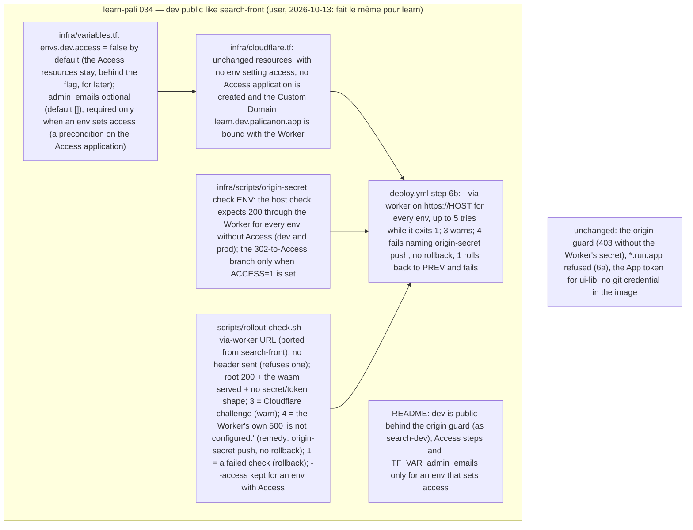

# 034 learn-pali's dev is public behind the origin guard, like search-front's

status: review · rank: 5 · level: standard · type: infra · request: user, 2026-10-13 ("regarde comment les autres ont deployer, le search par example, et fait le meme pour learn") · session: learn-pali-034-dev-public · after: [031]

## Summary
Re-ranked 5 at review round 2 (a second round, a medium finding). Re-ranked 4 at review round 1 (a medium finding D1, a CI gap found). Rank (rank.md): difficulty 3 (a reviewed mode ported from search-front 007, a default flipped, one workflow step, their tests), impact 3 (the dev host becomes public; the origin guard stays the protection, as on search-dev) → 3. Fast path: no new module; the user's instruction validates the design (quoted in the discussion).
Why: the first `tofu apply` of 031's infra failed on the Cloudflare Access application (the keychain token, account `lsh`, has no Access permission). search-front's dev, search-dev.palicanon.app, has no Access: it is public, protected by the origin guard, and its rollout checks the public host with `rollout-check.sh --via-worker`. The user asked for the same.
Decided: `envs.dev.access = false` by default (the Access resources stay behind the flag for a later env); `admin_emails` optional, required only by an env with Access; `origin-secret check` expects 200 through the Worker unless `ACCESS=1`; `rollout-check.sh --via-worker` ported from search-front (exit 3 warn, 4 the Worker's own 500 with no rollback, 1 rollback); deploy.yml step 6b uses it for every env, `--access` kept for an env with Access. The host stays learn.dev.palicanon.app (the user's choice of 2026-10-11; search uses search-dev).
State of the infra (applied 2026-10-13): secret learn-pali-origin-secret-dev (version 1), SA learn-pali-dev and its IAM, Cloud Run learn-pali-dev (bootstrap image), its public invoker, the Worker learn-pali-dev (no secret yet). Not created: the Access application and policy, the Custom Domain.

## Workflow

## Log
| Step | Result | Output |
| --- | --- | --- |
| Define | done | orchestrator, 2026-10-13: session learn-pali-034-dev-public (design d94e339a9c72d45 v1, discussion d933a32c006fa47, process d5b14518a395d49); worktrees wt/034/learn-pali (fix/dev-public) beside wt/034/ui-lib (v0.1.0) |
| Build | done | lane:dev-public (Sonnet): 36c5c4f (infra: dev without Access, admin_emails only for an env with access), 0ec17d6 (rollout-check --via-worker, deploy.yml 6b), lane:dev-public-docs 9b6f919 (stale comments); red seen (#5836, #5837) |
| Verify | done | orchestrator on wt/034 (learn-pali 9b6f919 beside ui-lib v0.1.0 90378bb): fmt, leptosfmt, clippy ×3, learn_pali tests, core, doc, deny ok, leptos build --release, Worker 12, origin-secret 107/0, rollout-check 640/0, tofu fmt + validate, YAML — 0. Coverage (cargo llvm-cov, the CI command, lines): before 031 (67c3439) 96.70 %, main (e63d068) 96.74 %, this branch 96.74 %; app/src/origin.rs 99.49 % |
| Review round 1 | fail | review d523fb822e7be4f; deep #5866 (on retry) 2 Δ + 3 T; sage #5878 (independent) clean, 1 T already tested. Found by the orchestrator while checking deep's T3: CI runs none of the script tests, the Worker tests nor tofu validate (since 031) |
| Fix round 1 | done | lane:fix1 (Sonnet): b26814c (D1/D2), dbf4957 (CI job infra), 3d13514 (README), 2cad206 (a pre-existing harness flake: $RANDOM collisions among ~330 fake servers, about 1 run in 10 failing; fixed here, counter names); red 60 failed → 769/0, 12 runs in a row |
| Infra applied | done | orchestrator, 2026-10-13, from this branch (its infra part unchanged since review round 1): `origin-secret push dev` (HTTP 201), then `tofu apply` (1 added: the Custom Domain); certificate after ~120 s; `https://learn.dev.palicanon.app/` 200 (the bootstrap hello through the Worker), `origin-secret check dev` OK |
| Review round 2 | fail | deep #5906: 1 medium (E1) + 2 tests; rulings in Reviews; sage summoned blind |
| Fix round 2 | done | lane:fix2: 7297a57 (exit 7, ET2, ET3), red 5 failed → 791/0 three runs; its uncommitted tests were wiped once by lane:fix1's checkout (#5918) and rewritten |
| Review round 3 | done | deep #5928: 302 closed; G1, G2, G4 taken in by the user, G3 ruled out (explained), G5 from #5918 |
| Fix round 3 | done | lane:fix3 5ca4d59: any 30x to Access → 7, a missing/empty/unreadable pattern → 64 before any request, the wasm's own head read, comments indented, serve() comment (87; the new cases make ~100 now, noted); red 14 failed + a mutation for G2 → 838/0 three runs |
| Check | done | orchestrator, tip 5ca4d59 + ui-lib 90378bb: rollout-check 838/0 twice, origin-secret 107/0, Worker, YAML, tofu fmt/validate; no Rust changed since Verify (cargo matrix and coverage 96.74 % stand). The live dev host answered through the Worker and `origin-secret check dev` OK (infra applied from this branch). No visible result beyond that: checked by the orchestrator |
| Merge | done | c6fef52 on main, 2026-10-13 |

## Design
Viewer: learn-pali-034-dev-public/design (d94e339a9c72d45), v1, validated by the user's instruction 2026-10-13.

## Lanes

## Reviews

### Round 3 (last) — 2026-10-13
deep #5928 (summons #5925): the 302 case closed; four edges. Open at the last round → the user (2026-10-13: "met la redirection, le wasm … et fix les comments"):
| # | Finding | Ruling | Fix |
| --- | --- | --- | --- |
| G1 | `access_in_front` matches only a 302, and returns quietly when the pattern file is empty or missing: a 301/303/307/308 to Access, or a missing pattern, falls to exit 1 → rollback | taken in (user) | any 30x whose Location matches the pattern → 7; an empty or missing pattern file in `--via-worker` → exit 64 naming the file (no rollback); tests for 301, 307, 308, empty and missing pattern |
| G2 | the wasm answering the Access redirect while `/` answers 200 is untested; `access_in_front` must read the failing check's own head | taken in (user) | a test: `/` 200, the wasm 302 to Access → 7, and the Location read from the wasm's head |
| G3 | a runner challenged by Cloudflare (cf-mitigated) with ACCESS false warns and goes green | ruled out (explained to the user) — a challenge means the runner never reached the page; it says nothing about Access or the revision; search-front's behaviour (its R6) | |
| G4 | three comment lines in deploy.yml at column 0 | taken in (user) | indent them with the block |
| G5 | the comment above `serve()` says ~330 servers, one run in four (lane:fix1 #5918: 87, about one run in ten) | taken in | the comment says 87 and about one run in ten |

### Round 2 — 2026-10-13
Posted by the orchestrator (small fix diff; the user asked for the dev quickly): deep #5906 (summons #5904), sage summoned blind afterwards.
| # | Finding | Ruling | Fix |
| --- | --- | --- | --- |
| E1 | deep: an env behind Access while its `ACCESS_<env>` says false: `--via-worker` sees the 302, exit 1, five tries, a good revision rolled back (three copies of one fact: tofu `access`, `ACCESS_<env>`, `ACCESS=1`) | taken in — tie the check to what the host does, not to the copy | `--via-worker`: a 302 whose Location matches `scripts/access-redirect-pattern` → exit 7 "the host is behind Cloudflare Access but ACCESS_<env> is false: set it (deploy.yml) to match infra"; deploy.yml: 7 fails named, NO rollback, no retry; tests |
| E2 | deep: under Access, 6b proves only the redirect | ruled out — the design accepted it for an env behind Access (no service token may pass Access, 031); the design wording says so (v2) | |
| E3 | deep: `edge_failure` compares `$mode` to the literal `--via-worker` while the model sets `mode=worker` | ruled out — false: the port keeps the literal (rollout-check.sh:72, 94, 153), the D2 tests drive it | |
| E4 | deep: the guard of the `infra` CI job lives in a script only that job runs | ruled out — low value; a deleted job is visible in the CI run list | |
| ET1 | deep: no case for `--via-worker` meeting the Access 302 | taken in | with E1 |
| ET2 | deep: `ACCESS_<env>` unset (a new env) | taken in | deploy-stub test: fails naming `ACCESS_<env>`, no rollout-check call |
| ET3 | deep: direct mode against a dead URL must stay exit 1 | taken in | a test: `revision` mode, closed connection → 1 |

### Round 1 — 2026-10-13
| # | Finding | Ruling | Fix |
| --- | --- | --- | --- |
| D1 | deep: 6b runs --via-worker for every env; an env with `access = true` answers 302 → exit 1 → a healthy revision rolled back | taken in | deploy.yml knows each env's access setting (a workflow-level map that mirrors `infra/variables.tf`'s defaults, both false today, a comment naming the pair); an env with access runs `--access` (2/4 fail, 3 warns, never a rollback), the others `--via-worker`; a deploy-stub test for each |
| D2 | deep: a failure of the edge (no answer: curl 000, TLS, timeout; a Cloudflare 52x; a 403 through the Worker) counts as a failed check and rolls back | taken in — none of these is the revision's fault, and a rollback does not cure them | `--via-worker` exit 6 for: no HTTP answer, a 52x, a 403 (through the Worker the guard only refuses when the Worker's secret is wrong — `origin-secret push`); exit 1 stays for what the revision serves wrong (404, its own 500, no wasm, a token shape); deploy.yml: 6 fails named, NO rollback; tests: a server that closes the connection, a 522, a 403 |
| T1 | deep: no test of an env with access in 6b | taken in | with D1 |
| T2 | deep: no test of "nothing answered" | taken in | with D2 |
| T3 | deep: nothing runs tofu validate; required_version | partly — `required_version = ">= 1.8"` already covers cross-variable validation (OpenTofu 1.8); **the orchestrator found more: CI runs none of scripts/rollout-check.test.sh, infra/scripts/origin-secret.test.sh, node --test infra/worker/proxy.test.mjs, tofu fmt/validate** | a CI job `infra` in ci.yml: setup OpenTofu (opentofu/setup-opentofu, version from versions.tf's floor or latest 1.x), `tofu fmt -check -recursive infra`, `tofu -chdir=infra init -backend=false` + `validate`, node 2x `--test`, both shell test scripts; a static test asserts the job runs each |
| S1 | sage: --via-worker with ORIGIN_SECRET set must exit 64 | ruled out — tested (rollout-check.test.sh:403-407) | |
| R1 | README point 3 still says the Cloud Run origin is reachable directly (lane:dev-public-docs) | taken in — false since 031's guard | README.md: the origin answers only the Worker (403 otherwise) |

## Merge
c6fef52 on main, 2026-10-13.
