# 048 Learn runs inside the PaliCanon app

status: merged · rank: 7 · level: standard · type: feature · request: app-001-palicanon-app T3 (user, 2026-10-16: "On a dit une app avec le search, learn et la map"; "Attendre les trois") · session: learn-pali-048-app-fragment · after: [] · ui-lib: v0.3.0

## Summary
Rank (rank.md): difficulty 6 (a new build mode, the shell split from the screens, a store abstraction across two hosts), impact 6 (the site's every page and the app's Learn) → 6.
Why: the PaliCanon app (Tauri, client side, offline) mounts Learn under /learn inside its own AppShell, with Search and the Map. Today learn-pali's Layout owns the AppShell (rail, Settings with 'Your progress', footer), the one route (home at /) and ImportConfirm; store.rs reads and writes localStorage pc_learn under hydrate; the deck is embedded (include_str!).
Design v4 (consensus): `save` returns nothing, a `status()` signal (Saved, Pending, Failed: Transient or NewerVersion with the unsaved state) and one strip offering Export; `Load::Unreadable` (an I/O failure: error, Reload, Export and Import off, no write); `on_change` re-reads; `store` and `files` (ProgressStore, FileTransfer) are required props of LearnProvider, `hydrate` implies `web-store`; the fragment's route is relative, the parent mounts it, links from `use_matched()`; the site's document diffed main vs branch in Verify; the app-side store (queue, retry, exit drain, version check) is T5a's. Open: whether `use_matched()` and `path!("")` behave as needed (the first red test settles it; fallback a LearnBase context). Design v1 was: a csr feature (ui-lib v0.3.0); a public Learn fragment (LearnRoutes under the parent's base path, LearnSettings for the host's Settings, LearnProvider for the progress context and ImportConfirm), no shell inside it; the site keeps its shell and renders the same HTML; a ProgressStore trait chosen by the host (the site: localStorage, the default feature; the app: its Tauri commands, localStorage not compiled in).
The first public download of the app waits for Learn, Search and the Map (user, "Attendre les trois").

## Workflow

## Log
| Step | Result | Output |
| --- | --- | --- |
| Define | doing | orchestrator, 2026-10-16: session learn-pali-048-app-fragment (design d5caaeabfda6d43 v1, discussion dc9c2e555937c40, process d66ad61efd6ad41); worktree /Users/lsh/projects/palicanon/wt/048/learn-pali (feat/app-fragment), ui-lib worktree /Users/lsh/projects/palicanon/wt/048/ui-lib at v0.3.0 |
| Define (consensus) | done | consensus agent, 3 rounds, v4 (deep, sage; gemini 429): status signal instead of a save result, Load::Unreadable, required store props, relative route + use_matched links; open: the router behaviour (first red test) |
| Define (user) | done | user, 2026-10-16: «Oui, construis 048 + 021» — the design validated |
| Plan | done | orchestrator: one Sonnet lane (the fragment, the backend/store trait and the site's rewiring share app.rs and the page: not separable without a file in two lanes), committed in steps, test first; heavy builds throttled (nice, -j 4: two tasks build in parallel on the user's machine); the router question settled by the first red test |
| Build | done | lane:fragment (Sonnet): 4352bf0 ui-lib v0.3.0, 4ed4950 router pin, 45efe17 features + cfg_gates, 8c3e98d the fragment, 16bde55 browser test + CI. Router: ParentRoute /learn + path!("") matches /learn and /learn/, use_matched() = "/learn" (root: ""), no fallback. Checks all exit 0 (fmt, clippy ssr/hydrate/csr + workspace, doc, leptos build, deny, csr-without-web-store, rollout-check 1028/0); tests 372+9+5+6, core/cli/build_deck 112+66+18+129+5, browser 1. Document diff of /: main vs the bump identical; vs HEAD: the hidden file input gone from Settings, two `<!>` markers; server 400×200, 100×404, hydrated, no panic |
| Verify | done | orchestrator, 2026-10-16, on 16bde55: `cargo test -p learn_pali --locked --features ssr` 372+9+5+6 passed, 0 failed; worktree clean |
| Rulings | done | orchestrator: (1) the file input built on demand by web_files() (the site loses its always-present hidden input; one assertion 1→0) — accepted: the site behaves the same; the user's check on learn.dev includes an Import on Safari and Chrome; (2) `classify` public, LearnProvider above the Router (a store is not Send), site_footer moved to app/, wasm-bindgen-test dev-dependency — accepted, noted for T5a; (3) the hydrate console warning from ui-lib catalogue.rs:37 (an untracked read) — a ui-lib follow-up, not this task |
| Review 1 | fail | reviewer: d1e8a20c7abda40 v1; deep 9612/9628/9642/9657/9674 (Δ and T in every batch, one real CI defect), sage 9691/9704/9720/9752/9777 (thin, gpt-oss-20b). Rulings in ### Round 2 — 2026-10-16
Voices: deep (9902, 9910, 9919), sage (9958 blind rerun, 9940, 9949). Rulings (orchestrator), taken in:
- H1 (deep 9910): `WebStore::save` refused on NewerVersion sets `status = Failed(NewerVersion { unsaved })`, so the site shows the strip with Export of the answer just given (test).
- H2 (deep 9910): `load()` reads the stored value first, then the unsaved memory: a storage that turns unreadable after a refused write answers Unreadable (test).
- H3 (deep 9910, sage 9940): a second Import click makes the previous input inert (its change handler ignored once superseded) before removing it; a stale chooser can never import (test with two picks).
- H4 (deep 9910, sage 9940): a chooser that cannot be made, or a file that cannot be read, is a distinct failure (not empty text): it shows its own reason and keeps a previous refusal untouched (test).
- H5 (deep 9910): `FakeKv` counts write attempts, refused ones included.
- H6 (deep 9902): "the strip stays once Failed until a save succeeds" lives in the store's status (or ProgressData), not in the strip's Memo: Failed → leave the page → Pending → return still shows the strip (test).
- H7 (deep 9919): "Start again" is not shown for NewerVersion (it can never act); under Unreadable, Review opens no session (test watching sessions, not only saves); BrokenBlock(NewerVersion) shows no "Start again" (test).
- H8 (deep 9902): README says what the code does (the input is removed after a change, or by the next pick); the seed.rs browser assertion runs in a browser test or goes; the tautological assertion in tests/csr.rs asserts something; a root brand href `/` case.
- H9 wording: design v5's "Its base is never a prop" becomes "its base never comes from the host: the route view hands use_matched() to the home as a required prop" (v6, viewer and here).
Ruled out: StartAgain's Invalid check (a UI guard on top of the store's, as ruled in round 1); re-parsing pc_learn on every save (a note, no defect).
This is the second round; a third is the last before the user.

### Round 1; Fix round 1 |
| Re-rank | 6 → 7 | a review round with medium findings (deep), a CI defect |
| Fix 1 | done | lane:fragment: 00679bf F6, 862371d F1, ecb7876 F5, ce1a44f F4, 704aa93 F3, 634632a F2 (a KeyValue trait under the web store), b34702a F7, 653f3b5 F8; red or mutation per item; BrokenKind is one enum (nothing merged). Local list at 653f3b5 all exit 0: fmt, clippy ssr/hydrate/csr all-targets + workspace, tests 384+9+6+6, core/cli/build_deck 112+66+18+129+5, browser 3, rollout-check 1028/0, doc, leptos build, deny, csr-without-web-store. Coverage lines 97.55% (main 96.74%) |
| Review 2 | fail | reviewer: d1e8a20c7abda40 v2; deep 9902/9910/9919 (F1, F2, F6, F8 answered; F3, F4, F5, F7 partly; new findings, the strongest in web.rs), sage 9958/9940/9949 (blind rerun; partials already tested elsewhere). Rulings in ### Round 2; Fix round 2 |
| Fix 2 | done | lane:fragment: eb5a0ad H1/H2/H5, 0c916e2 H3/H4 (pick_import calls back Result<String, PickFailed>), 082538a H6 (kept failure in ProgressData), 9f8c0a2 H7, f307c12 H8; red or mutation per item. Local list at f307c12 all exit 0; tests 390+9+6+6, browser 5, rollout-check 1028/0. Coverage lines 97.62% (main 96.74%). Gap named by the lane: the web-store DOM glue of H3/H4 (stale chooser, no chooser, FileReader error) has no browser test (the pure gate and the fragment's reaction are tested) |
| Paused | — | 2026-10-16: the user stopped this task's running agent and set the Map first («commence par intégrer la carte»); resumes from this row |
| Build (vendor) | done | 243b11a: placeholders.rs vendored into app/build (until ui-lib 068), so the crate builds from a git checkout; build and tests exit 0 |
| Rule (user) | — | 2026-10-16: «Fusionner sans dernier tour» — merged without review round 3; the round runs after the merge on main and its findings become a follow-up task |
| Check | done | orchestrator: the Fix 2 local list (all exit 0, coverage 97.62%) plus 243b11a's build and tests; the only visible site change is the on-demand file input (checked on learn.dev when Actions run again) |
| Merge | done | a19bfd6 on main (squash), pushed; tag fragment-v0.1.0 for the PaliCanon app (a v* tag would deploy prod) |

## Design
Viewer: learn-pali-048-app-fragment/design (d5caaeabfda6d43), v6 — v4 validated by the user 2026-10-16; v5, v6 = wordings ruled on the build and review 2.

```mermaid
flowchart TB
  subgraph t3["learn-pali 048 — Learn runs inside the PaliCanon app (T3 of app-001 v6) — the web site unchanged"]
    feat["features of the app crate (learn_pali): ssr and hydrate unchanged for the site, hydrate now also implies web-store; a new csr = leptos/csr + palicanon-ui-lib/csr (v0.3.0) + a private browser feature (hydrate OR csr, as ui-lib 067) for the DOM glue; web-store = the localStorage backend + the storage event + the Blob download and the file input (web-sys Storage, FileReader, Blob), enabled by hydrate, off in the app build (csr alone); the site's binary (main.rs, axum) only under ssr"]
    frag["the Learn fragment, public: LearnRoutes (#[component(transparent)] returning MatchNestedRoutes: one relative route path!(''), the home) that the PARENT mounts, the site at the root, the app inside its own ParentRoute path!('/learn'); LearnProvider (props: store, files; provides ProgressData, StoreWrites and the two traits in context, renders ImportConfirm after its children); LearnSettings (the 'Your progress' section for the host's Settings). Its base never comes from the host: the route view hands use_matched() of the home route to the home as a required prop, links are built from it (the brand link href, today '/', becomes /learn in the app), so the route and the href cannot drift. No AppShell, no rail, no footer, no Title inside it. Hidden dependencies, written in its rustdoc and each tested: AppShell's ShellState (LearnSettings reads settings_open), the one language signal (provide_language), root-served assets (/lotus.png), one LearnProvider per page (the dialog id pc-import), a ui-lib tag equal to the host's"]
    site["the site keeps its shell: App = Router + LearnProvider(web_store(), web_files()) around AppShell(nav, settings_extra = LearnSettings, footer) with LearnRoutes at the root, and its own Title; its SSR document unchanged but for the hidden file input (created on demand by web_files(), ruled 2026-10-16), cookies and tests unchanged (the rail, the footer, the origin guard stay the site's)"]
    store["ProgressStore, required by LearnProvider (no default, no 'missing store' state): load() -> Load, answering at once from the implementation's memory; save(&State), accepted at once, never 'durable' (it returns nothing); status() -> a signal Saved / Pending / Failed(SaveError), SaveError = Transient (the memory is kept, retried) or NewerVersion { unsaved: State } (terminal: the file wins; unsaved is the LATEST memory at the moment the conflict is received, saves coalesced behind the refused one included, so nothing the learner answered is lost silently); on_change(cb: Fn(), no payload), required, no default body: it says the memory changed outside a save, and the fragment's handler re-calls load() and status() and sets ProgressData from them. Load gains Unreadable(message), a read that failed with the file untouched (an I/O error; a file that parses badly is not this: the app moves it aside and answers Invalid with its raw text, app-001 native), next to Ok, Empty, Invalid, NewerVersion. Under Unreadable the home shows an error and a Reload button (the webview reload re-runs the app's start and its load, no trait method), Settings shows Export and Import off with the reason (the pattern of the newer-version reason), and nothing is ever saved over a file that could not be read: the STORE refuses both save and the exit write while its load answered Unreadable (the guard is the store's, not the button's), and ProgressData carries Unreadable too, so Settings shows 'Your progress' with the reason line and both buttons off. No start-fresh: a persistent I/O error (permissions, disk) is the OS's, the other services stay reachable. Web impl (web_store(), feature web-store) = today's synchronous localStorage pc_learn, status always Saved, on_change = the storage event of another tab; the pure decisions (classify, validate_import, export_name) unchanged. When status is Failed the fragment shows one strip 'Your progress is not saved' with Export: of the current state for Transient, of the unsaved state for NewerVersion (whose Load is then NewerVersion, the existing read-only path, so the strip and the read-only home appear together, each saying its part). A conflict is one synchronous run with no await in it: the store swaps its memory and sets the status, then calls on_change, whose handler re-reads load() into ProgressData; the DOM renders after the run, so the strip never shows over an editable home, and no grade can interleave. No flush() in the trait: the implementation owns its queue and its page-hide hook"]
    files["FileTransfer, required by LearnProvider: export(name, text) and pick_import(on_text), both fire-and-forget with the failure shown; the raw download of an Invalid or newer file goes through it. Web impl (web_files()) = Blob URL download and the hidden file input, as today; the app gives dialog and fs plugin commands (share sheet on iOS)"]
    deck["the deck stays embedded (include_str!, no fetch): the app works offline from the first start"]
    tests["tests: (a) the site's ~25 SSR document and layout tests pass unchanged, and once, in Verify, the rendered document of / is dumped on main and on the branch and diffed (badge sha normalised), the result in the Log: a one-time proof, not a committed snapshot (every copy edit would break it); (b) native tests of the fragment under a ParentRoute /learn: /learn and /learn/ render the home, / and /nope give Not found, the brand href is /learn, the same fragment at the root keeps href /, a ShellState-less host still renders; (c) a fake ProgressStore drives load, a save that fails Transient (strip, state kept), then NewerVersion on the retry (strip with the unsaved state offered to Export, home read-only, never both screens contradicting), Unreadable (error and Reload, Settings Export and Import off, neither save nor the exit write reaches the file), and a fake FileTransfer drives export and import; (d) one browser test (wasm-bindgen-test in headless Chrome, as ui-lib tests/csr.rs): LearnRoutes mounted under /learn by csr::mount with a fake store on a seeded state, the home appears, one review answer is given, the fake store saw one save; (e) CI: clippy and a build of csr alone (no web-store) on wasm32, so the app's feature set is built; nothing of the localStorage backend is compiled there"]
  end
  app["PaliCanon app (T5a): loads the progress file by its command BEFORE mounting and builds its ProgressStore on that memory; one Router, AppShell with the three services; LearnProvider(own store, own files), LearnRoutes inside ParentRoute /learn, LearnSettings in its Settings. Its store: save updates the memory at once and starts the write command at once (one in flight, later saves coalesced to the latest state, so the file order equals the save order); the Rust side checks the file's version at write time (refuses to overwrite a newer one; temp file, fsync, rename), and on exit and on page hide writes the LATEST memory (the coalesced slot, not only the in-flight command), never while its load was Unreadable or after a NewerVersion conflict; on NewerVersion it stops writing, hands the discarded memory to the error, re-reads the file and fires on_change (the fragment falls into its read-only path); on a Transient failure it keeps the memory, status Failed, and retries every few seconds, on the next save and on page hide, so the lag is bounded by the retry period and visible by the strip. Single window: on_change fires only after a conflict re-read. Out of scope: another process rewriting the file while the app runs (the write-time check is the only guard)"]
  ui["ui-lib v0.3.0: csr, csr::mount, Store (Local)"]
  ui --> feat
  feat --> frag --> app
  frag --> site
  store --> frag
  files --> frag
  store -.-> app
  files -.-> app
  deck --> frag
  tests -.-> frag
```

## Lanes

## Reviews

### Round 1 — 2026-10-16
Voices: deep (9612, 9628, 9642, 9657, 9674), sage (9691, 9704, 9720, 9752, 9777). Rulings (orchestrator), taken in:
- F1 CI (deep B5, first): the `test-browser` job's run steps get `working-directory: learn-pali` (or the repo's layout equivalent) — the job must actually run; and the csr clippy entry lints `--all-targets` so tests/csr.rs is linted.
- F2 web store (deep B1): a localStorage that is absent or throws on read gives `Load::Unreadable` (not Empty), and `WebStore` then refuses `save` like the app's store; a `set_item` error gives `status() = Failed(Transient)` (no silent loss; the design's "web status always Saved" becomes "Saved unless the browser refuses the write"), with a test for each.
- F3 the strip (deep B2): once Failed, the strip stays until a save succeeds (`Pending` after `Failed` keeps it); what Export offers is read at the click, the same value the strip shows; a mounted strip goes away on `Failed` → `Saved` (test).
- F4 Unreadable end to end (deep B3/B4/B5, sage): one test path: the home shows the error with its message (not discarded) and Reload, no session starts; Settings shows Export and Import off with the reason; ImportConfirm refuses; neither `save` nor `exit_write` reaches the store — under Unreadable AND after NewerVersion (the fake records calls); `on_change` alone flips the home to read-only.
- F5 the file pick (deep B1/B4): the on-demand input is removed after change or cancel (and on the next pick at the latest); a pick that fails shows its failure; choosing a new file clears the previous refusal only when a file is read (a cancel keeps it); FakeFiles can express a cancel and an unreadable file; README says the input is created on demand.
- F6 base (deep B5, sage B5): `base` stays an internal prop handed from the route view (use_matched panics outside a Route), but required: no silent "/" default.
- F7 tidying (deep): `gate_above` does not panic on a blank line; the save doc names the refusal after NewerVersion too; the remaining `hydrate` wording and the `reason` strings say browser; the dead `Reload` arm goes; seed.rs's browser path asserts something; `browser` stays private (not documented as a public feature) and `web-store` carries its web-sys features.
- F8 browser test (deep B5): a second answer given, `/learn/` (trailing slash) mounted, and a fallback route `/learn/nope` → Not found.
- Design wording: v4's "its SSR document … unchanged" becomes "unchanged but for the hidden file input, now created on demand" (task file and viewer, same turn).
Ruled out: provide `Backend` vs the traits (an internal name, the contract holds); two BrokenKind names (deep B3: they are one enum's variants across two modules — the lane checks and merges them only if they are truly duplicate); the duplicated guards in data_block and AddNew (defence in the UI on top of the store's, kept); coalesced saves and the clock edge (the app's store, T5a); a missing-provider panic test (documented panic).

## Merge
a19bfd6 (fragment-v0.1.0)
