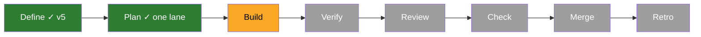

# 050 The progress synced through the user's Google Drive

status: building · rank: 7 · level: hard · type: feature · request: user, 2026-10-16 («un moyen de se connecter avec Google … pour passer d'un device à un autre»; «Google puis Apple; anatta plus tard»; «Passe sur la dev, et l'app desktop»; «sans serveur») · session: learn-pali-050-progress-sync · ui-lib: v0.3.0

## Summary
Rank (rank.md): difficulty 7 (OAuth on the web without a server, a merge with no clock, a sync cycle around 048's store rules, CSP changes on the site), impact 7 (the learner's progress across devices; a third-party script on the site) → 7.
Design v5 (consensus v4 with deep and sage; the user's choices): the progress file (today's export JSON) in the user's Drive appDataFolder (one module switches to a visible file if the web and desktop clients do not share it: the user's real check compares the two file ids); merge = a clock-free join in learn_core (greater (lapses, stage, due) wins whole; passed unioned on equal keys); one sync cycle in learn-pali for both hosts over a SyncTransport (sign_in, sign_out, account, pull, push); the web transport = Google Identity Services token client loaded on the first Sign in or Sync tap, token in memory only, a Sync chip after a reload; the desktop transport (Rust, PKCE loopback, Keychain, every 5 minutes) is built in the PaliCanon app after 005. No server stores anything. Sign out revokes at Google.
OAuth: project palicanon-app; web client 873594463453-ag83cvs5t5uqa6uvir9n4p9igbmdans7.apps.googleusercontent.com; consent screen External, Testing; scope drive.appdata; the Drive API enabled by hand (to be declared in infra here).

## Workflow

## Log
| Step | Result | Output |
| --- | --- | --- |
| Define | done | orchestrator + consensus (2 rounds, deep and sage; gemini 503/429), v5 with the user's choices (2026-10-16); research in the discussion (11095, 11096); ids {"design": "ddbf202d4e27c42", "discussion": "d3180a4ca3fe44e", "process": "d687855a263ca4e"} |
| Plan | done | one Opus lane (merge in core, the cycle and the web transport in app/, UI, CSP, infra): files coupled through the seam |

## Design
Viewer: learn-pali-050-progress-sync/design, v6 (v6: the desktop sign-in shows its link, user 2026-10-16; desktop only).

```mermaid
flowchart TB
  subgraph t["learn-pali 050 — the progress synced through the user's Google Drive (site and desktop app); Apple next, anatta later"]
    where["location in Drive, ONE module (drive_location): first choice the hidden appDataFolder (scope drive.appdata, non-sensitive), file pc_learn.json; if the first real test on learn.dev and in the app shows the web and desktop clients do not see the same file, the module switches to a visible file PaliCanon/pc_learn.json with scope drive.file (also non-sensitive), nothing else changes; scopes also ask 'email' (non-sensitive) to show the account"]
    format["the file: the same JSON as today's export (learn_core State v1, unchanged: no review timestamp is added); the Drive copy is read with State::from_json: a newer version is never overwritten (sync stops, 'Update the app to sync'), a copy that does not parse is never overwritten (sync stops, its raw text offered through FileTransfer.export)"]
    merge["merge(a, b), pure, learn_core::merge: a join, no clocks. Per term: union of the terms; on a term in both, the entry with the greater key (lapses, stage, due) wins whole; equal key: passed = union of the two (Session::start settles a full set as a climb). last_today = max. Order: b's terms, then a's others in a's order. Every answer keeps the key monotone (fail: lapses+1; climb: stage+1, or due later at Year; pass: same key, passed grows), so merge is commutative, associative, idempotent: a lost Drive write heals at the loser's next sync. Passes made under a lower key are dropped on purpose: a fail or a climb clears passed on one device too. A device whose clock ran ahead moves every device's day forward through last_today (as an Import does today): accepted"]
    cycle["one sync cycle, in learn-pali (sync.rs, one implementation for both hosts): refuse unless the store's load is Ok or Empty and its status is not Failed(NewerVersion); transport.pull → absent: push local; else read local NOW (store.load(), pending saves included, never a copy taken before the pull), merge(local, drive); push if merged != drive (State equality); store.save(merged) if merged != local, then the fragment's changed-elsewhere handler (as on_change); load, merge and save run in ONE synchronous callback on the UI thread (no await between), so no answer interleaves; this rests on the ProgressStore contract on both hosts (load answers from the store's memory, save accepts at once: the app's front store in the webview, its Rust writer behind it). A tab killed between push and save leaves Drive ahead: the next cycle heals it. No compare-and-set and no re-read: the join makes a raced write harmless. One cycle at a time, a request during one runs once after it. A failure changes nothing local: 'Not synced' with the reason and Retry"]
    when["when: on sign-in; at load when a token is at hand (desktop: always, from the Keychain; web: only within the tab's life); at the end of a session (back home); 'Sync now'; desktop only: also every 5 minutes while the app is open (the token is at hand there; user, 2026-10-16: «sync en continu», then «sans serveur»: the web stays gesture-bound, the Sync chip after a reload). No other background timer, no sync on page hide or quit (no gesture, no time); a session running is never re-read under the learner except by Sync now, which pauses it with its Reload banner"]
    web["site (hydrate), the web transport: Google Identity Services token client (script https://accounts.google.com/gsi/client, injected on the first Sign in or Sync tap only: a learner who never syncs loads no Google script), Web client 873594463453-ag83…; the access token in memory only (expires_in read), never in storage, never sent to our server; localStorage keeps only 'sync on' and the email as login_hint; after a reload a 'Sync' chip on the home: its tap calls requestAccessToken (prompt '', login_hint) in the gesture, then the cycle; Drive calls from the browser (fetch, Bearer); Sign out revokes the token (google.accounts.oauth2.revoke) and clears the hint. CSP: connect-src + https://www.googleapis.com, script-src + https://accounts.google.com/gsi/client (frame-src only if GIS needs it, checked on learn.dev)"]
    app["desktop app (Tauri), the desktop transport, all in Rust: installed-app flow, PKCE S256 + state, a 127.0.0.1:0 listener for one request (5 min timeout, then closed), the system browser by the opener; Desktop client 873594463453-v23g… and its non-confidential secret from option_env! at build (the build machine's keychain, a GitHub secret in CI; absent: no sync, the provider is None); refresh token in the macOS Keychain (keyring), access token in memory; sign out POSTs oauth2.googleapis.com/revoke (best effort) then deletes the Keychain item; PKCE makes an intercepted loopback code useless; Drive over reqwest (rustls); commands sync_sign_in, sync_sign_out, sync_account, sync_pull, sync_push (text only crosses IPC); the webview's CSP unchanged; the sign-in also SHOWS the Google URL in the app (a selectable link with Copy and Open in browser, user 2026-10-16: «afficher le lien pas juste ouvrir le navigateur»), the loopback waiting until the learner signs in or cancels"]
    ui["UI (in LearnSettings, both hosts, en/fr/vi, no em dash): signed out: 'Sync with Google Drive' and one line on what is stored where; signed in: the account email, 'Last synced <time>', Sync now, Sign out (keeps the local progress; revokes the token at Google, best effort, then forgets it; desktop: deletes it from the Keychain); a sync failure shows its reason; while signed out nothing changes from today"]
    seam["the seam: a SyncTransport trait beside ProgressStore in learn-pali backend.rs (sign_in, sign_out, account signal, pull, push; callbacks, not Send, as the store); LearnProvider takes sync: Option<SharedSync> (None: no sync UI); the cycle and the UI are learn-pali's, the merge and the format learn_core's; the site's transport in learn-pali (web feature), the app's in PaliCanon/app (front over the Rust commands)"]
    tests["tests: in learn_core next to merge: union, greater key wins whole, equal key unions passed, last_today max, order; property tests: commutative, associative, idempotent; every Session transition never lowers the key nor shrinks passed at an equal key (in session.rs, so a change of the key breaks it). The cycle over a fake transport and a fake store: absent file, unchanged (no push), changed, Drive newer or unparsable (stop, never written), local Unreadable / NewerVersion (no sync), a save made during the pull is kept, a failure leaves local untouched, one cycle at a time. The web transport with a fake token client; the desktop flow with a fake token endpoint and a fake Drive (wiremock), the listener's state check and timeout. Real check by the user on learn.dev and in the desktop app: sign in on both, answer on one, Sync now on the other; both transports log the Drive file id they resolved and the check compares them (two ids: the location switches to the visible file)"]
    infra["infra: the Drive API declared in learn-pali/infra (google_project_service drive.googleapis.com, enabled by hand 2026-10-16); OAuth clients and the consent screen are console-only (Testing, the user as test user: refresh tokens last 7 days there; Production before real use, no verification for non-sensitive scopes); learn.dev deployed from the laptop while GitHub Actions is blocked"]
  end
  apple["later: Apple (iCloud, the app only) as another SyncTransport, then an anatta account if needed"]
  where --> web
  where --> app
  format --> merge --> cycle
  when --> cycle
  web --> seam
  app --> seam
  seam --> cycle
  cycle --> ui
  tests -.-> cycle
  infra -.-> web
  apple -.-> seam
```

## Lanes

## Reviews

## Merge
