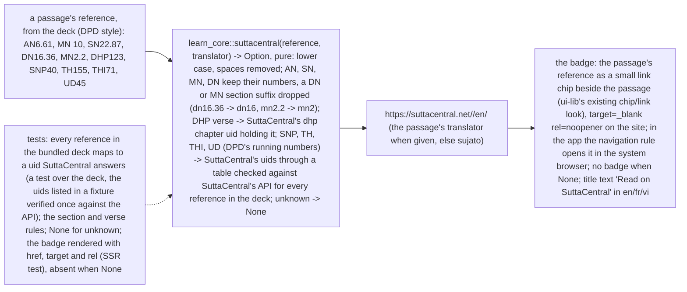

# 053 A passage links to SuttaCentral to read it whole

status: building · rank: 2 · level: simple · type: feature · request: user, 2026-10-16/17 («le sutta / passage devrait avoir un badge pour rediriger vers SuttaCentral et lire le passage en entier»; «avant, on a des passages de suttas, j'aimerais qu'on puisse avoir un badge pour lire sur SuttaCentral !») · light path, fast path (no architecture, no data change: the link is computed from the reference the deck already holds)

## Summary
Rank: difficulty 2 (a pure mapping from DPD-style references to SuttaCentral uids, a link chip), impact 2 (a link beside each passage) → 2.
Each sutta passage Learn shows gets a badge with its reference, linking to the sutta on SuttaCentral in the passage's translation. The deck's references are DPD style (43 distinct in the bundled deck: AN, SN, MN, DN, DHP, SNP, TH, THI, UD); most map directly, DN/MN section suffixes are dropped, and DHP/SNP/TH/THI/UD use DPD's running numbers that need SuttaCentral's uids (a table verified against SuttaCentral's API). No segment anchor: the deck does not hold one (the sutta opens whole). The follow-up viewer entry followup-passage-read-on-suttacentral (session learn-pali) is this task.

## Design
Diagram drawn from the user's two messages (fast path):

## Log
| Step | Result | Output |
| --- | --- | --- |
| Scope note | The user's ruling 2026-10-17 («ça doit dépendre de la langue»), relayed by the orchestrator mid-build: the link follows Learn's interface language. (1) the deck's translation in that language when SuttaCentral holds that translator for the sutta; (2) else SuttaCentral's own translation in that language, one translator per language by a fixed rule (its segmented editions first, then by author uid), resolved at build time into core/fixtures/suttacentral.tsv (no request at runtime); (3) else the English one (the deck's, else the first, else sujato), the badge title saying so («Read on SuttaCentral (English)» / «Lire sur SuttaCentral (en anglais)» / «Đọc trên SuttaCentral (tiếng Anh)»). A deck translator SuttaCentral lacks (the deck's French «christelle» on DN 22) gives way to the one it holds. | fd0f622, 098e2c5 |
| Verify the uids | 43 distinct sources, each checked against SuttaCentral's API on 2026-10-17 (/api/suttas/<uid>: suttaplex.uid, translators; the 16 DHP/SNP/TH/THI/UD ones also by their text in /api/bilarasuttas/<uid>/sujato). AN2.135 answers the range an2.130-140 (kept). DPD running numbers matched by sutta name and text (SNP4 = snp1.4, SNP40 = snp4.2, SNP56 = snp5.2, SNP68 = snp5.14, TH155 = thag2.35, TH259 = thag17.2, THI71 = thig14.1, UD45 = ud5.5). | core/fixtures/suttacentral.tsv |
| Core (red, green) | red: 15 failed, 1 passed (`cargo test -p learn_core --lib suttacentral`, stubs); green: 16 passed, clippy -D warnings clean | fd0f622 |
| App badge (red, green) | red: 5 failed, 1 passed (passage_badge x4, session x2, the absence test passes vacuously on the stub); green: 6 passed | 098e2c5 |
| Checks (README list, leptosfmt added; the two browser suites csr and web_sync need a chromedriver and were not run) | exit 0 for: fmt, leptosfmt, clippy ssr/hydrate/csr/core+cli+build_deck/core wasm, test learn_pali ssr (451 passed), test core+cli+build_deck (112, 66, 157 passed), csr-without-web-store, doc, cargo leptos build, cargo deny | all 0 |
| Served | cargo leptos serve on 127.0.0.1:3053 (pid 116, stopped by pid); a practice session in headless Chrome: Context card, badge «MN 1» href https://suttacentral.net/mn1/en/sujato target _blank rel noopener title «Read on SuttaCentral»; scrollWidth == innerWidth at 1100 and 390 (CDP mobile emulation) | scratchpad/053/lane/passage-badge-{desktop,phone}.png |
| Gold outline (user 2026-10-17: «peut-être le badge avec un contour jaune») | badge switched from Variant::Chip to Variant::Accent, Size::Sm, no class override; test red (1 failed, 3 passed) then green (4 passed). Checks exit 0: fmt, leptosfmt, 5 clippy runs, test learn_pali ssr (451), test core+cli+build_deck, csr (6 passed + 1 passed), web_sync, csr-without-web-store, doc, cargo leptos build, cargo deny. chromedriver 155.0.8059.82 (Chrome 155.0.8059.82). Screenshots desktop and phone, scrollWidth == innerWidth at 1100 and 390; server pid 2570 stopped | scratchpad/053/lane/passage-badge-{desktop,phone}.png |
| Check | done | the user, 2026-10-17: «peut-être le badge avec un contour jaune. Puis check les tests et merge» — the gold outline (Variant::Accent) done; orchestrator read the screenshots; all checks exit 0 incl. both browser suites |
