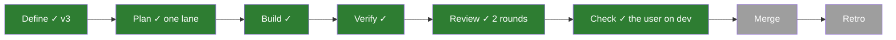

# 054 Add a passage's word to the practice

status: building · rank: 5 · level: standard · type: feature · request: user, 2026-10-17 («j'aimerais qu'on puisse ajouter des mots à la practice … quand on clique on peut voir la définition, il serait bien de pouvoir les ajouter») · session: learn-pali-054-add-word · after: [ui-lib 069 (v0.3.1, merged)]

## Summary
Rank: difficulty 5 (a new kind of term living in the progress, one lookup at ~10 sites, a format version bumped only when used, the sync merge), impact 5 (the learner's own words, kept in export and Drive) → 5.
User's answers: meaning in English like the deck (the deck has no fr/vi meanings); no button for a headword already a term of the practice, nor for a deck term not yet started; no removal yet; added words enter with the new terms.
Design v3 (consensus deep and sage, 2026-10-17): ui-lib 069's PaliText entry_action slot (v0.3.1: learn-pali bumps to it); the added term = a deck Term built from the popover's DPD entry and the passage (id = the headword, rank u32::MAX, a blank on the pressed form); `added` in State, stamped version 1 while empty and 2 once it holds a word; one State.term(deck, id) lookup at every site; adding goes through the running Session (add_term), never starts the word; merge unions added by id, keeping the lesser serialised term.

## Workflow

## Log
| Step | Result | Output |
| --- | --- | --- |
| Define | done | consensus (2 rounds, deep, sage; gemini 429), v3; the user's answers; session learn-pali-054-add-word (design d6afa14ac981449) |
| Build | done | slices: b318a5c ui-lib v0.3.1, 441022b added + versions + merge, 5174d9f the added Term, a0d00ab State::term (core), ab1f754 every app site, 480ffc7 add_term + add_word + queue, 8b9377f the popover button; lib 480, browser csr 7 (a real click), web_sync 1; screenshots scratchpad/054/lane-c |
| Review 1 | fail | reviewer dbb2b9c3e384a49 + blind d856631ee1bb74f; deep 11812/11822/11833, gemini 11879/11889/11899 (sage no review). Rulings in 
### Round 1 |
| User check | changed | the user on dev, 2026-10-17 (8b9377f): «je ne peux pas ajouter le mot» (no button seen; cause not yet found: the button shows in a fresh profile; the user's run may have been rebuilt by a sync) and «Quand je clique sur un mot j'attends qu'il soit ajouté à ceux commencés … Si on ajoute un mot, on veut l'ajouter à ceux commencés». Rulings: (U1) adding STARTS the word (due today, like add_new), for a word outside the deck and for a deck term not yet started (the button offered for any word not started); (U2) the button's visibility must not depend on a run signal that a rebuild may have disposed: offered falls back to the store, and a test rebuilds the run under the panel; the distinction started / not started on the home is a separate task (056) |
| Review 2 | fail | reviewer: a2m diff dee9d609d3ffc41, a2m graph app d4f3db6b3ee9049 / core d914f7f4c3eef48, review dbb2b9c3e384a49 v2; deep 12463/12474/12489/12498/12513, gemini 12464/12497 (A, B only: quota). Rulings in ### Round 2; the user: «fix les, deploy. Puis on fait l'app de bureau» |
| Fix 2 | done | lane:054-r2: 74eee7c R1–R5, d6a24a7 R6, d4e98b9 R7, e12dd9d clippy; red or mutation per item; all checks exit 0 (lib 516, csr 13 ×5 runs, web_add 2, web_sync 1); the user's go: «fix les, deploy» (no third review round) |
| Check | done | the user on dev, 2026-10-17: words added are started and counted (export: rahas 2, phassa 1 Daily); orchestrator: the fixes read against rulings R1–R7 |

## Design
Viewer: learn-pali-054-add-word/design (d6afa14ac981449), v4 — v3 + the user's U1 (adding starts the word), 2026-10-17.

```mermaid
flowchart TB
  subgraph uilib["ui-lib task (first, additive): a slot in the popover"]
    slot["PaliText gains an optional prop entry_action: Callback of (the form pressed, the WordEntry) returning a view, rendered under each entry inside the popover (phone: inside the bottom sheet); absent = today's look; ui-lib owns no string and no rule, the service decides what the slot shows; a gallery section with a button and with an 'Added' line; released as a ui-lib tag, learn-pali bumps to it in its own commit"]
  end
  subgraph lp["learn-pali 054 (after the ui-lib tag)"]
    popover["the card's example words (reveal and Context line runs): the service passes entry_action; for each entry whose headword is not a term id of the practice (a deck term, started or not, or an added word) it renders 'Add to practice' (en/fr/vi, no em dash); otherwise nothing (user: no button when already there); no button on a broken or unreadable store; pressing it adds through the running session and the same slot turns into a short 'Added' line, the popover stays open, desktop and phone"]
    term["the added Term, built from the dictionary entry (learn_core WordEntry found by headword in the deck words): id = the entry's headword exactly as the DPD writes it ('sānuvajja', 'abhiññā 1'; the same namespace as deck TermId), lemma = the headword without its number, pos, meaning {en: the DPD's short meaning} (no fr, vi, literal), no forms, no root, no construction; example = the card's example (text, source, sutta, translations, copied) with a blank on the first whole-word occurrence of the pressed form (before / answer / after), no blank when it is not found; rank u32::MAX (it sorts after every deck term in the ties of nearest and advance; among added words the stable sort keeps their order in the progress, and the order of the queue is the position in added). Facets follow facets_of unchanged: Meaning, Recall, and Context when the blank exists"]
    session["adding goes through the running session, never a separate save: Session.add_term(term) pushes it to state.added (refused when the id is a deck term or already added) and the run saves the snapshot like add_new does, so the next answer's save keeps it; one lookup State.term(deck, id) = the deck's term, else the added one (a deck term shadows an added one of the same id: the progress carries over, a deck update that later adds the headword changes nothing for the learner); every place that resolves a progress entry through the deck goes through it: due queue, settle_complete, nearest, request_new, advance, the card (run.rs), due_cards, new_left, summary, the stats; an added word that was started must be asked, counted and summarised like a deck term; invariant: adding STARTS (user, 2026-10-17, U1: a word outside the deck is added and started, a deck term not yet started is started; the button for any word not started) a word. The new-term queue (request_new): deck terms not started by rank, then added words not started in the order of added; new_left counts both; New terms draws as today (user: with the new terms)"]
    store["format: State gains added: [Term] (default empty); State::VERSION 2 is the highest this build reads; the file is stamped 1 while added is empty and 2 as soon as it holds an added word, so a learner who never adds keeps a file every older build and the PaliCanon app still read and write; a v2 file in an older build takes the existing NewerVersion path (read-only, Export, never overwritten, sync refuses: 050; nothing is lost, the old build waits for its update, as for any format bump); a build reads 1 and 2; from_json refuses an id twice in added (DuplicateTerm); the in-memory version is always VERSION, the stamp is chosen by to_json"]
    merge["sync (050): added is unioned by id, result in b's order then a's other words (as progress); same id on both sides: the lesser serialised term is kept whole, so the join stays commutative, associative, idempotent without a clock; the result version follows the same stamp; entries merge as today"]
    later["not now: removal (a union merge would bring a removed word back: removal needs tombstones in the merge, its own task); fr and vi meanings"]
    tests["tests: core: from_json reads 1 and 2, v2 round trip, to_json stamps 1 when empty and 2 with a word, duplicate id refused; add_term refused for a deck id and a duplicate; request_new order (deck then added, new_left); an added word started is due, asked on all its facets, in nearest, advance, summary and the home count (no orphan treatment); a deck term shadows an added one; merge unions, idempotent, commutative, same id picks one; app: the slot absent means ui-lib unchanged; SSR of the popover with and without the button and 'Added' (en/fr/vi); pressing adds to the run and the store (the next answer keeps it); no button when broken; an old build meeting v2 goes NewerVersion (fixture)"]
  end
  slot --> popover
  popover --> term --> session --> store
  store --> merge
  later -.-> store
  tests -.-> session
```

## Lanes

## Reviews

### Round 2 — 2026-10-17
Voices: deep (12463, 12474, 12489, 12498, 12513), gemini (12464, 12497). Rulings (orchestrator), taken in:
- R1 a run disposed between `live()` and the update falls back to the no-run path (add_word), never Unusable (test: disposal between the two calls).
- R2 a refused press keeps the entry actionable: the reason line AND the button to try again (test).
- R3 the refusal keeps its cause in the line (A3); a Transient save counts as accepted (the store retries), said in the doc.
- R4 one clock: the run's today is the one used to start a word in a run and outside it (no second "today").
- R5 `offered` reads the store when the panel opens and again on press (no frozen answer; test: the word started elsewhere meanwhile → no double start, "Added").
- R6 a file whose `added` empties after shadowing is stamped version 1 (test).
- R7 tests: a press on the slot by click (G3 by double click), "Add to practice" in fr and vi, U2's rebuild under an open panel end to end in the csr suite, web_add's Daily tile checked after answering too, and csr.rs's weakened `<= 1` made deterministic (a seeded card or a known first card).
Ruled out: add_word's load-modify-save (the store's memory is the single writer, A1 accepted in round 1); a deck term started from a passage keeps the deck's own example (its Context comes from the deck); from_json_upto's single caller (kept for the older-build test).

### Round 1 — 2026-10-17
Voices: deep (11812, 11822, 11833), gemini (11879, 11889, 11899). Rulings (orchestrator), taken in:
- A1 one writer: an add outside a run goes through the home's in-memory progress (ProgressData) and the ProgressStore's save, the same path as every other change, never a separate load-modify-save; a sync in flight then merges it (test: an add while a pull is pending keeps the word).
- A2 the button follows the store everywhere: on a broken, unreadable or newer store it shows nothing, inside a run too.
- A3 "Added" only once the save is accepted; a refused save shows its reason in the slot and the word is not counted (test).
- A4 the header's new-terms count follows an add (a count signal updated without rebuilding the card), test.
- A5 `deck::pinned` keys on the term's content, not only its id: a term changed by a merge or shadowed by a deck update is not served stale (test).
- A6 `may_advance` waiting for unstarted added words: documented as intended (they are new terms like the deck's), with a test.
- A7 the doc says what lookup does: a headword is offered from the pressed form's dictionary entries.
- A8 CI's ui-lib action bumped to v0.3.1 if it pins the tag.
- G1 (re-ruled 2026-10-17 after the lane's finding, #11990: the first wording contradicted v3) an added word whose id the deck now teaches is dropped from `added` at read time (classify, validate_import, the sync's pull), its progress kept and served by the deck's term; the same id twice stays Invalid.
- G2 `same()` compares content, not the version stamp (a version-1 file with no word equals an empty state), test.
- G3 a second press on the same entry (double click) ends on "Added", not on a refusal (test).
- Tests also: an added word's Context facet (its example present); a real version-2 file through store::load and an older build refusing it; "Added" in fr and vi; blank_on with the word twice in the passage; request_new reaching into the added words; going home after an add without answering keeps the word.
Ruled out: pinned after a poisoned lock (a panic elsewhere), ids with stray spaces (headwords come from the deck's dictionary as is).

## Merge
