# 059 The sync says where it stands: automatic cycles, a status line, a hint

status: merged · rank: 6 · level: standard · type: feat · session: learn-pali-059-sync-visible · request: the user, 2026-10-18 (desktop check of the Drive sync) · after: []

## Workflow

```mermaid
flowchart LR
  Define["Define ✓ v5, user 2026-10-22"]:::done --> Plan["Plan ✓ 8 slices, 2 waves"]:::done --> Build["Build ✓ 8 slices, 6 lanes"]:::done --> Verify["Verify ✓ matrix on one tip (Log)"]:::done --> Review["Review ✓ 3 rounds, fix 3 checked"]:::done --> Fix1["Fix 1 ✓ F1-F12, matrix on 5bc1519"]:::done --> Review2["Review 2 ✗ G1-G7"]:::fail --> Fix2["Fix 2 ✓ matrix on 9d0c693"]:::done --> Review3["Review round 3 (last)"]:::todo --> Check["Check ✓ the user on dev"]:::done --> Merge["Merge ✓ 0ddfed7"]:::done --> Retro:::todo
  classDef done fill:#cfe8cf,stroke:#2e7d32
  classDef doing fill:#fff3bf,stroke:#b58900
  classDef todo fill:#eee,stroke:#999
```

## Log
| Step | Result | Output |
| --- | --- | --- |
| Plan | done | lanes table above; process 13026; a2m impact + grep for the view! tags; overlap with 058 on locales/home.rs/session.rs |
| Build | done | S0a, S0b by the lead; lanes A1 pacer (21 tests), B web token expiry, C status line, D hint (26), E triggers, A2 gate (+32), cherry-picked in order; every lane red-first with mutations quoted in its hand-back (process) |
| Verify | done | integration: stub allows and the sync_chip key removed, csr tests for the Retry/Resume wiring and the paused line (tests/csr.rs), the hint's sign-in Effect in its own page (tests/sync_hint.rs, CI step + README), answered() pinned natively; rebased on main (058, 055 merged) with no conflict; matrix on the tip in the Log's last row |
| Matrix | green | tree e84ad51 (= tested c495344 after a fixup squash, `git diff` empty), rebased on main f08b611, ui-lib v0.3.1 522011c: ssr lib 637 + origin 9 + 6 + 6; core 112, cli 67, build_deck 19+; clippy ssr --all-targets / hydrate lib / csr lib exit 0; learn_core/cli/build_deck clippy 0; fmt 0; leptosfmt 0; doc -D warnings 0; csr-without-web-store 0; wasm: csr 15, web_sync 1, web_add 2, sync_triggers 1, sync_hint 1 all exit 0; cargo leptos build exit 0 |
| Fix 1 | done | F1-F12 by finding: pacer (F3 support, F5, F8 `now`, F12) 5513381 (lead); gate F2 F3 F4 F5 + F12 test a61d9bf (lane 4940a28); provider and hint F6 F7 84e0ba0 (722e98e); status line F9 + fr plural 3665701 (a04e47d); triggers F1 F8-focus 6ac760e (303795c); locale guards and CI feature grep F10 F11 5bc1519 (72ad527). Each fix test red first (quoted in each lane's hand-back in process), a mutation per shape test; not caught, said in the test docs: a plain `set_interval` (leptos 0.8.21's IntervalHandle has no Drop, F1's premise did not hold, the stored handle is kept as the contract), the status Memo reading `now` again, a listener registered in another client-only Effect. `Performance` web-sys feature is used (sync.rs `window.performance()`): kept. |
| Matrix 2 | green | tip 5bc1519 (code tree; main f08b611 unmoved, no rebase needed), ui-lib v0.3.1 522011c: ssr lib 667 + origin 9 + 9 cfg_gates + 6; core 112, cli 67, build_deck 19; clippy ssr --all-targets / hydrate lib / csr lib / core+cli+build_deck exit 0; fmt, leptosfmt, doc -D warnings, csr-without-web-store exit 0; wasm csr 15, web_sync 1, web_add 2, sync_triggers 2, sync_hint 1 exit 0; cargo leptos build exit 0 (16 commands, 16 exit 0) |
| Fix 2 | done | G1-G7 in three lanes: pacer and gate G1 G2 G3 76a9e94 (lane c21b5cf); status line and locale tests G4 G5 c2864ec (39b6252); triggers and provider G6 G7 9d0c693 (f7b8d9b). Red first or green on arrival with the sentence quoted, one mutation per behaviour in each hand-back. Deviations ruled by the orchestrator: G4(ii) the Paused line renders its one Resume whatever the build (pinned, no behaviour change); G5 the order-dependent comparison was in the same-keys check (both are sets now); `tick_started` generic so its failure branch is tested natively. |
| Matrix 3 | green | tip 9d0c693 (code tree; main f08b611 unmoved), ui-lib v0.3.1 522011c: ssr lib 675 + origin 9 + cfg_gates 9 + 6; core 112, cli 67, build_deck 19; clippy ssr --all-targets / hydrate lib / csr lib / core+cli+build_deck exit 0; fmt, leptosfmt, doc -D warnings, csr-without-web-store exit 0; wasm csr 15, web_sync 1, web_add 2, sync_triggers 2, sync_hint 1 exit 0; cargo leptos build exit 0 (16 commands, 16 exit 0) |
| Fix 3 | done | I1 d177b62 (`run()` resets `terminal` after the held check; red: `refused: still stopped` left 1 right 0, then green); I2 comment in `join` and I3 tests 12922fa (a failed push, an Ok push, a push timeout under a hold, a late answer dropped). Reds by mutation: M1 reset back before the check → I1 test red; M2 a failed push end sets `pending` when held → (a) red; M3 same on the Ok end → (b) red; M4 `take` always true → (c) red; each restored byte for byte (`cmp`). Check: test: exit 0 (lib 679 = 675 + 4), clippy_ssr: exit 0, clippy_hydrate: exit 0, clippy_csr: exit 0, fmt: exit 0, leptosfmt: exit 0. Note: after release a terminal state stays set, so the held gesture's ask arms nothing (the learner's next gesture outside a session lifts it) |
| Define | done | design v5 (d7e73fbf890d64d), consensus rounds 1–3 (deep 12982, gemini 13001, sage 13004; summaries 12971, 13007, 13009); the orchestrator ruled 12955 (process 12979); the user: «Oui tu peux lancer la construction» (2026-10-22) |
| Check (user) | fail → fix | «sync, mets-le en bas plutôt»; the line moved to the bottom: 70d23d7 (the status line and the hint close the home's column, `mt-6`; red first: the line before the content, mutation red again). Checks: test exit 0 (680 lib), clippy ssr / hydrate / csr exit 0, fmt exit 0 (after `cargo fmt` on the new test), leptosfmt exit 0 |
| Rebase | done | by the orchestrator onto origin/main (061 ui-lib v0.4.0, 060 release badge): keep-both conflicts in app/src/app.rs imports, .github/workflows/ci.yml (release_document step beside sync_triggers and sync_hint), README.md (app/tests row and both wasm command blocks); tip 0f61069; ui-lib pair detached at v0.4.0 943e949. Nothing the rebase broke: no fix needed |
| Verify 3 | green | tip 0f61069, ui-lib v0.4.0 943e949, one script, 22 commands, 22 exit 0: ssr lib 688 + origin 9 + cfg_gates 9 + no_build_git 3 + 6; core 112, cli 67, build_deck 19; clippy ssr --all-targets / hydrate lib / csr lib / core+cli+build_deck; fmt, leptosfmt, doc -D warnings, csr-without-web-store.sh; wasm csr 15, web_sync 1, web_add 2, sync_triggers 2, sync_hint 1, release_document 6; cargo leptos build; bash rollout-check.test.sh, release-values.test.sh, infra/scripts/origin-secret.test.sh, lifecycle.test.sh (19 passed), node --test infra/worker/proxy.test.mjs (20 pass) |

## Summary
Rank: difficulty 5 (a state machine over the existing SyncCycle, two hosts, timers and browser events, copy in three languages, csr and browser tests), impact 5 (every signed-in learner, both hosts) → 5.
The user, after checking the Drive sync in the desktop app: the browser asked to sign in again after a reload, and nothing said the sync worked («le sync ne me dit pas que ça marche»). Decided: no server of ours (kept); not signed in → a one-time hint toward Settings after the first finished session («si pas co, quelque chose pour le dire de sync pour le cross device»); signed in → automatic cycles with no option (after a saved change, on visibility, every 5 min while visible, on the online event), behind one gate in SyncCycle (MIN_GAP 15 s, a backoff ladder 10 s / 30 s / 1 min / 5 min, gestures bypass); a status line at the bottom of the home (`role=status`, the age outside it) carrying the count of terms that came from another device; the browser after a reload or the token's one-hour expiry shows 'Sync paused · Resume' (choice A: one tap, never a hijacked click; no silent renewal), the desktop never pauses; a Keychain failure is worded as local storage (`SyncError::Storage`), never 'Google Drive refused'. Ruled out: the toast (the count rides the status line), a 'resumed' host reason for Tauri mobile (Learn does not ship there yet; additive later), dropping the 5-min poll, two quota policies, silent token renewal. Open for the build: the en/fr/vi strings (plural of 'N terms from another device'; no em dash).

## Design
Viewer: learn-pali-059-sync-visible/design (d7e73fbf890d64d), v5, consensus 2026-10-22, validated by the user 2026-10-22.

```mermaid
flowchart TB
  subgraph off["Not signed in (web and app)"]
    hint["home banner, once: 'Use Learn on several devices? Sync with Google Drive.' [Open Settings] [Not now]; shown after the first finished session; 'Not now' and any sign-in remembered (pc_learn_hint in localStorage / the app's settings; if the write fails, a flag in memory for this tab); never while a session runs; Remembered-but-paused counts as signed in, no hint; phone: full width under the brand"]
  end
  subgraph on["Signed in: automatic, no option; the shared Leptos code owns triggers and timers (both hosts are webviews, only the transport differs)"]
    triggers["triggers, each only calls ask(reason): (1) a change the learner saved, debounced 10 s (origin rule: the cycle's own merge save carries origin Sync and never asks, the store's changed-elsewhere event never asks, any other save asks by default, so a new save path cannot forget to ask and the cycle cannot ask itself: two devices cannot ping-pong); (2) at open and when document.visibilityState turns visible (visibilitychange / focus); (3) a 5-min tick, skipped while hidden (not rescheduled from a hidden tab; the visible return asks); (4) the browser's 'online' event; (5) back home from a session if anything was asked during it. The reason is an enum; a host 'resumed' input (Tauri iOS/Android) is one more reason into the same gate, added only if the device check shows visibilitychange does not fire on resume (not drawn). Each ask logs its reason to the console (diagnosis only, no UI)"]
    gate["ask(reason), one coalescing gate in SyncCycle: ignored when paused, signed out, offline (navigator.onLine false: status 'Offline', not a failure; a gesture while offline shows 'Offline' at once and starts no cycle; backoff is armed by real failures only, the online event resets it and asks) or terminal; held by a session until release; a cycle in flight sets 'again' (one more after it, so a change made during a push is not lost); else one 'armed' flag and one trailing timer (an ask when the gap has already passed arms a zero-delay timer, so a wake burst of visible + focus + tick is absorbed): any ask while armed is absorbed (a burst, a wake, a release landing near a cycle's end make one cycle). Start time = last cycle's end + max(MIN_GAP 15 s, current backoff step); the backoff after a real failure is 10 s, 30 s, 1 min, 5 min cap; a success resets it; the online event resets it and asks, so it then waits for MIN_GAP only; an 'again' set during a cycle runs after MIN_GAP when the cycle succeeded, and is folded into the one trailing timer at the backoff delay when it failed (never dropped, never immediate). MIN_GAP and the backoff run on the monotonic clock. Gestures (Sync now, Retry, Resume, sign-in) bypass the gap: they cancel the armed timer, clear 'armed', reset the backoff and start at once (a cycle in flight: 'again'); sign-out clears pending timers, backoff and flags and cuts the cycle in flight (generation check: a late timer or answer is dropped)"]
    status["home status line, replaces the Sync chip, at the bottom of the home's column (user's check, 2026-10-22), one line, truncates on the phone: 'Synced · 2 min ago' (age from the wall-clock stamp taken when the cycle ended in this tab, clamped at 0, so a night's sleep reads '8 h ago', never '2 min ago'; refreshed each minute; the age and the count live in memory only, are never written to the progress JSON and never ask; a cycle that merged another device's progress adds '· N terms from another device', counted with the merge's own set comparison, kept until the next such cycle); 'Syncing…'; 'Offline. Sync resumes when you are back online.'; 'Not synced. Retrying automatically · Retry' with the cause (Network; a Drive error with the reason Drive gave, rate limit or full Drive alike: one backoff ladder, whose 5-min cap bounds the cost; the device's secure storage); no countdown; 'Not synced · See Settings' ('See Settings' is the button: it opens Settings) for the terminal states (Refused, DriveNewer, DriveUnreadable; DriveNewer says 'Update the app', the cure is a newer build, which a reload or relaunch brings): no automatic cycle until Sync now or a reload; a web write the store refuses is Refused(NotSaved), not a SyncError; Settings keeps the detail. No toast (a toast would race a session start; user via the orchestrator, 2026-10-22). Phone: one line, the label truncates and the button (Retry, Resume, See Settings) never does. Screen reader: the state label is the announced region (role status), the age text sits outside it, so the minute refresh is never announced"]
  end
  subgraph web["Browser: token in this tab's memory only (about 1 h), no server"]
    paused["one 'paused' state, derived from the account, not from a failed call: the account is Remembered with no valid token. Ways in: a reload, the token's expiry (the web transport turns SignedIn into Remembered when token.valid(now) fails, checked at each ask and at the status line's minute refresh, so no request is wasted and no timer watches the expiry; accepted by the user via the orchestrator, 2026-10-22, with no silent renewal), and a 401 (revoked). Web only: the desktop transport never reports it; Retry and Sync now exist on both hosts, Resume only on the web. Home shows 'Sync paused · Resume'. One tap = requestAccessToken in the gesture, then a cycle. No silent renewal attempt (the browser may block it). Retry and Sync now are gestures too and ask a token when none is held. The gate ignores every automatic ask while paused. A blocked window (Popup) keeps it paused with 'Allow pop-ups, then tap Resume'; a closed window (Cancelled) returns to the state before the tap, no error (paused stays paused: the chip is the message)"]
  end
  subgraph app["Desktop app (refresh token in the Keychain)"]
    desk["never paused: the same triggers through its SyncTransport; a refused refresh token turns signed out, the status says 'Signed out. Sign in again in Settings'; the Keychain denied or locked: 'Not synced. This device could not use its secure storage. Retry'"]
  end
  hint -->|Open Settings| settings["Settings: Sync with Google Drive"]
  settings --> on
  triggers --> gate
  gate --> cycle["SyncCycle (unchanged): pull, merge, save local first, push; one at a time; a session holds it; STEP_TIMEOUT 30 s"]
  cycle --> status
  cycle -->|401| paused
  paused --> gate
  desk --> triggers
  err["errors: SyncError::Storage (a new variant): app 006's Storage mapped to it, worded as local storage, never 'Google Drive refused'; a timeout stays Network"] -.-> status
```

## Lanes
Plan 2026-10-22 (lead). Files per slice are disjoint; slice 0 (the lead) ships the stubs, test first for the real parts, in two commits so the lanes that need little start early. Base `main` eb2ff22 + the task file; ssr suite baseline: see the Log.

| Slice | Files | Tests (red first) | Code | Done |
| --- | --- | --- | --- | --- |
| S0a (lead) | `app/src/lib.rs`, `backend.rs` (`SyncError::Storage`, `SyncTransport::refresh` default), `sync_panel.rs` (`error_reason` arm), `app/src/sync_pacing.rs` (shell: `Reason`, `Pacer` stub that returns `Act::Nothing`) | `Storage` worded as local storage, never 'Google Drive refused' | stubs  done f725863 |
| A1 pacer | `app/src/sync_pacing.rs` | the gate's case table (MIN_GAP, the backoff ladder, coalescing, again, gestures, online reset, reset) on a pure state machine with an injected monotonic time | `Pacer`  done a032721 (lane commit 999d6c0) |
| B web transport | `app/src/web_sync.rs`, `app/src/web_sync/browser.rs`, `app/tests/web_sync.rs` | a token past its expiry turns SignedIn into Remembered at `refresh()` with no request; a 401 and a reload stay Remembered | `token_state` + `refresh`  done 2fad4bb (lane commit e97c2ba) |
| S0b (lead) | `backend.rs` (`Backend::on_saved`, `save_merge`, `HintMemory`), `sync.rs` (`Reason` use, `ask` no-op, `Offline`, `synced_at`, `from_other`, `resume`, `check_account`, setters), `fragment.rs`, `app.rs`, `web.rs` (`web_hint` stub), `pages/home.rs` (mounts), locales en/fr/vi (every new key), `components/sync_status.rs` and `sync_hint.rs` (shells) | `save` asks, `save_merge` does not; `session_over`; locale parity | stubs and wiring  done a9e84d1 |
| A2 gate | `app/src/sync.rs` | one coalescing gate over `Pacer`: ignored when paused, signed out, offline, terminal or held; again; gestures bypass; sign-out cuts; stamps and the count; the cases of the diagram | `Cycle::ask`, `run` as gesture  done 4765d6b (lane commit 9d2404c) |
| C status line | `app/src/components/sync_status.rs`, `app/src/components/sync_panel.rs` | every line of the diagram's status node, the a11y split (role status, age outside), phone truncation classes | `SyncStatusLine`, the chip removed  done cadc50a (lane commit ba82149) |
| D hint | `app/src/components/sync_hint.rs`, `app/src/web.rs` | shown once after the first finished session, remembered, never in a session, none when signed in or remembered | `SyncHint`, `web_hint`  done 4f63515 (lane commit f18478c) |
| E triggers | `app/src/sync_triggers.rs`, `app/tests/sync_triggers.rs`, `.github/workflows/ci.yml`, `README.md` | visibility, focus, online, the 5-min tick skipped while hidden, in a headless Chrome | `install`  done 3efb464 (lane commit 8ab7896) |
| Docs (lead, last) | `README.md`, the PaliCanon docs (`projects/learn-pali/*`) | none | none  README test matrix done (e84ad51); PaliCanon docs/projects/learn-pali/ux.mmd line 16 ('Not synced across devices yet') and concepts.md are in another repo: edit listed in the hand-back, not committed |

Order: S0a, then A1 and B in parallel; S0b, then C, D, E in parallel; A2 after A1 and S0b; Verify last.
Overlaps with open branches: `feat/session-done-card` (058) touches `app/locales/*.json`, `app/src/pages/home.rs` and `components/session.rs`: a rebase conflict is likely on the locale tails and on home.rs; `feat/version-from-deploy` (060) and `fix/learn-pali-proxy-target` (051) touch no file of this task.

## Reviews

### Round 3 — 2026-10-22
Reviewer: review df0599c4cb97d40 v3 (the fix-2 diff 654182f..9d0c693); deep 14252/14261/14272 then 14277/14291/14302 (its last answer withdraws its own hold-window item and leaves 3 Δ, 4 T); gemini flash-lite "none" on parts 1–2 (14292, 14304), no answer on part 3 (429/503). The review closes here (three rounds). What deep leaves open goes to the user; the orchestrator applies the user's choice for 060 the same day («Corriger avant la fusion») and tells the user: Fix 3, checked by the orchestrator, no fourth round:
- I1 gate.rs `run()`: `terminal.set(false)` runs only when the gesture proceeds (after the held check), so a gesture during a session does not revive a stopped cycle (deep Δ3; test).
- I2 sync.rs `join`: a comment stating the `held.get()` check is the boundary (the push sends a local snapshot; a hold landing after it is harmless) (deep Δ2).
- I3 tests: a failed push whose answer lands while held → Failed, nothing armed, release asks nothing; an Ok push landing while held → Synced, release silent; STEP_TIMEOUT firing under a hold → Failed(Network), a late answer dropped by `take(step)` (deep T1, T2, T4). T3 (Deferred then release = one ask) is covered by R2A's `a_deferred_end_with_again_and_pending_gives_exactly_one_cycle`.
Ruled done: G7's sign-in Effect once (R2C's `a_sign_in_effect_run_twice_writes_the_host_memory_once`); G6's log call (browser-only code; `tick_started`'s failure branch is tested natively). Ruled out: the review graph's HR label wording (the graph is the reviewer's, not code).

### Round 2 — 2026-10-22
Reviewer: review df0599c4cb97d40 v2 (the fix range ea392e4..5bc1519); deep 14068/14083 (part 1), 14116 (part 2), 14134/14150 (part 3); gemini flash-lite thin (14071, 14129, 14151); sage a reading (14168). F1–F12 answered in form. Re-ranked 5 → 6 (a second round with findings). Rulings (orchestrator), taken in → Fix 2:
- G1 sync_pacing.rs `finished`: the unreachable `Outcome::Deferred => failures = 0` arm after the early return is deleted (deep 14083).
- G2 the pacer test helpers `run_cycle` / `running` end the cycle at `at + delay`, never before its start (14083); a `fire_at(id, now)` helper, and a test of a timer that fires inside the gap and re-arms for the rest (T).
- G3 tests: a Deferred end with `again` and `pending` both set gives exactly one cycle; an automatic ask meeting an expired token (`expire_on_refresh`) pauses and asks nothing (14083).
- G4 sync_status.rs: the `Failed(SignedOut)` → Paused arm keeps its place as a safety net and its doc says so (the transport turns the account Remembered on a 401; this arm covers a transport that does not) (14116); tests: a render with both a stamp and a count; a native build offers no Resume on the Paused line; `age_view` with a stamp appearing then disappearing; `singular(vi, 0)` in the table.
- G5 sync_panel.rs tests: the key-equality check compares sets, not order (14116).
- G6 sync_triggers.rs `install_with`: a failed interval (`handle.err()`) is logged to the console, never dropped silently; test: `focus` on a visible page asks exactly one Visible (14134).
- G7 fragment.rs: the mount Effect registers `on_saved` once across re-runs (a once guard like `install`, or the Effect reads no tracked signal: say which) and a test that two Effect runs register one listener; the sign-in Effect answers once (14150, 14134).
Ruled out: the web refresh producing Remembered only (the desktop transport is the app's, outside this repo); a sync key deleted from all three catalogues (the build's catalogue check and the `td!` macros fail the build: R1L); the pair guard covering every key (harmless, wider); `wasm_gate` reading the first `#![cfg(` line only (every gate is one line; said in the test doc); F9 observed at the DOM (an equal Line never notifies: the signatures hold it, as ruled); F1's handle without Drop (the documented contract); a desktop refused token reaching the line (the app repo's test); the sign-in-then-expired pair (the paused derivation covers it: the next refresh pauses).
Round 3 reads the fix diff only and is the last: a finding still open then goes to the user.

### Round 1 — 2026-10-22
Reviewer: review df0599c4cb97d40 v1; voices deep (13496, 13527, 13564, 13617, 13630, 13650, 13669), gemini (13442, 13519; flash-lite 13549/13563/13595/13616/13583), sage (thin: 13517, 13593, 13673). Rulings (orchestrator), taken in → Fix:
- F1 the 5-minute tick: keep the interval handle alive (deep 13630: a dropped `set_interval` handle may clear it); a browser test that observes a real tick with a short TICK through the door.
- F2 a gesture (`Cycle::run`: Sync now, Resume, Retry, sign-in) refreshes the account first and asks nothing when it is not SignedIn (deep 13496; test: a gesture while Remembered or SignedOut).
- F3 `fired` checks the timer id before anything else (deep 13496).
- F4 sign-in → Cancelled leaves no 'Retrying automatically': the line returns to the prior state (deep 13527; test: the Cancelled arm).
- F5 a deferred cycle (held by a session) leaves the ladder as it was, never Success (deep 13527).
- F6 `on_saved` registered inside the mount Effect, once (deep 13564); `session_over` is false for an empty session: the hint waits for a session with at least one answer (deep 13564).
- F7 the sign-in Effect checks `answered()` (tab flag or host memory), not `tab_answered()` (deep 13617).
- F8 `focus` asks only when `document.visibilityState == "visible"` (deep 13630, gemini 13442); `Pacer::fired` uses `now` (deep 13630).
- F9 the status line: the age in its own signal so the minute tick never rebuilds the label or its button (deep 13650; the design's 'never re-announces'); `SignedIn` + `Failed(SignedOut)` renders Paused, not Retry (the transport turns the account Remembered on a 401: make the pair consistent); `Synced` with no stamp shows no age (deep 13650).
- F10 locales: the fr and vi plurals at 0 and 1 for 'N terms from another device' (deep 13669); a test that no locale row holds an em dash and that `sync_chip` is gone from all three.
- F11 the fake transport models a refused refresh token (deep 13669); the `Performance` web-sys feature removed if unused; the CI feature flags of the new browser steps confirmed by the grep test.
- F12 Online during a failing cycle sets `again` and resets the ladder when the cycle ends (gemini 13442; test).
Ruled out: Remembered hiding failures behind Paused (by design: paused is derived from the account); Refused and DriveUnreadable on one line (by design: Settings keeps the detail); Open Settings answering the hint for good (opening Settings is the hint's purpose; a sign-in or Not now would answer it too); the test door public in the browser build (`#[doc(hidden)]`, browser-only, like the other doors); the Paused → `prepare` Effect (050's rule: the GIS script loads where a tap may follow; a fold, not a design change); the reason logged in browser builds only (the server never runs a cycle).

### Round 1 status — 2026-10-22
F1 done (handle kept; premise did not hold for leptos 0.8.21), F2 done, F3 done, F4 done (pinned, green on arrival after F2), F5 done, F6 done, F7 done, F8 done (focus + `Pacer::fired`), F9 done, F10 done, F11 done, F12 done. Ruled-out list unchanged.

### Round 2 status — 2026-10-22
G1 done, G2 done, G3 done, G4 done (doc + four guards; G4(ii) pinned to the real behaviour), G5 done, G6 done, G7 done (once guard; the Effect reads the account through `cycle.mount()`, so it could not be promised untracked). Ruled-out list unchanged. Round 3 reads the fix diff only.

## Merge
0ddfed7
| Check (orchestrator) | done | fix 3 diff read: terminal reset after the held check, a held gesture sets pending and returns; the join comment; three hold tests, four mutations red; lib 679; branch deployed to dev by workflow_dispatch for the user's check |
| Check | done | the user on dev (feat/sync-visible · 111dc4c, redeployed after the main push wiped it), 2026-10-22: «le sync du deck a l'air bien» (go) |
| Merge | done | 0ddfed7 on main (squash), pushed (dev deploys); prod by tag v0.1.10 |

## Retro
retro-discussion d5a9d54d537354e: summary 14572, deep 14573. Errors: the first consensus died on the Sonnet spend limit; two user questions ruled by the orchestrator (accepted after); rounds 2 and 3 mostly tests and comments; the lead relayed lane results through main (20 resumes, 400k tokens); lanes at 100k tokens from shared briefs; a task-file push to main wiped the dev check; a ui-lib version conflict resolved by the orchestrator; the status line's place never designed (the user's one rejection); gemini out all task, sage thin. Already changed during the task: the lead holds the Agent tool, one small brief file per lane, one review round by default (two at rank 4–7), light path to rank 3, deploy.md on bookkeeping pushes. Changed at the retro (docs 3755e8e): ask-yourself/front/where-does-it-sit.md; process.md: a user question is answered by the user and the Define row names the voices alive; lessons/2026-10-22-visible-elements-have-a-place.md. Ruled out: a lane-brief size cap at Plan (the one-file rule already bounds it); the lane owner resolving conflicts (the orchestrator sees both sides). Retro 059 validated.
