# 060 The footer badge says the deployed version, not the image's build ref

status: review (ready to merge) · rank: 4 · level: standard · type: fix · session: learn-pali-060-version-from-deploy · request: the user, 2026-10-17 («pourquoi le main plutôt que la version ? surtout en prod ?»), 2026-10-22 («pas main -> sha mais la version»)

## Summary
Rank: difficulty 3 (server env read, SSR→client handoff, deploy.yml, a script test), impact 3 (what every visitor reads in prod; the same defect in search-front) → 3.
Prod v0.1.8 shows 'main · 34c489c': the badge is baked into the content-addressed image, and a tag whose inputs equal main's reuses main's image. Design v1: the badge is a property of the deploy, read at start from an env var on the Cloud Run revision (tag → 'v0.1.8'; main → 'main · sha7'; branch dispatch → 'branch · sha7'; absent → 'dev'), rendered in the SSR document and read by the client from it; the image loses its badge build args. search-front mirrors it in its own task. Not the fast path: a value captured at one time and read at another (process.md).
Consensus 2026-10-22 (v4: gemini 13250/13268, deep 13254, sage 13271; summary 13274). Rulings on the user questions (process): prod `v0.1.8` alone; local `dev`, the git capture removed; a new revision per push to main. Order: ui-lib EnvBadge (owned strings, empty sha drops the separator) → tofu `ignore_changes` on the container env, applied → this task; 055's workflow_dispatch merged first. The lead checks once what gcloud does with `KEY=` (empty).

## Log
| Step | Result | Output |
| --- | --- | --- |
| Define | done | design v4 at consensus; rulings 2026-10-22 |
| Plan | done | lanes A, B1, C parallel; B2 after B1; D after A; base `cargo test -p learn_pali --features ssr --locked`: 523 lib + 9 + 6 + 6 integration passed (exit 0); ui-lib tag v0.3.2 final at 361e573 (the first tag lacked the version bump, re-tagged by the orchestrator) |
| Build, bump | done | `app/Cargo.toml` tag v0.3.2, `Cargo.lock` records 0.3.2 (`cargo update -p palicanon-ui-lib`), paired `wt/060/ui-lib` at 361e573 |
| Build, lanes | done | A 748fe6e 4bd4704 (release.rs, shell metas, footer, hydrate reader; ssr lib 524), B1 9116587 (rollout gate, exit 8), C 40e72ed (tofu ignore env), D a89a77b 0ae8b18 79fff03 (git capture removed, boot log line, README), B2 4c764ff 02fefb6 a7bfe38 (release-values.sh, deploy.yml, ci.yml). Rulings: boot println kept (moved to D with origin.rs test); shell/document behind ssr accepted |
| Verify | done | ssr tests 0; clippy ssr, csr, hydrate --lib, workspace --all-targets -D warnings 0; fmt 0; leptosfmt 0; rustdoc -D warnings 0; wasm csr 0, release_document 0, web_add 0, web_sync 0; csr-without-web-store.sh 0; `cargo leptos build --release --cargo-locked` 0; release-values.test.sh 172/0; rollout-check.test.sh 1230/0; lifecycle.test.sh 14/0; origin-secret.test.sh 107/0; both workflows parse (PyYAML); `tofu fmt -check` 0; `tofu init -backend=false` + `validate` in a scratch copy 0 (valid) |
| Fix round 1 | done | F1 ced74f0 (`from_metas` and `from_vars` share one normaliser; red: 3 failures on the old code), F2+F4(b) cd4bf8e (deploy.yml `current` fails open and says why; red: 5 assertions), F3 44dbd77 (READMEs: never `--set-env-vars`, `ROLLOUT_EXPECT_SHA` may be empty, the release env is gone after `tofu apply -replace` until the next deploy; lifecycle + release-values greps; red: 2 + 4), F4(a) nothing to add (empty tag name already tested, line 110; mutation gives 16 failures). F5 (a check): app/Cargo.toml l.121-128 `hydrate = ["leptos/hydrate", "palicanon-ui-lib/hydrate", "browser", "web-store", "web-sync", "dep:console_error_panic_hook"]` so `from_document` (feature browser) is built in the hydrate target; hydrate `--lib` clippy 0. Known and accepted: `gcloud run revisions describe` itself failing still fails step 1 (a transient gcloud failure fails the step; re-run by hand). Matrix on 44dbd77: ssr tests 0 (lib 527, assets 9, cfg_gates 6, origin 6); clippy -D warnings ssr, csr, hydrate --lib, workspace --all-targets 0; fmt 0; leptosfmt 0; rustdoc 0; wasm csr, release_document, web_add, web_sync 0; csr-without-web-store.sh 0; `cargo leptos build --release --cargo-locked` 0; release-values.test.sh 176/0; rollout-check.test.sh 1241/0; lifecycle.test.sh 16/0; origin-secret.test.sh 107/0; workflows parse; `tofu fmt -check` 0; `tofu init -backend=false` + `validate` (scratch copy) 0 |
| Fix round 2 | done | F6 f3fb60f (whitespace-only env at the client/server seam: `unknown` vs `dev` on purpose; parity test renamed to non-blank envs; 3 mutations red), F9 d9f203d (infra/README: a tag release is restored by `--ref v0.1.8`; red 15/4), F7 4f8eb38 (the unreachable `SAME_RC` arm deleted, grep test), F8 763f2fa (image equal + another ref's env -> redeploy with `--update-env-vars LEARN_PALI_ENV=main,...`; image-only-skip mutation red), F10 3cb99e2 (tag path, sha meta with no content exits 8) + a5c73a5 (README grep literal). Matrix on a5c73a5: ssr tests 0 (lib 529); clippy -D warnings ssr, csr, hydrate --lib, workspace 0; fmt, leptosfmt, rustdoc 0; wasm csr, release_document, web_add, web_sync 0; csr-without-web-store.sh 0; `cargo leptos build --release --cargo-locked` 0; release-values.test.sh 176/0; rollout-check.test.sh 1253/0; lifecycle.test.sh 19/0; origin-secret.test.sh 107/0; workflows parse; tofu fmt -check, init -backend=false, validate 0. Test-only env hooks for mutation runs (ROLLOUT_TEST_WORKFLOW, ROLLOUT_TEST_SCRIPT, RELEASE_TEST_README; the real files when unset) |
| Fix 3 | done | H3 5ba3434, H1 b0ee82e, H2 6529ad4, H4 0813642, H5 4c81c76; reds: H1 `current (good image, env of the wrong type)` 2 FAIL (own line missing, "another release" found) + release-values.test.sh 7 FAIL (`same` exit 1, want 2); H3 green on the real script, mutation (event name read) 1 FAIL; H4 mutation (message reworded) 3 FAIL; H5 15 FAIL (no guard), mutation (hook dropped from a list) FAIL per dropped hook; exit lines: release-values.test.sh exit 0 (206/0), rollout-check.test.sh exit 0 (1259/0), lifecycle.test.sh exit 0 (19/0), origin-secret.test.sh exit 0 (107/0), workflows parse exit 0. Rulings: `release-values.sh same` exits 2 for valid JSON whose env is not a list of entries (tests), deploy.yml reads the code with a `case` named RELEASE_RC (0 skip, 2 "could not read the serving revision's release", 1 "another release"), the SAME_RC grep stays; the lifecycle suite's GCP_TF and README_MD hooks are guarded too, CI=1 tests for all five hooks in release-values.test.sh; one `git fetch` |
| Rebase | done | resolved by the orchestrator: origin/main moved ui-lib to v0.4.0 (061); conflicts in app/Cargo.toml and Cargo.lock only (the 0.3.2 bump); main's side kept (tag v0.4.0, lock at 0.4.0 after `cargo update -p palicanon-ui-lib`); the pair `wt/060/ui-lib` detached at v0.4.0 = 943e949; no other hunk changed; tip 6d64544, 34 commits on main |
| Verify 2 | done | on 6d64544 (ui-lib v0.4.0): exit lines: ssr tests 0 (lib 531, assets 9, cfg_gates 6, origin 6); clippy -D warnings ssr 0, csr 0, hydrate --lib 0, workspace --all-targets 0; fmt 0; leptosfmt 0; rustdoc 0; wasm csr 0, release_document 0, web_add 0, web_sync 0; csr-without-web-store.sh 0; `cargo leptos build --release --cargo-locked` 0; release-values.test.sh 206/0 exit 0; rollout-check.test.sh 1259/0 exit 0; lifecycle.test.sh 19/0 exit 0; origin-secret.test.sh 107/0 exit 0; workflows parse 0; `tofu fmt -check` 0; `tofu init -backend=false` + `validate` (scratch copy) 0 |
| Open for the first dev deploy | todo | `--update-env-vars LEARN_PALI_SHA=` for a tag: gcloud parses `KEY=` to an empty value (read in the SDK's arg_parsers.ArgDict); what Cloud Run stores/returns for an empty env value is only seen on the first real deploy: read the revision JSON then (`gcloud run revisions describe … --format json`, `.spec.containers[0].env`). `same` treats absent == empty, so the skip logic holds either way. Apply order: lane C tofu apply BEFORE the first deploy that writes the env |

## Reviews

### Round 3 — 2026-10-22
Reviewer: review d8287670505874f v3 (the fix-2 diff a783aa4..2b1ba84); deep 14220 (6 Δ, 4 T), gemini 14232 (clean, flash-lite). The review closes here (three rounds); what deep leaves open went to the user, who chose to fix before the merge («Corriger avant la fusion»), checked by the orchestrator, no fourth round:
- H1 deploy.yml: a `same` exit 2 (the env of the wrong type with a good image) gets its own log line ("could not read the serving revision's release: deploying"), not "another release" (deep Δ1); a `raw-<rev>` fixture `{"spec":{"containers":[{"image":"<h-new>","env":"oops"}]}}` → running=false, the log says the read failed and never "another release" (T1).
- H2 rollout-check.test.sh ~856: the comment no longer claims exit 2 is unreachable; the `assert_file_lacks 'SAME_RC'` keeps its purpose (no dead arm) with a true rationale (Δ2).
- H3 release-values.test.sh: a tag dispatched by hand (`GITHUB_EVENT_NAME=workflow_dispatch`, `GITHUB_REF_TYPE=tag`, `GITHUB_REF_NAME=v0.1.8`) gives `LEARN_PALI_ENV=v0.1.8,LEARN_PALI_SHA=` (T2); if the script does not, the script is fixed, not the README (Δ3; the README's recovery line must be true).
- H4 the two no-content patterns (`.*no content` and `.*content`) unified on one literal message (Δ4).
- H5 the test hooks (ROLLOUT_TEST_WORKFLOW, ROLLOUT_TEST_SCRIPT, RELEASE_TEST_README) are refused when `CI` is set (the suite exits 64 naming the hook), so a mutation leftover cannot pass in CI (Δ6, T4).
Ruled out: `from_metas("   ", sha)` dropping a good sha (the design's "shows unknown": a corrupt env meta is a fault, the sha alone would mislead); a re-run of a tag while the serving revision is not the tagged one (the skip reads the serving revision: it redeploys, by design).

### Round 2 — 2026-10-22 (fixed: F6 f3fb60f, F7 4f8eb38, F8 763f2fa, F9 d9f203d, F10 3cb99e2 + a5c73a5; ready for round 3)
Reviewer: review d8287670505874f v2 (the fix diff 34e93a1..a783aa4); deep 14106 (6 Δ, 6 T, 6 changes), gemini 14136 (clean, flash-lite). Re-ranked 3 → 4 (a second round with findings). Rulings (orchestrator), taken in → Fix 2:
- F6 tests: the whitespace-only env pair (`from_metas("   ")` → unknown, `from_vars("   ")` → dev) added to the unit tests, and the equivalence test's claim narrowed to non-blank envs with its name saying so (deep Δ/T1).
- F7 deploy.yml: the `SAME_RC=2` arm is deleted (unreachable: the image jq fails first on the same bytes); the comment at line ~146 scoped to the JSON read (the describe call itself still fails the step, as accepted) (deep Δ3, Δ4, changes 2 and 5).
- F8 test: image equal and release different → `running=false` (a stub with `image-<rev>` == the new image and another ref's env), the design's redeploy sentence (deep T3; open since round 1).
- F9 infra/README: a tag release is restored by re-running the tag's deploy (`gh workflow run deploy.yml --ref v0.1.8`), a branch dispatch writes `branch · sha` (deep Δ5, change 4); the lifecycle test's assertion updated.
- F10 tests: a `<meta name="learn-release-sha">` with no `content` on the tag path exits 8 (deep T5/change 6); the README grep at release-values.test.sh:222 loses its `.` wildcard (deep Δ6).
Ruled out: the client normalising "recomputes" (the same function; wording); the idempotent cut; `--tag` naming another revision (a tag on main's commit: the skip reads the serving revision, by design); `content` before `name` (the parser takes any attribute order, tested in B1).
Round 3 reads the fix diff only and is the last.

### Round 1 — 2026-10-22 (fixed: F1 ced74f0, F2 cd4bf8e, F3 44dbd77, F4 cd4bf8e + existing test, F5 checked; ready for round 2)
Reviewer: review d8287670505874f v1; voices deep (13958, 13877, 13928, 13943), gemini (13773, 13824, 13867, 13920), sage (13796, 13924; two empty answers not counted). Rulings (orchestrator), taken in → Fix:
- F1 `from_metas` normalises like the server: trims both values and cuts the sha to 7 (deep 13877); test: a padded meta, a sha longer than 7.
- F2 step 1 of deploy.yml handles `release-values.sh same` exit 2 (malformed revision JSON): it deploys (fails open) and says why in the log; test in rollout-check.test.sh (deep 13928).
- F3 README and infra/README: say `--set-env-vars` is never used; `ROLLOUT_EXPECT_SHA` may be empty (a tag); after a `tofu apply -replace` the release env is gone until the next deploy (a workflow_dispatch restores it); the lifecycle test asserts the last sentence (deep 13943, 13958).
- F4 tests: an empty ref name refused by release-values.sh (gemini 13773); `same` with an empty image read exits 2 (deep 13958).
- F5 a check, not a change: confirm the `hydrate` feature implies `browser` so `from_document` is built in the hydrate target (deep 13877); write the feature line in the Log.
Ruled out: failing open on a JSON parse error (an extra revision is the worst case; now logged by F2); the gate and the deploy calling the same script (the design's stated limit; the literal-value test); `meta_content` taking the first exact match (by design); `shown` masking the secret only (nothing else is secret); the whole-document meta query (first match, the head writes them first); `render_layout` providing the context (the design's SSR → context); release_document.rs as a browser test (the pure `from_metas` has native tests); the silent `unknown` fallback (the design); the rollback to a pre-060 revision showing 'dev' (accepted at consensus); no_build_git not scanning deploy.yml (release-values.test.sh does); refusals beyond the design (kept: a ref with a comma would break the env list).
Follow-up (not 060): `.git` in the Docker build context (deep 13958): a `.dockerignore` entry in its own light task.

## Lanes
Plan 2026-10-22 (lead). a2m impact: `SiteFooter` reaches only `links`; `git_info::badge_from_env` has no caller but `build.rs` (a `#[path]` include) — a2m is blind to the consts (`BUILD_BRANCH`, `BUILD_SHA`, `BADGE`) read by `env!` and to the `view!` tags (`EnvBadge`, `SiteFooter`); those edges were found by grep (`app/src/app.rs:26-36`, `app/src/app/site_footer.rs:13,25,59,126`, `app/build.rs`, `app/Dockerfile:68-69`, `deploy.yml:127-128`).
Open branches touching the same files: `feat/sync-visible` (059) touches `.github/workflows/ci.yml` (a step near the csr tests, line ~142), `app/Cargo.toml` (web-sys features), `app/src/app.rs` (the `use crate::{…}` line and one `LearnProvider` attribute), `app/src/lib.rs` (mod and `pub use` lines), `README.md`. Disjoint hunks; no lane waits, the later merge rebases. `fix/learn-pali-proxy-target` (051) touches `infra/worker/*` only: no overlap.

The contract the lanes share: env vars `LEARN_PALI_ENV` / `LEARN_PALI_SHA` on the revision; metas `learn-release-env` / `learn-release-sha` in the SSR head; `scripts/release-values.sh` (prints `LEARN_PALI_ENV=<v>,LEARN_PALI_SHA=<v>`; `same` reads a revision's JSON on stdin and exits 0 when its two values equal the intended ones, absent = empty); `rollout-check.sh revision` takes `ROLLOUT_EXPECT_ENV` (required) and `ROLLOUT_EXPECT_SHA` (required, may be empty) and exits 8 on a meta mismatch.

| Lane | Files | Tests (first) | Code | Done |
| --- | --- | --- | --- | --- |
| A Rust (done) | `app/src/release.rs` (new), `app/src/app.rs`, `app/src/app/site_footer.rs`, `app/src/lib.rs`, `app/src/main.rs`, `app/tests/release_document.rs` (new, wasm) | unit (`ReleaseInfo` from env: value, blank, absent, sha cut to 7, tag with no sha, from metas: both/missing one/none); SSR render (metas in head, badge text per case, no dot for a tag); wasm test of the hydrate reader | `ReleaseInfo`, `shell`/`document`, footer, `hydrate` wrapper | |
| B1 rollout gate (done) | `scripts/rollout-check.sh`, `scripts/rollout-check.test.sh` | the meta mismatch (exit 8), the two required variables (64), a healthy page with the right metas | the `release` check in `revision` mode | |
| B2 deploy (after B1, done) | `scripts/release-values.sh` (new), `scripts/release-values.test.sh` (new), `scripts/rollout-check.test.sh` (deploy-step section), `.github/workflows/deploy.yml`, `.github/workflows/ci.yml` | literal-value test per event; `same` fixtures; wiring grep on deploy.yml; `scripts/rollout-check.test.sh` (sequel of B1, never parallel): its deploy-step section (stub gcloud / stub rollout-check run on deploy.yml's steps) is updated for the new steps | the script, deploy.yml (update-env-vars, no build-args, the skip compares env, the gate gets the expectation), ci.yml steps | |
| C infra (done) | `infra/gcp.tf`, `infra/README.md`, `infra/scripts/lifecycle.test.sh` (new) | grep test: `ignore_changes` holds the container env and the old entries | `ignore_changes` + README paragraph; `tofu validate` | |
| D cleanup (after A, done) | `app/build.rs`, `app/src/git_info.rs` (deleted), `app/Dockerfile`, `README.md`, `app/tests/no_build_git.rs` (new) | grep test: no `LEARN_PALI_GIT`, no `git_info`, no `rev-parse` under `app/` build files | removals; README: line 20 and the Deploy section | |

Apply order (for the orchestrator and the user): tofu apply of lane C BEFORE the first deploy that writes `LEARN_PALI_ENV`, or the next apply strips the env and the badge reads 'dev' with no diff shown.

The lead (not a lane) bumps `app/Cargo.toml` to ui-lib `v0.3.2` and `Cargo.lock`.

## Design
Viewer: learn-pali-060-version-from-deploy/design (d48570ec6eb7f42), v4, consensus 2026-10-22.

```mermaid
flowchart TB
  today["today: the footer badge ('main · 34c489c', 'v0.1.7 · ebf34fa') is baked into the image at build time (const env! from build.rs: build args LEARN_PALI_GIT_BRANCH/COMMIT, else git); images are content-addressed (h-hash of app, core, Cargo files, ui-lib commit), so a prod tag whose inputs equal main's reuses main's image and its badge says 'main' (seen 2026-10-17, v0.1.8)"]
  inv["invariant: what the badge says is a property of the DEPLOY REVISION (which ref was rolled out), not of the image; one value, written once by deploy.yml onto the revision, read by the server at start, handed to the browser through the SSR document. The image is identical across refs"]
  today --> inv
  subgraph WRITE["write: deploy.yml (the only writer; tofu never touches it)"]
    vals["two values mirroring the badge's two fields: LEARN_PALI_ENV = the tag name (v0.1.8) | main | the branch (dispatch, 055); LEARN_PALI_SHA = empty for a tag, sha7 otherwise. The workflow passes data, it parses nothing"]
    deploy["gcloud run deploy ... --update-env-vars LEARN_PALI_ENV=..,LEARN_PALI_SHA=.. (never --set-env-vars: it wipes RUST_LOG and the ORIGIN_SECRET reference, and every request would then be refused). The image build loses its badge build args: its hash no longer changes with the ref"]
    skip["'already running?' compares the SERVING revision's image AND its two env values to the intended ones; absent and empty compare equal (a jq default), so a tag release does not redeploy forever; any other difference deploys a new revision (same image, new env). So every push to main makes a revision and the dev badge shows the pushed sha; v0.1.9 with main's inputs still deploys"]
    tofu["infra/gcp.tf: ignore_changes gains the container env, like image and scaling today: a later tofu apply cannot rewrite the template and flip the badge. A RUST_LOG or ORIGIN_SECRET edit after creation is a gcloud update or tofu apply -replace, written in infra/README.md. Order: this ignore is applied (tofu apply) BEFORE the first deploy that writes the env, or the next apply strips it and the badge reads 'dev' with no diff shown"]
    vals --> deploy --> skip
    tofu -.-> deploy
  end
  subgraph READ["read: the Rust side"]
    srv["server at start: ReleaseInfo { env, sha } from the two vars; absent or blank env → env 'dev', sha empty (local run; no git capture any more); sha is cut to 7 characters. build.rs capture_git_info, git_info.rs, the Dockerfile ARGs and the env! consts are deleted"]
    ssr["SSR document: ReleaseInfo written in <head> as <meta name='learn-release-env'> and <meta name='learn-release-sha'>, rendered into the footer badge from the same value"]
    cli["hydrate entry reads the two metas before mounting and provides the same ReleaseInfo to App: the client never recomputes, so SSR and hydration agree. The SSR always writes the metas and the rollout gate asserts them, so a missing one is a broken page: the client then shows 'unknown' (never 'dev', which is the local run's word, so a fault is not mistaken for a benign state)"]
    app["desktop app (client only, no server): its own version at build time (CARGO_PKG_VERSION / tauri.conf.json), same footer, same component; not learn's env"]
    srv --> ssr --> cli
    app -.-> cli
  end
  badge["footer badge wording: prod tag 'v0.1.8' (no dot, no sha); dev 'main · 34c489c'; a dispatched branch 'feat/x · 34c489c'; local run 'dev'. ui-lib EnvBadge takes owned strings and an empty sha drops the separator and the sha (additive ui-lib change, released, then a tag bump here); EnvBadgeInfo and the shell's prop are untouched"]
  inv --> WRITE
  deploy --> srv
  cli --> badge
  gate["rollout gate: rollout-check.sh already curls the tagged revision's URL; it also asserts the document's learn-release metas equal the intended values (reads what a browser gets, not what the workflow computed); a mismatch fails before the traffic moves, with a message and an exit code of its own (a wrong release is not a flaky curl). A skip path deploys nothing and is not re-gated: the serving revision was gated when it shipped. Rollback to PREV restores PREV's own env: the badge follows the traffic"]
  deploy --> gate
  gate --> badge
  tests["tests: unit (ReleaseInfo from env: value, blank, absent, sha cut to 7, tag with no sha); SSR render (metas in head, badge text per case, the footer shows no dot for a tag); hydrate entry reads the metas (wasm-free helper over strings); a script test in CI of scripts/release-values.sh, which reads the variables Actions provides (GITHUB_REF_TYPE, GITHUB_REF_NAME, GITHUB_SHA) and prints the two values; the test feeds it each event (push main, tag v0.1.8, dispatch of feat/x, a blank sha) and compares to LITERAL expected values (independent of the script, so it proves the rules); a wiring test greps deploy.yml: the deploy step calls the script and passes its output to --update-env-vars, no --set-env-vars anywhere, no LEARN_PALI_GIT build-args left (it proves the workflow calls it; the gate compares the served page to the same script, so it catches wiring and rollout faults but not a wrong script, which the literal-value test does); rollout-check.test.sh gains the meta mismatch case; ui-lib EnvBadge tests (empty sha, owned strings)"]
  badge --> tests
  sf["search-front: the same defect, its own task mirrors this one after ui-lib releases the EnvBadge change"]
  inv -.-> sf
```

| Apply | done | orchestrator, 2026-10-22: `tofu plan` 1 to import, 0 to change; `tofu apply` complete (google_project_service.drive imported; the env ignore rule in the config); nothing changed on the cloud |
| Check | done | the user, 2026-10-22: «apply le badge sur search / map / learn» (go); orchestrator: the dev badge and the revision env are read after the merge |
| Merge | done | 23c7ae2 on main (squash), pushed: the dev deploy is the first env write; prod by tag v0.1.9 after the dev badge is read |
