# 062 Add a word by search; Practice with its count in a popup

status: merged · rank: 5 · level: hard · type: feat · session: learn-pali-062-add-word-by-search · request: the user, 2026-10-22 («On peut ajouter un search dans le learn ? si on veut ajouter des termes ?»; «à la place du slide … le practice et un icône search»)

## Summary
Rank: difficulty 5 (a new gateway endpoint in the api repo, build-deck's passage modules moved to a library and run at request time, a server function, two popups, the CTA change), impact 4 (every learner; the home's main row) → 5.
The home's CTA row becomes Practice + a search icon; the ahead count moves into a popup on tap Practice (the user's choice); the icon opens 'Add a word': a dictionary search (DPD through a new API endpoint, prefix, diacritic-insensitive) with Add per entry; a found word gets its sutta passage exactly as the deck does (the DPD example and its source matched in the API's text and blanked: build-deck's source.rs, segments.rs, blank.rs become a library used by the server function); no DPD example → no passage facet. The + (Learn more today) is unchanged. The desktop app (offline) comes later with an embedded index. Ruled out: searching the suttas for a passage at random (the DPD example is the deck's own source). Consensus 2026-10-22 (v3: deep 14515/14528, sage 14523/14540; gemini 429; summary 14547). The user (2026-10-22): the Practice popup only when nothing is due (as the slider today). Cut: 064 the CTA row and the Practice popup (learn-pali, light); api 008 the dictionary asset and GET /v1/dictionary; T3 here: the learn_passage crate, the server functions, the token and infra, the 'Add a word' page. The user's check (2026-10-23) rejected the popup: «la barre de scroll ne devrait pas être sur le Add, quand on add on devrait pas fermer le search … on devrait avoir une interface un peu plus comme le search de suttas»; ruled by the orchestrator: a page at <base>/add (the icon a link), the list scrolled by the page, adding keeps the page; the design's `icon` node rewritten (viewer v4). The licence of a full-DPD asset is CC BY-NC-SA 4.0: the notice travels with it.

## Log
| Step | Result | Output |
| --- | --- | --- |
| Define | done | design v3 at consensus; the user's answer on the Practice popup 2026-10-22 |
| Build T3 | done | orchestrator by hand (no agents): ef38aa3 learn_passage crate; the typed Why; the server functions (10 tests against a fake API); the search popup and the icon; the infra (tofu applied: 4 added; the learn tokens issued and stored in Secret Manager dev and prod) |
| Verify T3 | done | test_app 765 ok, test_rest ok, clippy ssr/hydrate/csr/rest 0, fmt 0, doc 0, deny 0, api-token.test.sh ok |

## Design
Viewer: learn-pali-062-add-word-by-search/design (d25df3983d4a048), v3, consensus 2026-10-22.

```mermaid
flowchart TB
  subgraph home["T1 learn-pali: the home's actions (user, 2026-10-22)"]
    cta["the CTA row: 'Practice' (primary) and a search icon button beside it (icon-only, aria-label 'Add a word', 44px target on a phone); with nothing started there is no Practice, the icon stays (it is a way in, like the +); the ahead-count slider leaves the row"]
    pop["tap Practice, NOTHING DUE (the only state that has the slider today): a Popup (ui-lib 0.4.0 DialogSize::Popup) with the count 1..started (default 5, page state as today) and Start = a practice ahead; Escape or the close button closes it first; phone: the same popup, full width. CARDS DUE: Practice goes straight to the review as today, no popup (recommended; open question to the user)"]
    plus["the + (Learn more today: +5 / +10 / Custom) is unchanged"]
  end
  subgraph search["T3 learn-pali: Add a word by search"]
    icon["the search icon on the CTA row opens the 'Add a word' SCREEN IN PLACE (a mode of the home like a session, no route: the user 2026-10-23 «pourquoi tu fais une route ? on a pas une app réactive ?»; the first check: «une interface un peu plus comme le search de suttas», not a popup): the home's frame (brand row, column), the title and Back home, the field (the search icon inside, focus on arrival; at least 2 characters, debounce 300 ms, a sequence number per query, no search while an IME composes, a newer query drops an older answer), the count line, the entries as a list the PAGE scrolls (rows separated, nothing over Add), each row: headword (homonym number muted), pos, meaning, 'Add' / 'Adding...' / 'Added' (disabled); adding keeps the screen and its list. States: idle (a hint), searching, list (at most 10), empty, error + Retry"]
    sfn["server function search_words(q): Result<Vec<Entry>, SearchError>; calls the API with the site's token (Secret Manager -> env, tofu in learn-pali/infra; a browser never holds it); SearchError separates Unreachable (timeout 2 s, 5xx, 429; one silent retry with jitter on connect, 503 or timeout, never on 401 or 429) from Misconfigured (401/403: logged at error level, shown as Unreachable); an empty list is Ok(vec![]), never an error"]
    src["T2 api repo: GET /v1/dictionary?q=<prefix>&n=10 (Dictionary action behind the same gate): 200 {items:[{headword, lemma, pos, meaning, example, source, sutta}]} one item per DPD headword (lemma_1), exact match first, then the DPD's frequency when the asset keeps it, then length; q folded (lowercase, NFD marks dropped, ṁ and ṃ one letter) against an indexed folded column; 400 when q < 2 or > 64 characters, 404 no_dictionary when none loaded. NEW asset dictionary.db built from the full DPD (dpd_headwords, headwords only, no inflection table), pinned in assets.lock; the slim dpd.db and /v1/dpd/{word} are untouched"]
    entry["Add on a row: re-read the standing first (started in the run or the store, or an unusable store) BEFORE any network call; the headword is a deck term (deck().term): start the deck's own term, no passage call; else passage_for(entry) then add_through(start_word)"]
    passage["server function passage_for(entry): Result<Passage, PassageError>. Library crate learn_passage (moved from build_deck: source.rs, segments.rs, blank.rs, the Fetch trait and translate_example, their tests; no rusqlite, no curl; build_deck depends on it). The Fetch trait stays SYNC; the server implements it over reqwest::blocking (rustls) and runs the whole passage in spawn_blocking with a deadline: 2 s per call, 8 s for the whole Add (the deadline is a Transient, not a Miss: a slow day must not store a word without its line for good). Steps as the deck: source_uid -> /v1/sutta/{uid} -> /pli -> match_segments -> the languages the sutta has (en, fr, vi, kept all: the word's example outlives the page language) -> blank_example (the DPD's first marked span). The calls run one after the other (about 5 warm); the T3 lead logs the Add's duration and makes the language texts concurrent (Fetch over &self) only if the median passes 2 s. No prefetch on hover (no hover on a phone). Outcome lines are plain log lines, never awaited"]
    miss["outcomes, each logged by name (no learner data): Found (the Pāli line matched; translations as many as the texts gave, none is fine); Miss(NoExample | UnmappedSource | TextNotServed | NotMatched) -> the word is added WITHOUT the 'a line from the suttas' facet and the popup says so ('Added. No line from the suttas for this word.'); Transient (timeout, 5xx, 429) -> nothing added, 'Could not fetch the line from the suttas. Nothing was added. Try again.'; Misconfigured (401/403) -> nothing added, error log, same wording"]
    add["the write is made by the browser callback through add_through with the captured Backend, never through a signal of the popup: closing the popup or leaving the page while the call is in flight still adds the word once. The Term is added_term-shaped (id = lemma_1, meaning en, example = the passage or None, forms empty, rank u32::MAX); State and its version, the progress and the sync unchanged; AlreadyStarted after the call (another tab) is shown as 'Added'"]
    cut["task cut: T1 CTA row + the Practice popup (learn-pali, no dependency); T2 the dictionary route + asset (api repo, deployed to dev first); T3 passage crate + server functions + token + the search popup (learn-pali, after T1 for the row and after T2 for the live search; built first against a fake API server)"]
  end
  tests["tests: T1 the row renders Practice + the icon and no slider, no Practice with nothing started, Practice popup count remembered and Start, due state goes straight to the review; T2 api: prefix, folding (ṁ ṃ, ā), exact first, limit, q too short or long, no dictionary loaded, the gate; T3 passage crate: the moved tests plus a fake Fetch for Found / each Miss / Transient / Misconfigured / partial translations; server functions against a fake API (the token never in a response body or a log line; a started headword makes zero calls; a source that maps to no uid although sutta_1 is set is Miss(UnmappedSource); a deadline is Transient); popup: debounce, IME, stale answer dropped, empty, error + Retry, Adding, Added, deck term, closed while adding; core: a Term with example None or blank None starts without the Context facet; end to end against a fake API that also answers each non-Found outcome: the stored Term equals the fake's passage, the row then says Added and a second Add makes no call; the search popup opens, closes on Escape, and never shares the screen with the Practice popup; csr/browser: the icon opens the popup and a word is added"]
  cta --> pop
  cta --> icon --> sfn --> src
  icon --> entry
  entry --> passage --> miss --> add
  entry -->|"deck term"| add
  tests -.-> home
  tests -.-> search
```

| Check T3 | doing | on learn.dev (feat/add-word-by-search · 1d8fa70, run 39811040508) with api-dev serving the dictionary (h-f519f11e38e1422c): search_words answers entries, passage_for Found with the markup stripped and the blank on the marked word (dhamma 1.10, AN5.57), en and fr lines; the home hydrated with the icon; waiting for the user |
| Fix T3 (check) | done | the popup becomes the page /add (the icon a link, the page scrolls, adding keeps the page); 767 app tests, every clippy target, fmt, doc, deny, scripts green |
| Check T3 | doing | on learn.dev (feat/add-word-by-search · b6c3ddd, run 39895470433): /add served (title, field, Back home), the icon a link on the home; waiting for the user |
| Fix T3 (check 2) | done | the page becomes a mode of the home (no route), the home's frame, the icon in the field, a count line and dividers; 766 app tests, clippy, fmt green |
| Check T3 | doing | on learn.dev (feat/add-word-by-search · 3de62d0, run 39896859158): the icon opens the screen in place, hydrated, no panic; waiting for the user |
| Check T3 | done | the user, 2026-10-23: «ok tag et deploy prod» on f9764ab |
| Merge | done | e77264b on main (squash); prod tag v0.1.13; the API's dictionary route deployed to prod by hand (h-f519f11e38e1422c, checked, serving) |

## Retro
By the orchestrator alone (no agents). The design (consensus v3) was built as drawn, then the user's three checks on dev rewrote its surface: a popup (v3) became a page like the sutta search (v4), then a mode of the home, not a route (v5), then five retouches. Lessons: a UI designed as a popup for a list should have been checked against the site's own precedents first (the sutta search exists; the home's modes exist); the consensus's voices did not ask «what does the site already do for a list?». Errors: the /api route was not registered (leptos_routes registers no server function) and passage_for's struct argument needed JSON, both found by probing dev; the API names headword/lemma the other way round from the design's assumption; the DPD's <b> markup reached the stored line until the deck's blank rule was reused; a copy of the home's frame was pasted for the page before the mode took it. The two leads of the day cost 190k and 256k before the user stopped agents; the orchestrator built the rest by hand in one evening. Retro 062 validated.

## Merge
e77264b
