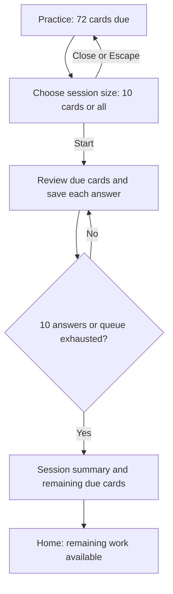

# 075 Choose the size of a due review session

status: ready for user check · rank: 3 · level: standard · type: feat · request: user, 2026-11-08 · light path

## Summary

The learner wants a short session even before finishing today's reviews:
with 72 cards due, they should be able to choose only 10.

Rank: difficulty 3 (the due CTA, review run limit, counter and summary),
impact 3 (the main learning flow and saved progress) → 3.

Current behaviour: Practice starts every due card immediately. A quantity
popup exists only for extra practice when nothing is due (task 064).
The due count represents facet questions, whereas the extra-practice
picker counts distinct terms. The due-session picker therefore
explicitly counts cards/questions, matching the due badge.

## Validated behaviour

- With cards due, Practice opens a compact quantity popup on desktop and
  mobile. Choose from 1 to the current due-card count, or choose all.
- Start reviews due cards with normal grading and progress saves. The
  chosen quantity limits answered questions, including any retry questions.
- Stop at the chosen quantity or when the queue is exhausted, whichever
  comes first. The counter reflects that session's limit.
- Unanswered cards and unasked retries are not graded or marked complete.
  Remaining due work stays available on the home screen.
- The completion screen describes the short session and remaining due
  work without claiming the day's work is finished.
- Escape or closing the popup starts nothing and changes no progress.
- The existing extra-practice picker keeps its current behaviour.
- Update English, French and Vietnamese copy and the README.

## Validated flow

## Validation plan

- A due Practice click opens the picker; closing starts no session.
- Selecting 10 with 72 due asks at most 10 questions and saves normal
  grading; unasked work remains due, including partially reviewed terms.
- Cover failures/retries, fewer available cards, all cards, and reloading
  progress between opening the picker and starting.
- Verify session counters, completion wording and all three locales.
- Run app/core tests, formatting and SSR/hydrate/CSR checks through sccache
  with the isolated toolchain; inspect desktop and mobile behaviour.

## Log

| Step | Result |
| --- | --- |
| Define | Grounded in task 064 and the current due CTA, review start and completion screen. GitSense lists no repositories in project palicanon; local source used. Behaviour was proposed before implementation, as required by the repository's Define step. |

| Define | User validated the proposed behaviour with “oui”, 2026-11-08. |

| Build | Implemented in `/private/tmp/learn-pali-075/learn-pali`, branch `feat/learn-pali-075-session-size`, paired with a source export of ui-lib v0.4.5 (`b72de679c0a499aee84d7a16302db9ef4f3bfa47`). Main and its untracked AGENTS.md/wt files were preserved. The draft task file was moved into this worktree. |
| Test first | New run-budget tests first failed because the limiting API was absent. Regression coverage now includes exactly 10 answers out of 72, saved partial progress, retries/failure, exhaustion, stale quantity clamping, zero budget, reloading with one answer left, reloading an exhausted budget, and explicitly starting new terms afterward. |
| Verify | 792 app unit tests plus native integration tests and docs passed; 257 core tests passed; fmt, Leptos formatting, SSR/all-targets Clippy, hydrate/CSR wasm32 Clippy and rustdoc passed. Full SSR/hydrate site build passed. `cargo sweep --time 7` completed without old artefacts to remove. |
| Browser | Real Chromium, 1280×900 and 390×844: due picker default 10/max 72; Escape leaves progress identical; 10 passes leave 62 due; state survives reload; choosing 3 leaves 59; All starts all 59; no page errors or horizontal overflow. Captures and scripts live in `/private/tmp/learn-pali-075/`. |
| Review | One focused headless Opus review, following token-economy. Bare mode lacked authentication; the lean non-bare run succeeded. Two findings fixed and regression-tested: reloading an exhausted budget cannot grant another answer; a review that finishes all due work retains the existing add-new section, and an explicit add-new action clears the old budget. The current agent performed the implementation and checked those fixes; no viewer session on the light path. |
| Check | Local preview: http://127.0.0.1:3276/. Awaiting the user's visible-result check before merge or publication. No push or deployment performed. |

## Review notes

The picker owns the minimum of 1; the run accepts a zero remaining budget.
Reload of an active short session starts from freshly saved progress with
only its unspent answer budget. Reload after its end returns home. As with
existing unlimited review rebuilds, the rebuilt counter starts at zero.
All retains the previous full queue, including retries. Starting new terms
explicitly after completing today's due work clears a previous budget.

The existing wasm-bindgen browser suites were updated to press the new
popup's All/Start action, but were not executed through chromedriver (not
installed). Browser validation used the built site's real hydrate bundle
through Playwright/Chromium instead.

## Errors

- sccache was blocked by the sandbox: stopped its server and retried the
  checks outside the sandbox, keeping `RUSTC_WRAPPER=sccache` throughout.
- Early implementation compile/lint and two fixture assertions were
  corrected before final verification. The reviewer found the exhausted
  reload-budget case and completion-path mismatch; both have regression
  coverage now.
- Initial preview omitted `LEPTOS_HASH_FILES=true`, so its script URL could
  not load; restarted with the build's hashed-file configuration before
  browser verification.

## Retro

Apply the session cap at the answer boundary to preserve partial-term
progress, and preserve zero when carrying its remaining budget across a
reload. Reuse the current completion path once today's due work is done.
