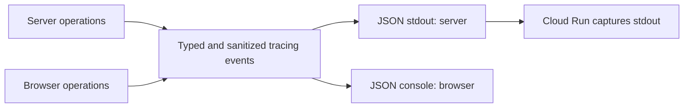

# 078 Structured operational logs

status: merged locally · rank: 4 · level: standard · type: feature

## Request

2026-11-13: "pour linstant ajoute les logs dans learn". The user approved
implementation after discussing events and cross-service Grafana views.

## Scope and contract

Difficulty 4 (native and browser sinks, feature gates), impact 4 (diagnostic
output only, with privacy constraints). Grounded on fa8804b. GitSense's
PaliCanon index lists search-front only; exact local sources are used.

Use tracing events with stable names and OpenTelemetry resource attributes:
namespace palicanon, service learn, release version, deployment environment
and server/browser runtime. JSON lines on server stdout, JSON in the browser
console. No collector, exporter, network traffic, persistence or dashboard.
The host of the CSR fragment owns its subscriber. Default INFO; server DEBUG
is opt-in. Third-party targets are excluded from the site's sinks.

Instrument startup and graceful shutdown, sanitized HTTP summaries, bounded
origin refusals, API requests/retries and passage outcomes, progress storage
failures/recovery, import/export, sync outcomes and sign-in failures. Keep
request paths normalized and request identifiers generated locally. Never
log headers, URLs, query text, words, Drive ids, account information, progress
JSON, raw errors or panic payloads. No per-answer or successful-save logs.

The deployment environment is separate from LEARN_PALI_ENV (which names a
release). Set LEARN_PALI_DEPLOYMENT_ENV explicitly, or infer dev/prod from
the existing Cloud Run service name; otherwise local development/unknown.
Pass it to hydration through a safe meta tag. No invented OTel trace ids.

## Plan and acceptance

1. Add JSON sinks and shared event identity, with captured-output tests.
2. Replace existing raw logs; add server and client operation events.
3. Verify redaction, severity, filtering, refusal rate limiting and feature
   separation; run SSR tests, native and wasm clippy, formatting and docs.
4. Document configuration, event catalogue and the backend-free behavior.

No workflow voices or agents have been run; no review, merge or deployment
is implied by local implementation. User-owned AGENTS.md and wt/ in the
main checkout are untouched. Worktree: /private/tmp/learn-pali-078/learn-pali.

## Log

- Define: prior event proposal and global/namespace/service hierarchy accepted
  by the user's implementation request; local task records the bounded target.
- Build: in progress.
- User clarification: every event carries the service's deployed tag in
  `service.version`; branch name and commit remain separate. Both site
  runtimes read the same release metadata, never the Cargo package version.
- Build complete: shared JSON event identity; stdout and console sinks;
  lifecycle, HTTP, API, passages, storage, transfer and sync instrumentation.
  Panic hooks keep only the code location, never the payload.
- Verify: 798 SSR unit tests plus integration suites pass (including three
  telemetry integration tests). Actual Chrome: both web_sync tests pass,
  including JSON console output with the exact server tag. Clippy passes
  for SSR all-targets, hydrate wasm lib and CSR wasm all-targets. Rustdoc
  with warnings denied, rustfmt, leptosfmt and diff whitespace checks pass.
- Smoke: a temporary native server starts with v0.0.0-smoke, handles an API
  request, logs its normalized route without query/secret contents, and
  exits cleanly on SIGTERM. Every emitted event has that exact tag.
- Hygiene: cargo sweep --time 7 ran in this worktree; no old artifacts.
  The sibling ui-lib is an isolated archive of the pinned v0.4.5 tag.
- Closure: local implementation only; no independent voice review, hosted
  checks, human branch validation, push, merge or deployment is claimed.

## Errors and corrections

- sccache was blocked by the sandbox. Stopped its server, then built through
  sccache outside the sandbox, preserving RUSTC_WRAPPER.
- The shared sibling ui-lib was newer than the pin. Replaced the task's
  temporary symlink with a v0.4.5 archive and regenerated only the intended
  lockfile changes before final checks. The shared checkout is untouched.
- Initial compiler checks exposed macro-helper visibility and feature-gate
  mistakes; corrected before the full SSR and browser checks. Clippy found
  statement punctuation, documentation and single-pattern match issues;
  fixed without lint suppressions.
- The wasm runner rejects cargo's forwarded --quiet; reran the real-browser
  tests without cargo -q. The native smoke needed LEPTOS_OUTPUT_NAME, as a
  cargo-leptos run supplies; fixed only its temporary test environment.

## Retro

Resource names can be agreed before a collector exists. Keep the deployed
tag distinct from the deployment environment, and test emitted JSON with
canary values rather than relying on source-text log allowlists.

## Pre-merge closure (2026-11-13)

The user explicitly requested merging both logging branches before moving
to search-front. Local review uses base fa8804b and implementation 2cfbaef;
the fetched origin/main has not moved. The existing test evidence applies
to this implementation. No additional local correctness/privacy blocker
was found. Retro above was assessed alongside improve: the shared JSON
resource contract deserves a cross-service conformance follow-up, proposed
in Learn task 079; it is not accepted or implemented by this merge.

An independent external Claude review was prepared, but automatic approval
review rejected exporting the private diffs to that destination. Nothing
was sent. The user-authorized local merge proceeds with local code review
and automated checks; no independent model review is claimed. GitHub push
and deployment remain separate, unperformed operations.

- Local squash merge into main authorized by the user and performed on 2026-11-13; no push or deployment.
