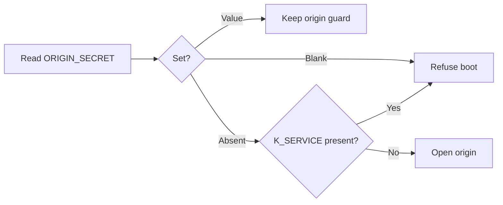

# 080 Require ORIGIN_SECRET on Cloud Run only

status: merged locally
rank: 7 — blocks moving learn.palicanon.app from Cloud Run to ssh.lsh.tech (lsh-tech, stack palicanon prod); small change
level: standard — bounded startup predicate, with fail-closed security regression tests
request: the user, 2026-11-13: "je pense quon peut virer directement !" (about the Worker + ORIGIN_SECRET guard, once served through a Cloudflare tunnel)
repository: learn-pali
studio: project PaliCanon (4focg1ii7uzp), conversation learn-pali-080-origin-guard-cloud-run-only (wz3l3opiqlky), brief d565023b389d; threads grounded 6cae0e640261, design 61c868dbc3ea, planner 92239a1bbee2, ast-target e07690251067, impl 85f129e896fe, review c3d581a882f7, process f1b134795127, retro 47a4c4376cf5

## Summary

PaliCanon prod moves from Cloud Run to the server ssh.lsh.tech, behind a
Cloudflare tunnel (lsh-tech). On Cloud Run the service has a public
`*.run.app` URL, so it answers only requests carrying `x-origin-auth`
(the Worker's secret, task 007/031). Behind the tunnel the container has
no public address: the only way in is Cloudflare, the Worker goes away and
nobody sends the header. Today a deployed build (`K_SERVICE` set, or the
image's `LEPTOS_ENV=PROD`) refuses to start without `ORIGIN_SECRET`.

Change: the secret is **required only on Cloud Run** (`K_SERVICE` set).
Elsewhere it is optional — set, the guard applies as today; unset, no
guard. Dev stays on Cloud Run behind Access for now and keeps its guard
(removing it everywhere would let `*.run.app` bypass Access). The
mock-in-production refusal keeps using the deployed-build test.

Out of scope: deleting the guard and the Worker (once dev moves too),
the lsh-tech stack itself.

## Grounded context and impact

- learn-pali at 684e51d (origin/main). GitSense version: not checked.
- Paths and symbols: `app/src/origin.rs` — `deployed()`, `OriginRequired`, `OriginSecret`; `app/Dockerfile` (LEPTOS_ENV=PROD, its boot self-check); the origin tests;
  `.github/workflows/deploy.yml` (its bare-origin check stays valid on Cloud Run).
- Impact: boot on the server without `ORIGIN_SECRET` must start and serve;
  Cloud Run without it must still refuse; with it, unchanged everywhere.

## Constraints and decisions

- lsh-tech decision (2026-11-13): no Worker, no origin secret behind the
  tunnel; Cloudflare WAF and rate limits stay at the zone.
- A release to prod is needed before learn.palicanon.app moves (lsh-tech stack uses
  the new image digest).
- Human gates: design TARGET, AST target, merge, prod release.

## Expected output

- Unit tests: (Cloud Run, no secret) → refuses; (Cloud Run, secret) →
  guard on; (no `K_SERVICE`, `LEPTOS_ENV=PROD`, no secret) → starts, no
  guard; (no `K_SERVICE`, secret) → guard on.
- A prod release whose image starts on ssh.lsh.tech without the secret.

## Workflow contract

Current step: merged locally
Input: this brief
Artifact: implementation and qualification below
Target thread: review
Next persona: human validation of prod release
Validation gate: prod release requires human validation, as listed above

## Log

- 2026-11-13: task created from the lsh-tech migration (lsh-tech conversation
  « Journal — plateforme lsh-tech »). The persona `role-grounded` is not
  published in Sippa (source studio): the grounded handoff waits for it.

## Implementation target (2026-11-13)

The user authorized implementing these briefs in this session. The runtime
contract remains the four cases above, including an explicitly empty K_SERVICE
as present/fail-closed. Blank ORIGIN_SECRET remains invalid on every host.
Only the origin-secret requirement predicate changes: the presence of K_SERVICE,
not LEPTOS_ENV. Search's deployed/mock refusal and Map's VIZ_GATE do not change.
Docker self-checks must explicitly simulate Cloud Run when checking this
refusal. Existing Worker, origin comparisons and deployment gates stay intact.

AST target: the origin constructor's missing-secret arm tests K_SERVICE;
Search retains deployed() exclusively for Config/mock policy. Learn/Map's
helper names/docs reflect Cloud Run. Add table-driven startup tests, actual
process tests for production without K_SERVICE, and maintain image/smoke tests.

Worktree isolates existing checkout edits and uses ui-lib v0.4.5. Merge and
prod release remain the brief's human gates. There is no infrastructure
migration, deletion of the Worker, change to Access or production release here.

## Qualification and local review

- Scope implemented: only the missing-origin-secret predicate uses the presence
  of K_SERVICE; an empty marker still requires a secret. Explicit blank secrets
  remain invalid everywhere. Configured secrets retain the guard everywhere.
- The new origin_cloud_run_matrix failed against the old code in all three
  services, then passed. Actual production-mode processes start without a
  secret outside Cloud Run. Existing secret comparison, duplicate-header,
  refusal/privacy, mock and gate regression tests remain in the suite.
- Native SSR tests: 834 passed, 1 ignored, no current failures.
  Clippy SSR all-targets -D warnings, rustdoc -D warnings, rustfmt,
  leptosfmt and diff checks passed. Workers, routing, gate handlers, infra
  and deployment workflows are unchanged; no dependencies changed.
- Image smoke checks explicitly simulate Cloud Run in RUN only; K_SERVICE
  is not baked into ENV. Production image builds were not run locally:
  Docker is unavailable. The updated Docker contracts and native smoke
  tests cover the corresponding startup behavior; CI must build the image.
- Review is local source/diff review, not independent model review. The task's
  pre-existing unknown-persona handoff was read; it was not claimed resolved
  or used as permission to export private source to another provider.
- Latest remote tag was read. Proposed next patch release after human
  validation and merge: v0.1.22. No tag, merge, push, release or infrastructure
  deployment was performed for this task.
- scripts/rollout-check.test.sh: 1,259 assertions passed, including the Docker contract.
- Disk fell below 50 GiB during builds. An inactive older Map target was cleaned after checking active cargo/rustc/rust-analyzer processes; free space rose to 69 GiB. No active target or original checkout edit was cleaned. Final cargo sweep follows qualification.

## Authorized local merge

2026-11-13: user requested "merge" after the implementation qualification.
Origin/main had not advanced. The staged application tree matches the tested
feature commit exactly; only this task's closure metadata changes. No new
runtime, dependency, gate, Worker or deployment behavior was added in integration.
The recorded SSR tests, clippy/docs and image-contract checks therefore cover
this application snapshot. The local-review/independent-review limitation above
remains explicit; no external model review is implied by this closure.

Any original untracked copy of this task brief was checked against the task
input and backed up before integrating its tracked, updated counterpart. Other
tracked edits and untracked paths are verified unchanged. No migration, remote
push, tag or prod release is authorized or performed by this merge-only step.
The proposed prod patch still waits for the brief's human release validation.
